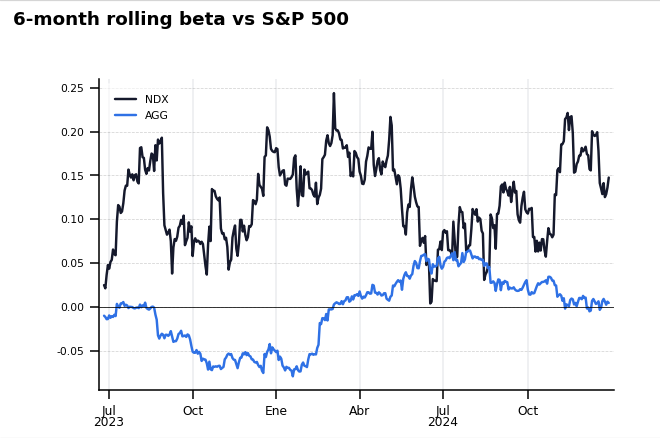
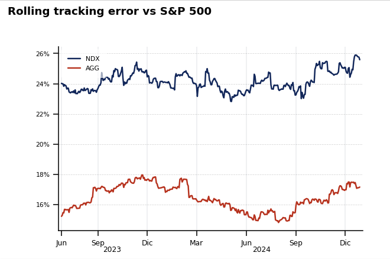

# Benchmark-relative metrics

These functions compare **every column against one benchmark column of the same DataFrame**. The benchmark is selected by name with `benchmark="SPX"`; its own result is trivial (beta 1, tracking error 0...).

```python
import numpy as np
import pandas as pd
import helpers_ps as hp

hp.set_graph_theme()

rng = np.random.default_rng(42)
dates = pd.bdate_range("2023-01-02", periods=520)
rets = rng.normal([0.0004, 0.0006, 0.0002], [0.009, 0.013, 0.004], size=(len(dates), 3))
prices = pd.DataFrame(
    100 * np.exp(rets.cumsum(axis=0)),
    index=dates,
    columns=["SPX", "NDX", "AGG"],
)
```

!!! tip "Portfolio vs benchmark"
    To measure a **portfolio** against its benchmark, put both NAV series in the same DataFrame: `df = pd.concat([nav_portfolio.rename("Portfolio"), index_level.rename("Benchmark")], axis=1)` and call `hp.Calcs.tracking_error(df, benchmark="Benchmark")`.

---

## Summary table

| Function | Returns | What it measures |
|---|---|---|
| `active_return(df, benchmark)` | DataFrame | Per-period return of each asset minus the benchmark. |
| `beta(df, benchmark, window=None)` | Series (or DataFrame if `window`) | Sensitivity to the benchmark: `cov(asset, bench) / var(bench)`. |
| `tracking_error(df, benchmark)` | Series | Standard deviation of the active return (annualized by default). |
| `rolling_tracking_error(df, benchmark, window=252)` | DataFrame | Tracking error through time. |
| `information_ratio(df, benchmark)` | Series | Mean active return / tracking error. |
| `rolling_information_ratio(df, benchmark, window=252)` | DataFrame | Information ratio through time. |
| `upside_capture(df, benchmark)` | Series | How much of the benchmark's **up** periods the asset captured. |
| `downside_capture(df, benchmark)` | Series | How much of the benchmark's **down** periods the asset suffered. |
| `capture_ratio(df, benchmark)` | Series | `upside_capture / downside_capture` (> 1 is good). |
| `hit_ratio(df, benchmark)` | Series | Share of periods with positive active return. |
| `excess_return(df, benchmark, period="qtd")` | DataFrame | Period-to-date return of the asset minus the benchmark, through time. |
| `consistency(df, benchmark, period="qtd")` | Series | Share of dates with positive excess return (based on `excess_return`). |

Shared arguments: `method` (`"simple"` / `"log"`), `annualize`, `periods_per_year` (252), `ddof` (1), `window`, `min_periods` (see [conventions](getting_started.md#common-conventions)).

```python
bench = "SPX"
table = pd.DataFrame({
    "Beta": hp.Calcs.beta(prices, bench),
    "Tracking error": hp.Calcs.tracking_error(prices, bench),
    "Information ratio": hp.Calcs.information_ratio(prices, bench),
    "Upside capture": hp.Calcs.upside_capture(prices, bench),
    "Downside capture": hp.Calcs.downside_capture(prices, bench),
    "Capture ratio": hp.Calcs.capture_ratio(prices, bench),
    "Hit ratio": hp.Calcs.hit_ratio(prices, bench),
})
table.drop(index=bench).round(3)
```
**Output**

```text
      Beta  Tracking error  Information ratio  Upside capture  Downside capture  Capture ratio  Hit ratio
NDX  0.107           0.243             -0.242           0.049             0.257          0.193      0.505
AGG -0.003           0.163             -0.484           0.005            -0.003         -1.576      0.487
```

!!! note "Benchmark row"
    The benchmark compared with itself gives `beta=1`, `tracking_error=0` and `information_ratio=NaN` (division by zero); drop its row as above when presenting results.

---

## Beta

`beta(df, benchmark, window=None, method="simple", min_periods=None, ddof=1)`

- `window=None`: one historical beta per asset (Series).
- `window=N`: **rolling beta** (DataFrame with the same dates), using `N` observations.

```python
rolling_beta = hp.Calcs.beta(prices, "SPX", window=126).drop(columns="SPX")

g = (
    hp.GraphMtplt(rolling_beta)
    .graph_line(x_axis={"bbg_format": True, "tick_step": 3})
    .config_yaxis(fmt=".2f")
    .horizontal_lines([0], color="black")
    .horizontal_guides(mostrar_cero=False)
    .add_legend()
    .add_title("6-month rolling beta vs S&P 500")
)
```


---

## Tracking error and information ratio

```python
rolling_te = hp.Calcs.rolling_tracking_error(prices, "SPX", window=126)
rolling_ir = hp.Calcs.rolling_information_ratio(prices, "SPX", window=126)

pd.concat({"TE": rolling_te["NDX"], "IR": rolling_ir["NDX"]}, axis=1).dropna().tail(3).round(3)
```
**Output**

```text
               TE     IR
2024-12-25  0.258  0.247
2024-12-26  0.258  0.212
2024-12-27  0.256  0.404
```

Both use the active return `asset - benchmark` per period. `annualize=True` multiplies the tracking error by `sqrt(periods_per_year)`.

```python
g = (
    hp.GraphMtplt(rolling_te[["NDX", "AGG"]].dropna())
    .graph_line(
        series=[{"ticker": "NDX", "color": "#12275A"}, {"ticker": "AGG", "color": "#B7331F"}],
        x_axis={"bbg_format": True, "tick_step": 3},
    )
    .config_yaxis(fmt=".0%")
    .horizontal_guides(mostrar_cero=False)
    .add_legend()
    .add_title("Rolling tracking error vs S&P 500")
)
```


---

## Capture ratios and hit ratio

- `upside_capture` and `downside_capture` compound the asset's and the benchmark's returns **only over the periods in which the benchmark was up / down** and divide them. In upside, above 1.0 (100%) is good; in downside, **below 1.0 is good**.
- `capture_ratio = upside_capture / downside_capture`.
- `hit_ratio` is the percentage of periods in which the asset beat the benchmark.

!!! info "Data frequency"
    These statistics are calculated on the **periodicity of your DataFrame**. For monthly capture ratios use month-end prices: `prices.resample("ME").last()`.

---

## Excess return and consistency (period-to-date)

`excess_return(df, benchmark, period="qtd", fallback=True, week_freq="W-FRI")` returns the **period-to-date return of each asset minus that of the benchmark** on every date. `period` is one of `"wtd"`, `"mtd"`, `"qtd"`, `"ytd"`.

`consistency()` is the share of dates in which that excess return was positive.

```python
ex_ytd = hp.Calcs.excess_return(prices, "SPX", period="ytd")
cons = hp.Calcs.consistency(prices, "SPX", period="mtd")

pd.DataFrame({"Excess YTD (last)": ex_ytd.iloc[-1], "MTD consistency": cons}).drop(index="SPX").round(3)
```
**Output**

```text
     Excess YTD (last)  MTD consistency
NDX             -0.200            0.446
AGG             -0.155            0.444
```

---

## Next step

[Risk: VaR and Expected Shortfall ->](risk.md)
