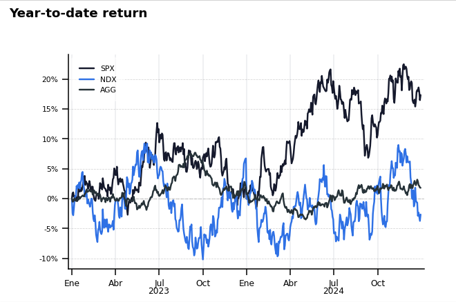
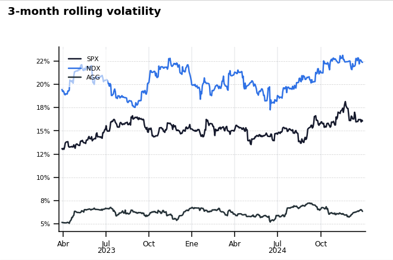
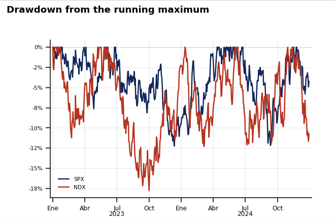

# Returns, performance and drawdowns

```python
import numpy as np
import pandas as pd
import helpers_ps as hp

hp.set_graph_theme()

rng = np.random.default_rng(42)
dates = pd.bdate_range("2023-01-02", periods=520)
rets = rng.normal([0.0004, 0.0006, 0.0002], [0.009, 0.013, 0.004], size=(len(dates), 3))
prices = pd.DataFrame(
    100 * np.exp(rets.cumsum(axis=0)),
    index=dates,
    columns=["SPX", "NDX", "AGG"],
)
```

---

## Period-to-date returns

`wtd`, `mtd`, `qtd` and `ytd` return a **DataFrame with the same shape as the input**. On each date they give the return since the **end of the previous week / month / quarter / year**, so the **last row** is the current "to-date" figure and the whole series can be charted.

| Function | Base price | Arguments |
|---|---|---|
| `wtd(df, fallback=True, week_freq="W-FRI")` | Last price of the previous week (weeks end on Friday by default) | `week_freq`: pandas weekly frequency |
| `mtd(df, fallback=True)` | Last price of the previous month | |
| `qtd(df, fallback=True)` | Last price of the previous quarter | |
| `ytd(df, fallback=True)` | Last price of the previous year | |

`fallback=True` uses the **first price of the current period** as base when the series starts in the middle of a period (no previous period-end exists), so the first periods are not lost as `NaN`.

```python
last = pd.DataFrame({
    "WTD": hp.Calcs.wtd(prices).iloc[-1],
    "MTD": hp.Calcs.mtd(prices).iloc[-1],
    "QTD": hp.Calcs.qtd(prices).iloc[-1],
    "YTD": hp.Calcs.ytd(prices).iloc[-1],
})
last.round(4)
```
**Output**

```text
        WTD     MTD     QTD     YTD
SPX -0.0071 -0.0266  0.0607  0.1735
NDX -0.0200 -0.0911 -0.0340 -0.0266
AGG -0.0134  0.0123 -0.0030  0.0181
```

```python
g = (
    hp.GraphMtplt(hp.Calcs.ytd(prices))
    .graph_line(
        series=[{"ticker": "SPX"}, {"ticker": "NDX"}, {"ticker": "AGG"}],
        x_axis={"bbg_format": True, "tick_step": 3},
    )
    .config_yaxis(fmt=".0%")
    .horizontal_guides()
    .add_legend()
    .add_title("Year-to-date return")
)
```


!!! info "Calendar-day data"
    Period-to-date calculations assume prices may be stored per calendar day with non-trading days forward-filled (for example a Bloomberg `PX_LAST` download). They work equally with business-day data.

---

## Performance statistics

| Function | Returns | Key arguments |
|---|---|---|
| `total_return(df, method="simple")` | Series: cumulative return over the whole sample | `method` |
| `annualized_return(df, periods_per_year=252, method="simple")` | Series: compound annual growth rate | `periods_per_year`, `method` |
| `volatility(df, method="simple", annualize=True, periods_per_year=252, ddof=1)` | Series: standard deviation of returns | `annualize`, `periods_per_year`, `ddof` |
| `sharpe_ratio(df, risk_free_rate=0.0, ...)` | Series: excess return / volatility | `risk_free_rate` (**annual**, e.g. `0.03`) |
| `downside_std(df, target_return=0.0, annualize=False, ...)` | **DataFrame** with one column `std_downside` | `target_return` (per period), `annualize` |
| `sortino_ratio(df, target_return=0.0, ...)` | Series: excess return / downside deviation | `target_return` (**annual**) |

```python
stats = pd.DataFrame({
    "Total return": hp.Calcs.total_return(prices),
    "Annualized return": hp.Calcs.annualized_return(prices),
    "Volatility": hp.Calcs.volatility(prices),
    "Sharpe (rf=3%)": hp.Calcs.sharpe_ratio(prices, risk_free_rate=0.03),
    "Sortino": hp.Calcs.sortino_ratio(prices),
})
stats.round(3)
```
**Output**

```text
     Total return  Annualized return  Volatility  Sharpe (rf=3%)  Sortino
SPX         0.196              0.091       0.150           0.455    0.959
NDX         0.039              0.019       0.204           0.046    0.276
AGG         0.037              0.018       0.062          -0.168    0.448
```

### Not daily data?

Tell the function how many observations a year has. With **monthly** prices:

```python
monthly_prices = prices.resample("ME").last()

hp.Calcs.volatility(monthly_prices, periods_per_year=12)
hp.Calcs.annualized_return(monthly_prices, periods_per_year=12)
hp.Calcs.sharpe_ratio(monthly_prices, risk_free_rate=0.03, periods_per_year=12)
```

### Rolling volatility

The functions summarize the whole sample. For a rolling statistic compute returns and use pandas:

```python
daily = prices.pct_change().dropna()
rolling_vol = daily.rolling(63).std() * np.sqrt(252)          # 3-month rolling, annualized

g = (
    hp.GraphMtplt(rolling_vol)
    .graph_line(x_axis={"bbg_format": True, "tick_step": 3})
    .config_yaxis(fmt=".0%")
    .horizontal_guides(mostrar_cero=False)
    .add_legend()
    .add_title("3-month rolling volatility")
)
```


`rolling_tracking_error()` and `rolling_information_ratio()` (see [Benchmark-relative](benchmark_relative.md)) do this for you against a benchmark.

---

## Drawdowns

| Function | Returns |
|---|---|
| `drawdown(df, method="simple", min_price=1e-6)` | DataFrame: distance (<= 0) from the running maximum on every date |
| `max_drawdown(df, method="simple", min_price=1e-6)` | Series: the worst drawdown of each asset |
| `calmar_ratio(df, periods_per_year=252)` | Series: annualized return / absolute max drawdown |

```python
pd.DataFrame({
    "Max drawdown": hp.Calcs.max_drawdown(prices),
    "Calmar": hp.Calcs.calmar_ratio(prices),
}).round(3)
```
**Output**

```text
     Max drawdown  Calmar
SPX        -0.122   0.743
NDX        -0.178   0.105
AGG        -0.087   0.205
```

```python
g = (
    hp.GraphMtplt(hp.Calcs.drawdown(prices))
    .graph_line(
        series=[{"ticker": "SPX", "color": "#12275A"}, {"ticker": "NDX", "color": "#B7331F"}],
        x_axis={"bbg_format": True, "tick_step": 3},
    )
    .config_yaxis(fmt=".0%")
    .horizontal_guides()
    .add_legend(loc="lower left")
    .add_title("Drawdown from the running maximum")
)
```


`min_price` protects against division by zero: prices below it are treated as missing.

---

## Next step

[Benchmark-relative metrics ->](benchmark_relative.md)
