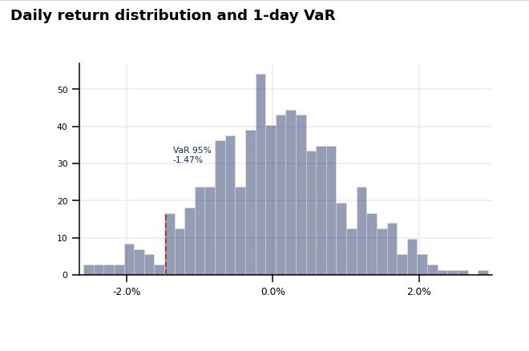

# Risk: Value at Risk and Expected Shortfall

```python
import numpy as np
import pandas as pd
import helpers_ps as hp

hp.set_graph_theme()

rng = np.random.default_rng(42)
dates = pd.bdate_range("2023-01-02", periods=520)
rets = rng.normal([0.0004, 0.0006, 0.0002], [0.009, 0.013, 0.004], size=(len(dates), 3))
prices = pd.DataFrame(
    100 * np.exp(rets.cumsum(axis=0)),
    index=dates,
    columns=["SPX", "NDX", "AGG"],
)
```

Both functions return a `Series` indexed by asset, **expressed as a positive loss** (0.0147 means a loss of 1.47%) over `horizon` return periods.

---

## `value_at_risk`

`value_at_risk(df, confidence=0.95, method="historical", returns_method="simple", horizon=1)`

| `method` | How it is computed |
|---|---|
| `"historical"` | Empirical quantile of the observed returns (no distribution assumed). |
| `"gaussian"` | Normal distribution with the sample mean and standard deviation. |
| `"cornish_fisher"` | Gaussian VaR adjusted by the **skewness** and **kurtosis** of the sample. |

```python
pd.DataFrame({
    "Historical 95%": hp.Calcs.value_at_risk(prices),
    "Gaussian 95%": hp.Calcs.value_at_risk(prices, method="gaussian"),
    "Cornish-Fisher 95%": hp.Calcs.value_at_risk(prices, method="cornish_fisher"),
    "Historical 99%": hp.Calcs.value_at_risk(prices, confidence=0.99),
    "Gaussian 99%, 10 days": hp.Calcs.value_at_risk(prices, confidence=0.99, method="gaussian", horizon=10),
}).round(4)
```
**Output**

```text
     Historical 95%  Gaussian 95%  Cornish-Fisher 95%  Historical 99%  Gaussian 99%, 10 days
SPX          0.0147        0.0152              0.0152          0.0218                 0.0656
NDX          0.0220        0.0210              0.0210          0.0291                 0.0930
AGG          0.0064        0.0063              0.0064          0.0087                 0.0278
```

- `confidence` must be between 0 and 1 (`ValueError` otherwise).
- `horizon` is a number of **observations** of your DataFrame (10 for ten trading days of daily data). The `"historical"` method uses **rolling compounded returns** over the horizon; the parametric methods scale the mean by `horizon` and the volatility by `sqrt(horizon)`.

---

## `expected_shortfall`

`expected_shortfall(df, confidence=0.95, returns_method="simple", horizon=1)`

Also called **Conditional VaR**: the **average loss in the cases that exceed the VaR**. It is always larger than or equal to the VaR of the same confidence.

```python
pd.DataFrame({
    "VaR 95%": hp.Calcs.value_at_risk(prices),
    "ES 95%": hp.Calcs.expected_shortfall(prices),
}).round(4)
```
**Output**

```text
     VaR 95%  ES 95%
SPX   0.0147  0.0197
NDX   0.0220  0.0271
AGG   0.0064  0.0077
```

---

## Combining with the distribution chart

The historical VaR is the 5th percentile of the returns, which can be shown on a histogram with [`graph_dist`](../GraphMtplt/Dist/graph.md):

```python
daily = prices.pct_change().dropna()
var95 = hp.Calcs.value_at_risk(prices)["SPX"]

g = (
    hp.GraphMtplt(daily)
    .graph_dist(
        series=[{
            "ticker": "SPX",
            "label": "S&P 500 daily return",
            "color": "#12275A",
            "tag": [{
                "value": -var95,
                "show": "line_tag",
                "template": "VaR 95%\n{value:.2%}",
                "line": {"color": "#B7331F", "linestyle": "--"},
                "tag": {"fontsize": 7, "ubic_etq": (6, 40), "label_h_align": "left"},
            }],
        }],
        bins=40,
        x_axis={"fmt": ".1%", "tick_values": [-0.04, -0.02, 0, 0.02, 0.04]},
    )
    .config_yaxis(fmt=".0f")
    .add_title("Daily return distribution and 1-day VaR")
)
```


---

## Next step

[Technical indicators ->](technical.md)
