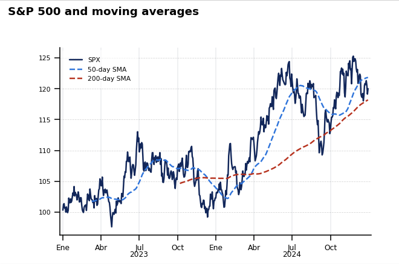
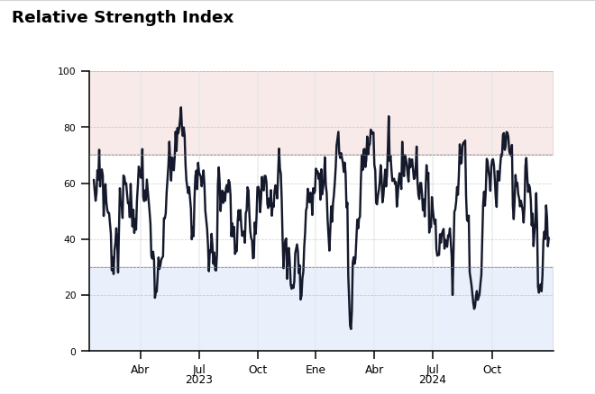

# Technical indicators

Indicator functions take the price DataFrame and return a DataFrame **with the same dates**. The output column names combine a **prefix** and the asset name (`SMA50_SPX`), so several assets and several windows can live in the same result. Change the prefix with `prefix="..."` (use `{w}` as the placeholder for the window).

```python
import numpy as np
import pandas as pd
import helpers_ps as hp

hp.set_graph_theme()

rng = np.random.default_rng(42)
dates = pd.bdate_range("2023-01-02", periods=520)
rets = rng.normal([0.0004, 0.0006, 0.0002], [0.009, 0.013, 0.004], size=(len(dates), 3))
prices = pd.DataFrame(
    100 * np.exp(rets.cumsum(axis=0)),
    index=dates,
    columns=["SPX", "NDX", "AGG"],
)
```

| Function | Output columns | Arguments (default) |
|---|---|---|
| `sma(df, windows=None, min_periods=None, prefix="SMA{w}_")` | `SMA50_SPX`... | `windows` (`[50]`) |
| `ema(df, windows=None, min_periods=None, prefix="EMA{w}_")` | `EMA27_SPX`... | `windows` (`[27]`) |
| `rsi(df, window=14, prefix="RSI{w}_")` | `RSI14_SPX`... (0-100) | `window` |
| `zscore(df, window=252, min_periods=None, prefix="ZScore{w}_")` | `ZScore252_SPX`... | rolling z-score of the price |
| `bollinger_bands(df, window=20, num_std=2.0, min_periods=None)` | `BB_Middle20_`, `BB_Upper20_`, `BB_Lower20_` + asset | |
| `macd(df, fast=12, slow=26, signal=9)` | `MACD_`, `MACDSignal_`, `MACDHist_` + asset | |
| `momentum(df, windows=None, prefix="MomentumSimple{w}_")` | `MomentumSimple15_SPX`... | z-score of the rolling compounded return of each window; `windows` (`[15, 30]`) |
| `momentum_sma(df, prefix="MomentumSMA_")` | `MomentumSMA_SPX`... | discrete score **1 to 5** (1 = bearish, 3 = neutral, 5 = bullish) from the 5- and 15-day moving averages |

---

## Moving averages

```python
ma = hp.Calcs.sma(prices[["SPX"]], windows=[20, 50, 200])
ma.dropna().tail(2).round(2)
```
**Output**

```text
            SMA20_SPX  SMA50_SPX  SMA200_SPX
2024-12-26     120.67     121.81      118.14
2024-12-27     120.51     121.82      118.19
```

```python
spx = prices[["SPX"]].join(hp.Calcs.sma(prices[["SPX"]], windows=[50, 200]))

g = (
    hp.GraphMtplt(spx)
    .graph_line(
        series=[
            {"ticker": "SPX", "color": "#12275A"},
            {"ticker": "SMA50_SPX", "label": "50-day SMA", "color": "#3075DB", "linestyle": "--"},
            {"ticker": "SMA200_SPX", "label": "200-day SMA", "color": "#B7331F", "linestyle": "--"},
        ],
        x_axis={"bbg_format": True, "tick_step": 3},
    )
    .config_yaxis(fmt=",.0f")
    .horizontal_guides(mostrar_cero=False)
    .add_legend()
    .add_title("S&P 500 and moving averages")
)
```


`min_periods=None` means a value is produced only when the **full window** is available (the first `window - 1` rows are `NaN`).

---

## RSI

```python
rsi = hp.Calcs.rsi(prices[["SPX"]])

g = (
    hp.GraphMtplt(rsi)
    .graph_line(series=[{"ticker": "RSI14_SPX", "label": "RSI (14)"}], x_axis={"bbg_format": True, "tick_step": 3})
    .config_yaxis(lim=(0, 100), fmt=".0f")
    .shade_y((70, 100), color="#B7331F", alpha=0.10)
    .shade_y((0, 30), color="#3075DB", alpha=0.10)
    .horizontal_lines([30, 70], linestyle="--")
    .horizontal_guides(mostrar_cero=False)
    .add_title("Relative Strength Index")
)
```


---

## Bollinger bands and MACD

```python
bb = hp.Calcs.bollinger_bands(prices[["SPX"]], window=20, num_std=2.0)
macd = hp.Calcs.macd(prices[["SPX"]])

print(bb.columns.tolist())
print(macd.columns.tolist())
```
**Output**

```text
['BB_Middle20_SPX', 'BB_Upper20_SPX', 'BB_Lower20_SPX']
['MACD_SPX', 'MACDSignal_SPX', 'MACDHist_SPX']
```

Use the Bollinger columns as three line series, and the `MACDHist_` column as a bar series.

---

## Z-score, momentum

- `zscore`: `(price - rolling mean) / rolling std` over `window` observations. Useful to flag stretched prices (|z| > 2).
- `momentum`: for each window, the rolling compounded return is standardized with its own rolling mean and standard deviation (a z-score of the return).
- `momentum_sma`: classifies each date with a score from 1 to 5 by comparing the price with the 15-day moving average, the slope of that average and the gap between the 5- and 15-day averages. It uses fixed windows (5 and 15) and has no window argument.

```python
hp.Calcs.zscore(prices, window=126).dropna().tail(2).round(2)
```
**Output**

```text
            ZScore126_SPX  ZScore126_NDX  ZScore126_AGG
2024-12-26           0.11          -0.78           0.51
2024-12-27           0.35          -0.55           0.45
```

---

## Next step

[Ranges, relative series and percentile rank ->](transformations.md)
