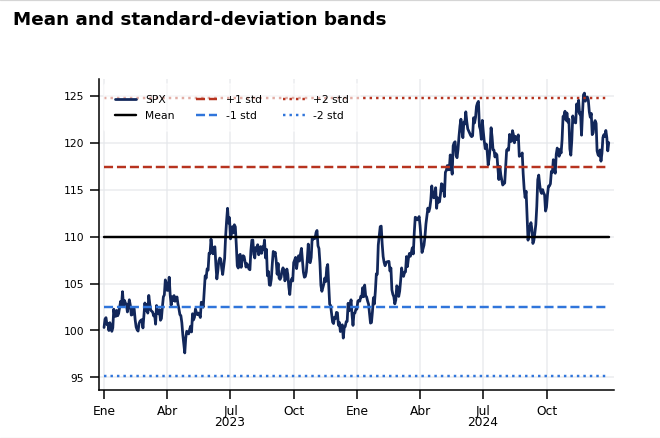
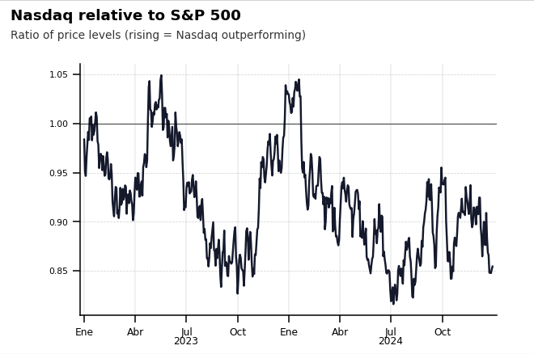

# Ranges, relative series and percentile rank

```python
import numpy as np
import pandas as pd
import helpers_ps as hp

hp.set_graph_theme()

rng = np.random.default_rng(42)
dates = pd.bdate_range("2023-01-02", periods=520)
rets = rng.normal([0.0004, 0.0006, 0.0002], [0.009, 0.013, 0.004], size=(len(dates), 3))
prices = pd.DataFrame(
    100 * np.exp(rets.cumsum(axis=0)),
    index=dates,
    columns=["SPX", "NDX", "AGG"],
)
```

---

## `mean_std_bands`

`mean_std_bands(df, std_multipliers=None, prefix="Mean({w}std)_")`

Static reference levels **mean + k x std** of the **whole sample**, repeated on every date so they can be drawn as horizontal lines (valuation bands, mean reversion). The default multipliers are `[-1, 0, 1]`. Unlike the other functions it does not need a `DatetimeIndex` of prices: any numeric DataFrame works (for example a P/E history).

```python
bands = hp.Calcs.mean_std_bands(prices[["SPX"]], std_multipliers=[-2, -1, 0, 1, 2])
bands.iloc[-1].round(2)
```
**Output**

```text
Mean(-2std)_SPX     95.11
Mean(-1std)_SPX    102.53
Mean(0std)_SPX     109.95
Mean(1std)_SPX     117.37
Mean(2std)_SPX     124.79
Name: 2024-12-27 00:00:00, dtype: float64
```

```python
spx = prices[["SPX"]].join(bands)

g = (
    hp.GraphMtplt(spx)
    .graph_line(
        series=[
            {"ticker": "SPX", "color": "#12275A", "lw": 1.8},
            {"ticker": "Mean(0std)_SPX", "label": "Mean", "color": "black", "linestyle": "-"},
            {"ticker": "Mean(1std)_SPX", "label": "+1 std", "color": "#B7331F", "linestyle": "--"},
            {"ticker": "Mean(-1std)_SPX", "label": "-1 std", "color": "#3075DB", "linestyle": "--"},
            {"ticker": "Mean(2std)_SPX", "label": "+2 std", "color": "#B7331F", "linestyle": ":"},
            {"ticker": "Mean(-2std)_SPX", "label": "-2 std", "color": "#3075DB", "linestyle": ":"},
        ],
        x_axis={"bbg_format": True, "tick_step": 3},
    )
    .config_yaxis(fmt=",.0f")
    .add_legend(ncol=3, loc="upper left")
    .add_title("Mean and standard-deviation bands")
)
```


---

## `relative`

`relative(df, calculations)` creates **derived series between columns**. `calculations` is a list of dictionaries:

| Key | Required | Description |
|---|---|---|
| `ticker` | yes | Column on the left-hand side. |
| `relative` | no (`"1"`) | Column on the right-hand side. `"1"` returns the ticker unchanged (no operation). |
| `operation` | no (`"/"`) | `"/"`, `"-"`, `"*"` or `"+"`. |
| `name` | no | Output column name (an automatic name is generated otherwise). |

```python
rel = hp.Calcs.relative(prices, calculations=[
    {"ticker": "NDX", "relative": "SPX", "operation": "/", "name": "NDX / SPX"},
    {"ticker": "SPX", "relative": "AGG", "operation": "-", "name": "SPX - AGG"},
    {"ticker": "AGG", "relative": "1"},
])
rel.tail(3).round(3)
```
**Output**

```text
            NDX / SPX  SPX - AGG      AGG
2024-12-25      0.848     16.203  104.372
2024-12-26      0.851     15.049  104.089
2024-12-27      0.855     15.967  104.049
```

```python
g = (
    hp.GraphMtplt(rel[["NDX / SPX"]])
    .graph_line(x_axis={"bbg_format": True, "tick_step": 3})
    .config_yaxis(fmt=".2f")
    .horizontal_lines([1.0], color="black")
    .horizontal_guides(mostrar_cero=False)
    .add_title("Nasdaq relative to S&P 500")
    .add_subtitle("Ratio of price levels (rising = Nasdaq outperforming)")
)
```


Errors: empty list (`ValueError`), not a list of dictionaries (`TypeError`), unknown column or unsupported operation (`ValueError`).

---

## `rank_percentile`

`rank_percentile(df, value=None)` returns, **per column**, the percentile (0-1) of a value within the historical distribution of that column.

| `value` | What is ranked |
|---|---|
| `None` | The **last row** of `df`. |
| number | That number. Requires `df` with exactly **one column**. |
| one-row DataFrame | One value per column (same columns as `df`). |

```python
last_rank = hp.Calcs.rank_percentile(prices)                  # where is today vs history?
what_if = hp.Calcs.rank_percentile(prices, value=pd.DataFrame([[110, 100, 104]], columns=prices.columns))

pd.DataFrame({"Today": last_rank, "If SPX=110, NDX=100, AGG=104": what_if}).round(3)
```
**Output**

```text
     Today  If SPX=110, NDX=100, AGG=104
SPX  0.850                         0.601
NDX  0.621                         0.438
AGG  0.815                         0.806
```

A percentile of `0.85` means today's value is higher than 85% of the history. It combines well with the distribution chart: its `{percentile}` tag field shows the same idea directly on the histogram.

---

## Next step

[The `Metrics` class ->](metrics_class.md)
