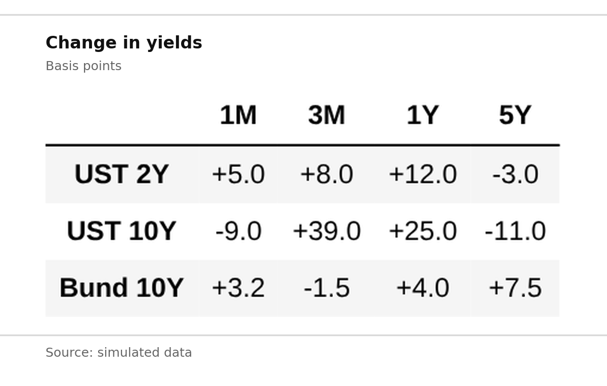

# DfStyling: Getting Started

`DfStyling` turns **pandas DataFrames into presentation-ready images**. The central class is `TableSheet`: it holds one or several tables (and charts), records the styling you apply to each, and composes everything (sheet title, panel titles, notes, sources) into **one image** that you can preview in a notebook, save as PNG / PDF / SVG, or insert into a presentation.

```python
import helpers_ps as hp

sheet = (
    hp.DfStyling.TableSheet(df, width_in=7)
    .style_table(font_size=11, text_align="center")
    .format("{:.1f}")
    .panel(title="Yield changes", subtitle="Basis points")
    .add_source("Source: Bloomberg")
)
sheet.preview()                      # show it in a notebook
sheet.save("yield_changes.png")      # write it to disk
```

Like [`GraphMtplt`](../GraphMtplt/getting_started.md), **every method returns the sheet**, so everything chains.

---

## Requirements

Tables are drawn by a **headless Chromium browser** (through [Playwright](https://playwright.dev/python/)), so the HTML/CSS of a pandas `Styler` is reproduced exactly.

| Need | How |
|---|---|
| `playwright` | `pip install playwright` |
| A Chromium-based browser | Any **Google Chrome** or **Microsoft Edge** installed on the machine is used automatically. Otherwise run `python -m playwright install chromium`. |
| The font | `Inter` is the default font of titles and notes. If it is not installed, `DejaVu Sans` is used. |

You can point to a specific browser with a custom renderer:

```python
from helpers_ps.DfStyling import PlaywrightRenderer

renderer = PlaywrightRenderer(chrome_path=r"C:\Program Files\Google\Chrome\Application\chrome.exe")
sheet = hp.DfStyling.TableSheet(df, renderer=renderer)
```

!!! note "Browser launch"
    The browser is launched **once per render**, with all tables of the sheet rendered in the same batch, and results are **cached by content**. Changing a title, the layout or the spacing never launches the browser again; changing the styling of one table only re-renders that table.

---

## Your first table

```python
import numpy as np
import pandas as pd
import helpers_ps as hp

yields = pd.DataFrame(
    {
        "1M": [5.0, -9.0, 3.2],
        "3M": [8.0, 39.0, -1.5],
        "1Y": [12.0, 25.0, 4.0],
        "5Y": [-3.0, -11.0, 7.5],
    },
    index=["UST 2Y", "UST 10Y", "Bund 10Y"],
)
```

```python
sheet = (
    hp.DfStyling.TableSheet(yields, width_in=6)
    .style_table(font_size=11, text_align="center")
    .format("{:+.1f}")
    .panel(title="Change in yields", subtitle="Basis points")
    .add_source("Source: simulated data")
)
```


In a notebook, `sheet.preview()` shows the result. `sheet.save("table.png")` writes it.

---

## The mental model

| Concept | What it is |
|---|---|
| **Sheet** | The whole image: optional title, a grid of panels, general notes and sources. |
| **Panel** | One element of the grid: a **table** (a DataFrame / `Styler` plus its styling) or an **image** (usually a chart). |
| **Active panel(s)** | The styling methods apply to the *active* panels. The newest panel is active; select others with `on("name")` or `on()` for all. |
| **Recipe** | A table is stored as its source plus the ordered list of operations applied to it. The `Styler` is rebuilt from that recipe whenever needed, so **re-running a notebook cell never accumulates CSS**. |

Typical flow:

1. **Create** the sheet with one or several DataFrames (`TableSheet(df)`, `TableSheet({"a": df1, "b": df2})`, or `add_table()`).
2. **Style** each table (`style_table`, `format`, borders, highlights, color ranges...). See [Styling tables](tables.md).
3. **Describe** each panel (`panel(title=..., notes=...)`) and the sheet (`add_title`, `add_note`, `add_source`).
4. **Arrange** the panels on a grid (`layout`) and set the size ([Panels, charts and layout](panels_images.md), [Sheet appearance and output](output.md)).
5. **Output**: `preview()`, `save()`, `to_bytes()`, `figure`.

---

## Method overview

| Group | Methods | Page |
|---|---|---|
| **Create / select panels** | `TableSheet(...)`, `add_table`, `add_image`, `on`, `remove`, `panel_names` | [Panels](panels_images.md) |
| **Panel texts** | `panel(title, subtitle, notes, align, valign, scale, ...)` | [Panels](panels_images.md) |
| **General table style** | `style_table`, `table_border`, `header_line`, `format` | [Styling tables](tables.md) |
| **Cells, rows and columns** | `style_cell(s)`, `border_cell(s)`, `highlight_rows`, `highlight_columns`, `border_rows`, `border_columns` | [Styling tables](tables.md) |
| **Conditional colors** | `text_color_by_range`, `background_color_by_range`, `apply_styler` | [Styling tables](tables.md) |
| **Sheet text** | `add_title`, `add_note`, `add_source` | [Appearance](output.md) |
| **Grid and size** | `layout`, `config_layout`, `subplots_adjust` | [Panels](panels_images.md), [Appearance](output.md) |
| **Output** | `preview`, `render`, `save`, `to_bytes`, `to_array`, `figure`, `size_in`, `last_path` | [Appearance](output.md) |
| **Debugging** | `recipe`, `clear_styles` | [Styling tables](tables.md#inspecting-and-resetting-styles) |

The complete signatures are in the [API reference](../api/DfStyling/sheet.md).

---

## Functional API (without a sheet)

The styling operations also exist as **functions that take and return a pandas `Styler`**: `style_table`, `style_cell`, `style_cells`, `border_cell`, `border_cells`, `highlight_rows`, `highlight_columns`, `border_rows`, `border_columns`, `text_color_by_range` and `background_color_by_range`. `TableSheet` uses them under the hood. They are useful when you want the styled DataFrame itself, for example to export it to Excel with [`to_excel_closed_styled`](../Excel/getting_started.md). See [Functional styling](functional.md).

---

## Next step

[Styling tables ->](tables.md)
