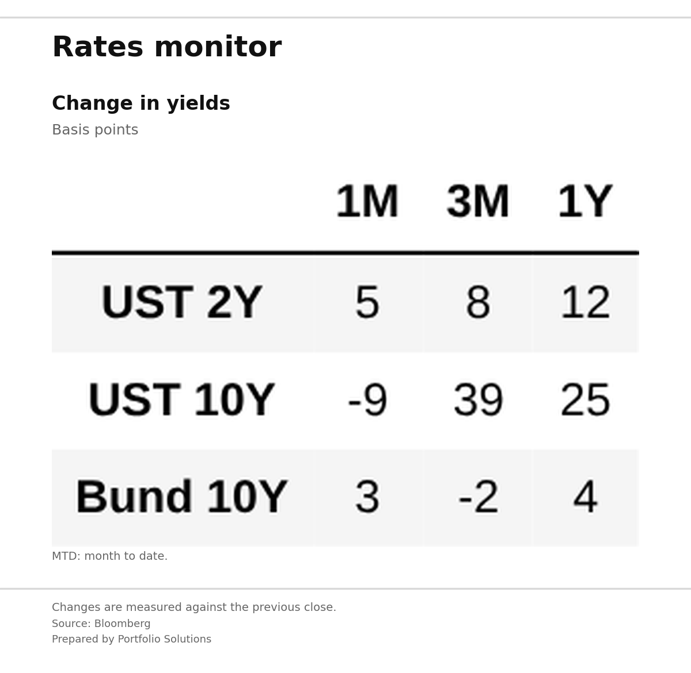
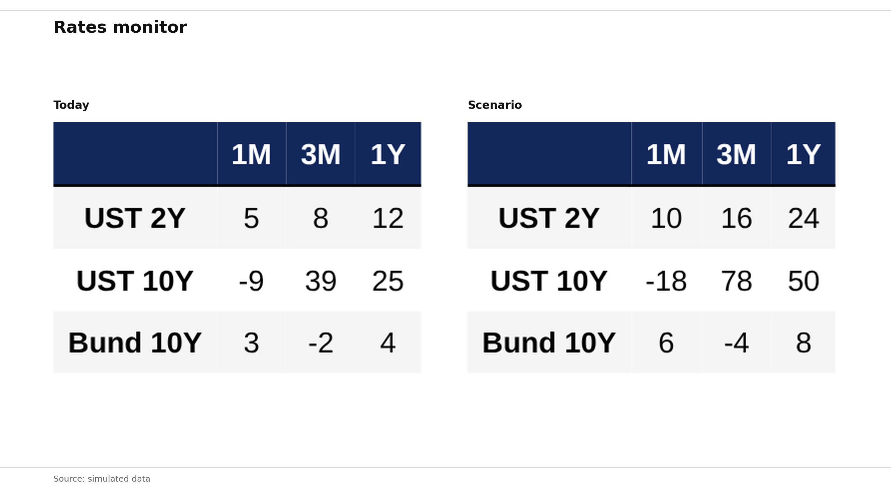

# Sheet appearance and output

This page covers the **sheet-level** settings (size, margins, text styles, rules, scaling) and how to **preview, save and reuse** the final image.

```python
import numpy as np
import pandas as pd
import helpers_ps as hp

TableSheet = hp.DfStyling.TableSheet

df = pd.DataFrame(
    {"1M": [5, -9, 3], "3M": [8, 39, -2], "1Y": [12, 25, 4]},
    index=["UST 2Y", "UST 10Y", "Bund 10Y"],
)
```

---

## Sheet texts

| Method | Description |
|---|---|
| `add_title(text, *, size=None, color=None, weight=None)` | Sheet title above all panels. `""` removes it. |
| `add_note(*notes, size=None, color=None)` | **Appends** general notes below the panels (above the sources). `size` / `color` apply to **all** notes, including those of each panel. |
| `add_source(*sources, size=None, color=None)` | **Replaces** the source lines at the bottom. Called with no arguments it clears them. |

!!! info "Sources and copyright"
    Source lines are printed **exactly as written**; nothing (prefix, license, copyright) is added automatically. Write `"Source: Bloomberg"` or `"© My Company"` yourself.

```python
sheet = (
    TableSheet(df, width_in=6)
    .style_table(font_size=11, text_align="center")
    .panel(title="Change in yields", subtitle="Basis points", notes="MTD: month to date.")
    .add_title("Rates monitor")
    .add_note("Changes are measured against the previous close.", size=7)
    .add_source("Source: Bloomberg", "Prepared by Portfolio Solutions", size=6.5)
)
```


---

## `config_layout`: every visual parameter

`config_layout(**changes)` changes any field of `SheetStyle`, validating it **before** applying (nothing changes if a value is invalid). The same names can be given to the `TableSheet(...)` constructor. Fields that accept `None` return to *automatic* when set to `None`.

```python
sheet.config_layout(width_in=13.33, height_in=7.5, scale="fit")
sheet.config_layout(wspace=None)        # back to col_gap_in
```

### `SheetStyle` fields

**Size**

| Field | Default | Description |
|---|---|---|
| `width_in` | `8.0` | Image width in inches. |
| `height_in` | `None` | Image height in inches. `None` = computed from the content. When set, the image has **exactly** that height: sources are anchored to the bottom, panels that do not fit are scaled down and free space follows `valign`. |
| `valign` | `"top"` | Where the panels sit when `height_in` leaves free space: `"top"`, `"center"`, `"bottom"`. |
| `dpi` | `200` | Resolution of rendered tables and of the exported image. |
| `font_family` | `"Inter"` | Font of titles, notes and sources. A comma-separated list is accepted; falls back to `DejaVu Sans`. |

**Spacing** (`subplots_adjust` semantics, `None` = automatic)

| Field | Default | Description |
|---|---|---|
| `left`, `right` | `None` | Grid edges as a fraction of the image width. `None` uses `margin_in`. |
| `bottom`, `top` | `None` | Grid edges as a fraction of the height measured **from the bottom**. Require `height_in`. |
| `wspace`, `hspace` | `None` | Space between columns / rows as a fraction of the average column width / row height. `None` uses `col_gap_in` / `row_gap_in`. |
| `margin_in` | `0.45` | Side margin in inches. |
| `col_gap_in`, `row_gap_in` | `0.30` | Gaps in inches. |
| `pad_top_in`, `pad_bottom_in` | `0.15`, `0.20` | Space above the top rule and below the last source line. |

**Text**

| Field | Default | Description |
|---|---|---|
| `header_size`, `header_color`, `header_weight` | `18`, `#111111`, `bold` | Sheet title. |
| `title_size`, `title_color`, `title_weight` | `12`, `#111111`, `bold` | Default panel titles. |
| `subtitle_size`, `subtitle_color` | `9`, `#666666` | Panel subtitles. |
| `title_gap_in` | `0.08` | Gap between a panel title block and its table. |
| `footer_size`, `footer_color` | `9`, `#666666` | Default size / color of notes and sources. |
| `note_size`, `note_color` | `None` | Notes (panel and general). `None` uses `footer_*`. |
| `source_size`, `source_color` | `None` | Source lines. `None` uses `footer_*`. |
| `line_spacing` | `1.5` | Line height as a multiple of the font size. |
| `wrap_text` | `True` | Wrap titles and notes to the width of their cell. |

**Rules and canvas**

| Field | Default | Description |
|---|---|---|
| `line_color`, `line_width` | `#D9D9D9`, `1.2` | Color and thickness (points) of the two horizontal rules. |
| `top_line`, `bottom_line` | `True` | Show the rule above the content / above the sources. |
| `background` | `"white"` | Canvas color. |
| `scale` | `"uniform"` | How panels are resized (below). |
| `resampling` | `"lanczos"` | Filter used to resize table images (`"lanczos"`, `"bicubic"`, `"bilinear"`, `"nearest"`). |
| `table_font_px` | `14` | Base font size of rendered tables in CSS pixels (overridden by `style_table(font_size=...)`). |
| `zebra` | `True` | Alternate row shading. |

You can also build the style once and reuse it across sheets:

```python
from helpers_ps.DfStyling import SheetStyle

house_style = SheetStyle(width_in=13.33, height_in=7.5, header_size=20, line_color="#12275A")
sheet = TableSheet(df, style=house_style)
```

### Scale: how panels are resized

| `scale` | Behavior |
|---|---|
| `"uniform"` (default) | The **same scale for every table**, the largest that fits all cells. Tables of the same sheet show the same visual font size. |
| `"fit"` | Stretches each panel to the width of its cell. |
| `"natural"` | Keeps the real size (`pixels / dpi` inches) and only shrinks panels that do not fit. |

Each panel can override the sheet value with `panel(scale=...)`. Image panels treat `"uniform"` as `"natural"`.

---

## Spacing

`subplots_adjust(left=None, bottom=None, right=None, top=None, wspace=None, hspace=None)` positions the grid like `matplotlib.pyplot.subplots_adjust`. Only the values you pass change; every value is a **fraction**:

- `left`, `right`: edges as a fraction of the image width.
- `bottom`, `top`: edges as a fraction of the height **measured from the bottom** (`top=0.9` leaves 10% above). They require `height_in`.
- `wspace`, `hspace`: space between columns / rows relative to the average column width / row height.

The sheet title and the sources are aligned with the **left edge of the grid**.

---

## A slide-sized image

For a 16:9 slide use `width_in=13.33, height_in=7.5`:

```python
sheet = (
    TableSheet({"a": df, "b": df * 2}, width_in=13.33, height_in=7.5)
    .on().style_table(font_size=14, text_align="center",
                      header_styles={"color": "white", "background-color": "#12275A"},
                      corner_styles={"background-color": "#12275A"})
    .on("a").panel(title="Today")
    .on("b").panel(title="Scenario")
    .layout(nrows=1)
    .subplots_adjust(left=0.06, right=0.94, top=0.80, bottom=0.14, wspace=0.12)
    .add_title("Rates monitor")
    .add_source("Source: simulated data")
)
```


```python
sheet.size_in
```
**Output**

```text
(13.33, 7.5)
```

---

## Output methods

| Method / property | Returns | Description |
|---|---|---|
| `preview()` | the sheet | Shows the sheet in a Jupyter notebook (no file). |
| `render()` | the sheet | Pre-renders the tables so later outputs are immediate. Optional: every output renders on demand. |
| `save(path=None, *, dir=None, name=None, fmt=None, transparent=False)` | the sheet | Writes a file. Give either `path`, or `name` (with an optional `dir`). The format comes from `fmt` or the file extension (`png` if none): `"png"`, `"pdf"`, `"svg"`, `"jpg"`. The `dir` folder is created if missing. |
| `last_path` (property) | `Path` or `None` | Path written by the last `save`. |
| `to_bytes(fmt="png", *, transparent=False)` | `bytes` | Encoded image. |
| `to_array()` | `ndarray (H, W, 3)` | RGB pixels of the final image. |
| `figure` (property) | `matplotlib.figure.Figure` | The composed sheet, rebuilt on every access from the cached table images. |
| `size_in` (property) | `(width, height)` | Final size in inches. |

```python
import os

sheet.save(dir="out", name="rates_monitor", fmt="png")
sheet.save("out/rates_monitor.pdf")
print(sheet.last_path)
sorted(os.listdir("out"))
```
**Output**

```text
out/rates_monitor.pdf
['rates_monitor.pdf', 'rates_monitor.png']
```

!!! tip "`save` has the same naming as `GraphMtplt`"
    `sheet.save(dir="out", name="lamina")` mirrors `graph.save(dir=..., name=...)`. Note, though, that `TableSheet.save` writes a **file** and returns the sheet, while `GraphMtplt.save` returns a buffer.

### Insert in PowerPoint

`to_bytes()` can be inserted directly in a slide with `python-pptx`:

```python
import io
from pptx import Presentation
from pptx.util import Inches

prs = Presentation()
prs.slide_width, prs.slide_height = Inches(13.33), Inches(7.5)
slide = prs.slides.add_slide(prs.slide_layouts[6])        # blank layout

slide.shapes.add_picture(io.BytesIO(sheet.to_bytes()), 0, 0, width=prs.slide_width)
prs.save("monitor.pptx")
os.path.exists("monitor.pptx")
```
**Output**

```text
True
```

---

## Cache and renderer

| Object | Description |
|---|---|
| `RenderCache(max_mb=256)` | LRU cache of rendered table images, keyed by **content** (the HTML that is rendered). Pass `cache=RenderCache(max_mb=0)` to `TableSheet` to disable caching. Attributes: `hits`, `misses`, `size_mb`; methods: `get`, `put`, `clear`. |
| `clear_render_cache()` | Empties the process-wide cache shared by all sheets. |
| `PlaywrightRenderer(chrome_path=None, channels=("chrome", "msedge", "chromium", None), timeout_ms=30000, launch_args=())` | Renders HTML to images with headless Chromium. Customize it to choose the browser executable or pass launch arguments. |

You can supply **your own renderer** as any callable `renderer(documents, dpi) -> list of RGB uint8 arrays`.

!!! warning "Jupyter on Windows"
    Jupyter installs an event-loop policy that cannot spawn subprocesses. `PlaywrightRenderer` runs the browser in a dedicated thread with the right policy, so it works inside notebooks without extra steps. If no browser can be launched, the error lists every attempted channel and how to fix it (`python -m playwright install chromium`, or install Chrome / Edge).

---

## Troubleshooting

| Symptom | Cause | Fix |
|---|---|---|
| `No Chromium-based browser could be launched` | No Chrome / Edge and no Playwright Chromium. | `python -m playwright install chromium` or use `PlaywrightRenderer(chrome_path=...)`. |
| `ImportError: Playwright is required to render tables` | Playwright is not installed. | `pip install playwright`. |
| `top`/`bottom` ignored or an error at render time | They need a fixed `height_in`. | Set `height_in`. |
| Title font looks different from Inter | Inter is not installed in the system. | Install the font or set `font_family`. |
| Table text too small next to the title | `scale="uniform"` shrinks all tables to fit the narrowest cell. | Use `scale="fit"` on the panel, or increase `width_in`. |

---

## Next step

[Functional styling ->](functional.md)
