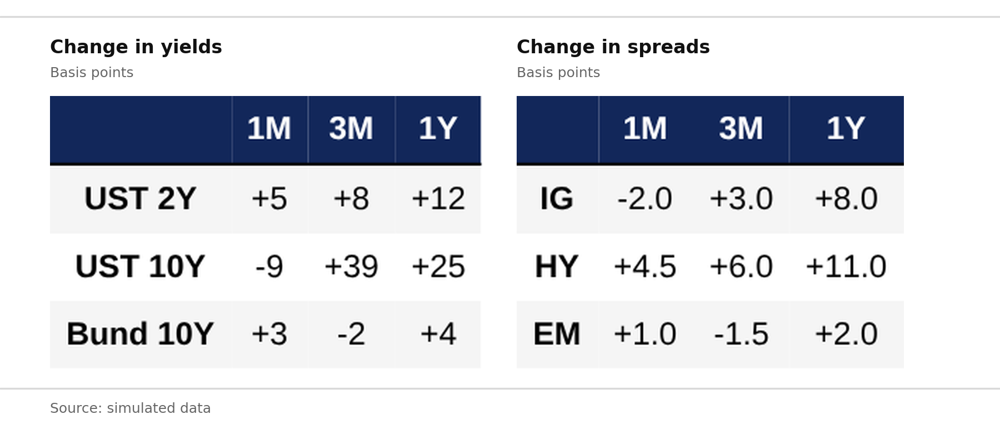
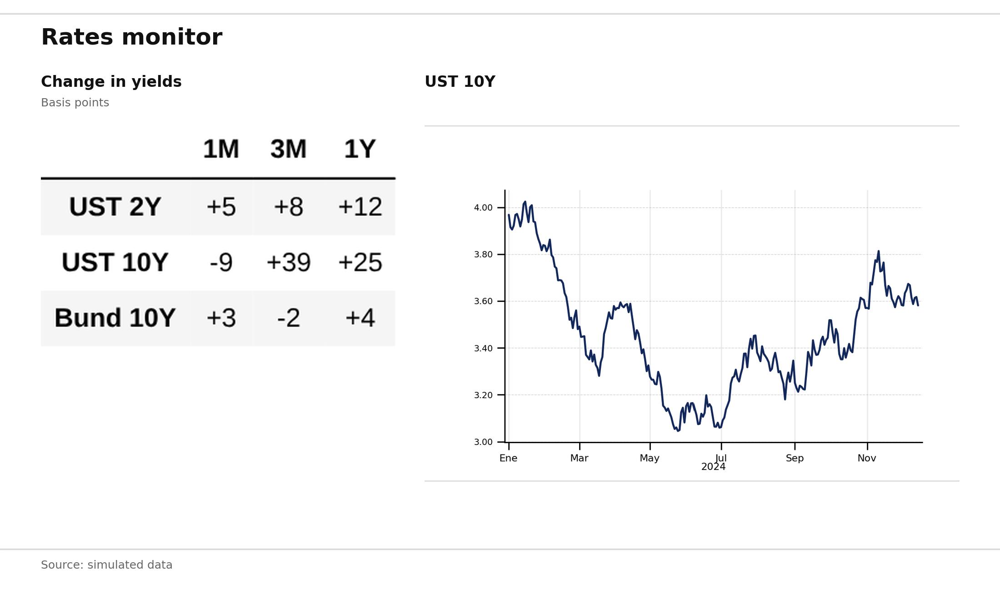
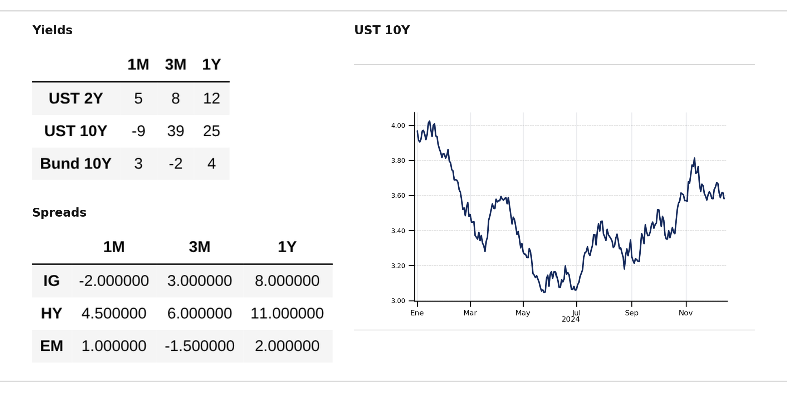

# Panels, charts and layout

A `TableSheet` is a **grid of panels**. A panel is either a **table** (DataFrame / `Styler`) or an **image** (a `GraphMtplt` chart, a Matplotlib figure, a PIL image, a file...). This page explains how to create panels, give them names and titles, select which ones a styling call affects and arrange them on the grid.

```python
import numpy as np
import pandas as pd
import helpers_ps as hp

TableSheet = hp.DfStyling.TableSheet

rng = np.random.default_rng(5)

df_yield = pd.DataFrame(
    {"1M": [5, -9, 3], "3M": [8, 39, -2], "1Y": [12, 25, 4]},
    index=["UST 2Y", "UST 10Y", "Bund 10Y"],
)
df_spreads = pd.DataFrame(
    {"1M": [-2.0, 4.5, 1.0], "3M": [3.0, 6.0, -1.5], "1Y": [8.0, 11.0, 2.0]},
    index=["IG", "HY", "EM"],
)

dates = pd.bdate_range("2024-01-02", periods=250)
curve_df = pd.DataFrame(
    {"UST 10Y": 4 + rng.normal(0, 0.04, len(dates)).cumsum()},
    index=dates,
)
```

---

## Creating the sheet

`TableSheet(dataframe=None, *, names=None, style=None, renderer=None, cache=None, nrows=None, ncols=None, width_ratios=None, **style_options)`

`dataframe` can be:

| Input | Result |
|---|---|
| A `DataFrame`, `Styler` or `Series` | One table panel. |
| A list of tables | Several panels named `panel_0`, `panel_1`... (or `names=[...]`). |
| A dictionary `{name: table}` | Several panels with your names. |
| `None` | An empty sheet; add panels later with `add_table` / `add_image`. |

Any [`SheetStyle`](output.md#sheetstyle-fields) field (`width_in=11`, `height_in=7.5`, `font_family=...`) can be passed as keyword argument.

```python
TableSheet(df_yield)                                         # one table
TableSheet([df_yield, df_spreads], names=["yield", "spreads"])
TableSheet({"yield": df_yield, "spreads": df_spreads}, width_in=12)
```

### Adding panels later

| Method | Description |
|---|---|
| `add_table(dataframe, name=None, *, activate=True)` | Adds a table panel. A `Styler` is copied, never modified. |
| `add_image(image, name=None, *, activate=True)` | Adds an image panel (see below). |
| `remove(*keys)` | Removes panels (by name or position) and their cells in an explicit layout; rows / columns left empty are dropped. |
| `panel_names` (property) | List of panel names in creation order. |

By default the **new panel becomes the only active one**, so the styling calls that follow apply to it. Use `activate=False` to keep the previous selection.

---

## Selecting panels

`on(*keys)` chooses the panels that the **next calls** apply to. Keys are names or positions (negatives allowed); **no arguments selects every panel**.

```python
sheet = (
    TableSheet({"yield": df_yield, "spreads": df_spreads}, width_in=9)
    .on().style_table(font_size=11, text_align="center",
                      header_styles={"color": "white", "background-color": "#12275A"},
                      corner_styles={"background-color": "#12275A"})
    .on("yield").format("{:+.0f}").panel(title="Change in yields", subtitle="Basis points")
    .on("spreads").format("{:+.1f}").panel(title="Change in spreads", subtitle="Basis points")
    .layout(nrows=1)                       # side by side
    .add_source("Source: simulated data")
)
```


---

## Panel texts and geometry: `panel`

`panel(*, title=None, subtitle=None, notes=None, align=None, valign=None, scale=None, title_size=None, title_color=None, title_weight=None)`

`None` leaves a setting unchanged; use `""` (or `[]` for notes) to clear it. It applies to the active panels.

| Argument | Description |
|---|---|
| `title`, `subtitle` | Text above the table (subtitle is smaller and gray). |
| `notes` | A string or list of strings **below the panel**. Replaces the previous ones. |
| `align` | `"left"` (default), `"center"`, `"right"`: horizontal position when the panel is narrower than its cell. |
| `valign` | `"top"`, `"center"`, `"bottom"`: vertical position when the cell is taller than the panel (for example a panel that spans several rows). |
| `scale` | Overrides the sheet's [`scale`](output.md#scale-how-panels-are-resized) for this panel. |
| `title_size`, `title_color`, `title_weight` | Style overrides of this panel's title. |

```python
sheet.on("yield").panel(
    title="Change in yields",
    subtitle="Basis points",
    notes=["MTD: month to date.", "Source: Bloomberg."],
)
```

---

## Charts as panels: `add_image`

`add_image(image, name=None, *, activate=True)` accepts a **`GraphMtplt` object directly**, a Matplotlib `Figure`, a NumPy array, a PIL image, encoded `bytes`, or a file path. Figures (and objects with a `_fig`, such as `GraphMtplt`) are rasterized when the sheet is rendered with the sheet's `dpi`, so they always reflect their **current state**.

```python
chart = (
    hp.GraphMtplt(curve_df)
    .graph_line(series=[{"ticker": "UST 10Y", "color": "#12275A"}],
                x_axis={"bbg_format": True, "tick_step": 2})
    .config_yaxis(fmt=".2f")
    .horizontal_guides(mostrar_cero=False)
)

sheet = (
    TableSheet(df_yield, names=["yield"], width_in=11)
    .style_table(font_size=11, text_align="center")
    .format("{:+.0f}")
    .panel(title="Change in yields", subtitle="Basis points")
    .add_image(chart, name="curve")
    .panel(title="UST 10Y", scale="fit")
    .layout([["yield", "curve"]], width_ratios=[2, 3])
    .add_title("Rates monitor")
    .add_source("Source: simulated data")
)
```


!!! info "Chart size"
    Image panels treat `scale="uniform"` as `"natural"`: a chart keeps its real size and is only shrunk if it does not fit. Use `panel(scale="fit")` to make it fill the width of its cell. Choose the chart's size when you create it with `GraphMtplt.plot(figsize=(w, h))`.

---

## Arranging panels: `layout`

`layout(rows=None, *, nrows=None, ncols=None, width_ratios=None)`

| Form | Result |
|---|---|
| `layout()` | Stack the panels **vertically** (the default). |
| `layout(nrows=1)` | One row: panels **side by side**. |
| `layout(ncols=2)` / `layout(nrows=2)` | Fill a grid row by row in creation order. If only one is given, the other is the smallest that fits. |
| `layout([["a", "b"], ["c", "c"]])` | **Explicit grid**, like `matplotlib.pyplot.subplot_mosaic`. Repeating a name makes the panel **span** several cells. Use `None` or `"."` for an empty cell. |
| `width_ratios=[1, 2]` | Relative width of each column (one value per column). |

Row heights follow the content of each row.

```python
sheet = (
    TableSheet({"yield": df_yield, "spreads": df_spreads}, width_in=11)
    .on().style_table(font_size=11, text_align="center")
    .on("yield").panel(title="Yields")
    .on("spreads").panel(title="Spreads")
    .add_image(chart, name="curve").panel(title="UST 10Y", scale="fit")
    .layout([["yield", "curve"], ["spreads", "curve"]], width_ratios=[3, 4])   # the chart spans both rows
    .on("curve").panel(valign="center")
)
```


!!! warning "Rectangles only"
    A repeated name must occupy a **rectangular block** of cells (otherwise `ValueError`). A row with fewer entries is stretched when its length divides the number of columns (`[["a", "b"], ["c"]]` makes `c` span both columns).

### Spacing between panels

Grid spacing follows `matplotlib.subplots_adjust` semantics (see [Sheet appearance and output](output.md#spacing)):

```python
sheet.subplots_adjust(wspace=0.15, hspace=0.25)       # fractions of the average width / height
sheet.config_layout(col_gap_in=0.4, row_gap_in=0.3)    # or fixed gaps in inches
```

---

## Next step

[Sheet appearance and output ->](output.md)
