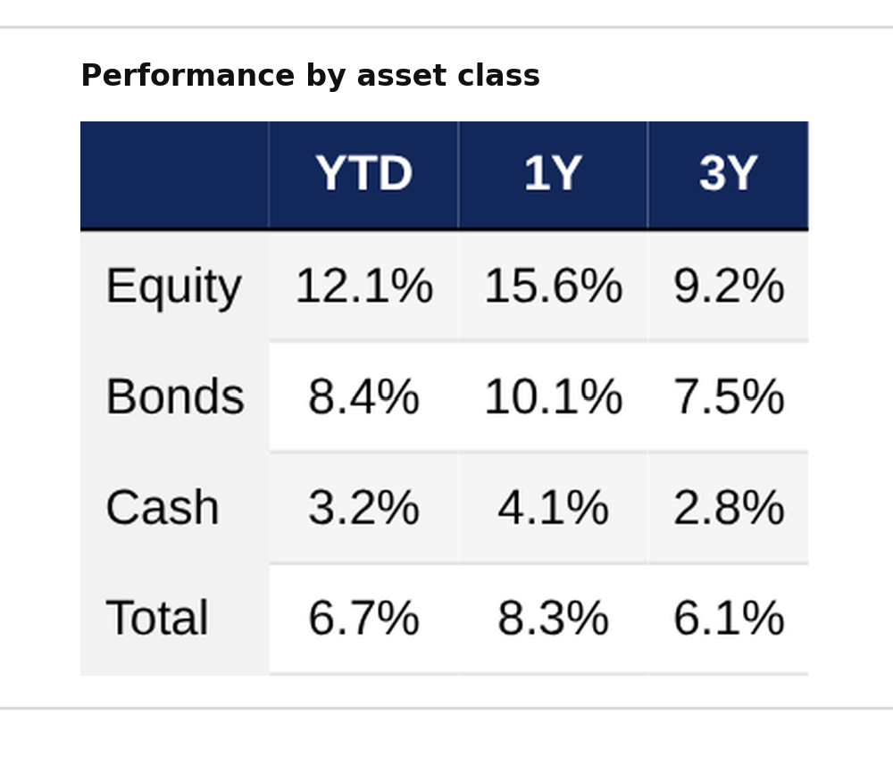
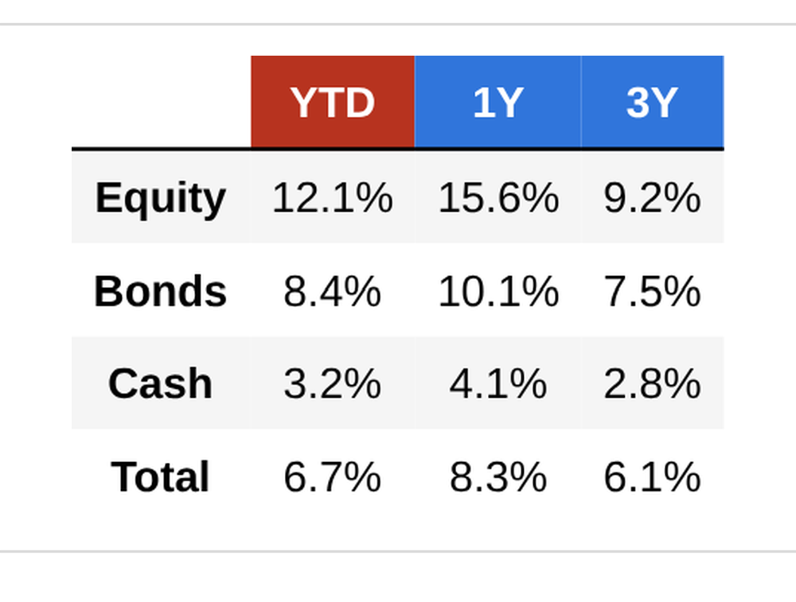
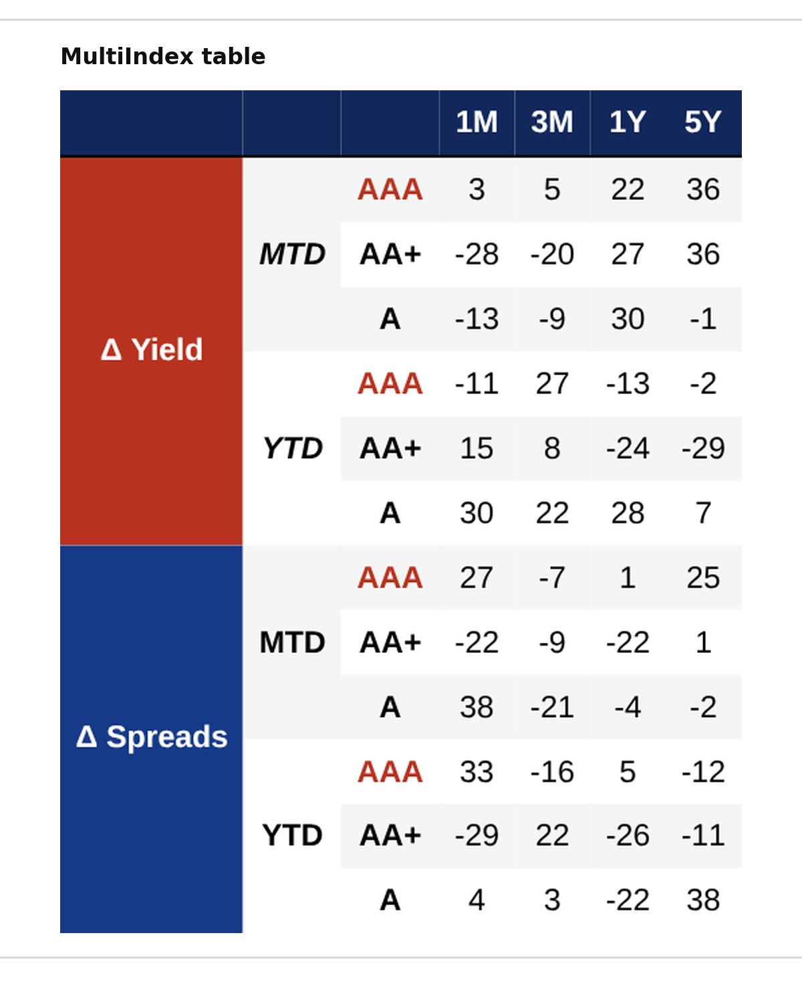
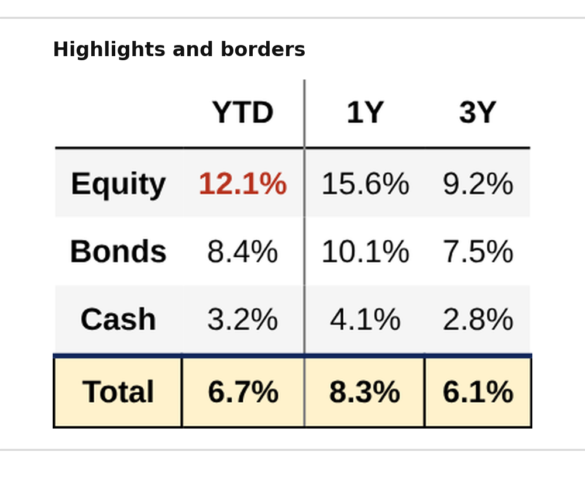
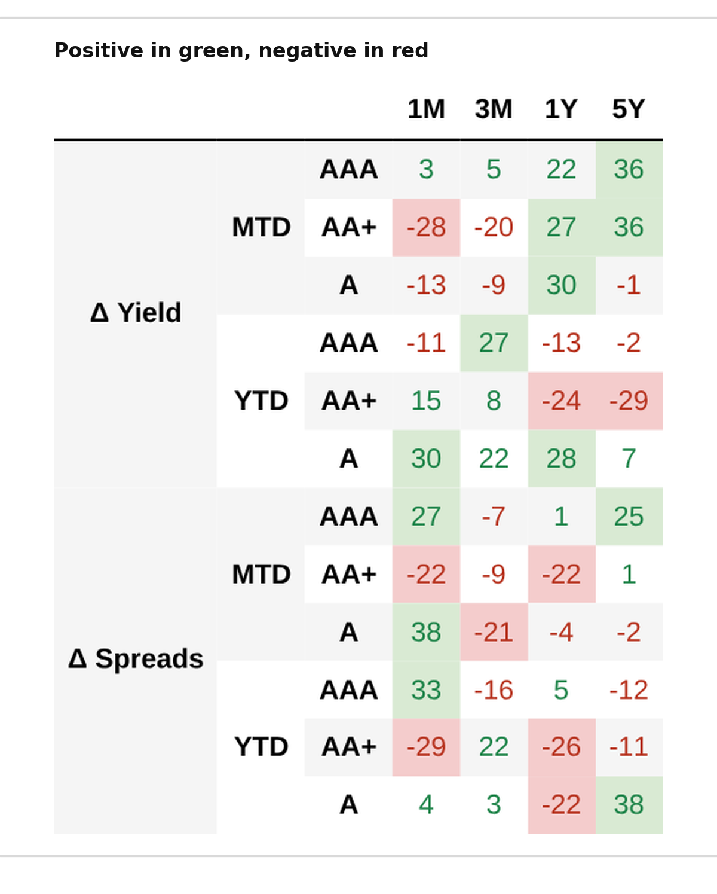

# Styling tables

Every styling method of `TableSheet` acts on the **active panel(s)** (the most recently added one by default; see [`on()`](panels_images.md#selecting-panels)). Calls are **recorded** in the order you write them and replayed to build the final table, so the **latest call wins** when two rules set the same CSS property.

All style arguments are plain **CSS properties** in dictionaries: `{"background-color": "#12275A", "color": "white", "font-weight": "bold"}`.

The examples use two tables. A simple one and a **MultiIndex** one with the index levels `Metric`, `Period` and `Rating`.

```python
import numpy as np
import pandas as pd
import helpers_ps as hp

TableSheet = hp.DfStyling.TableSheet

simple = pd.DataFrame(
    {
        "YTD": [0.121, 0.084, 0.032, 0.067],
        "1Y": [0.156, 0.101, 0.041, 0.083],
        "3Y": [0.092, 0.075, 0.028, 0.061],
    },
    index=["Equity", "Bonds", "Cash", "Total"],
)

index = pd.MultiIndex.from_product(
    [["Δ Yield", "Δ Spreads"], ["MTD", "YTD"], ["AAA", "AA+", "A"]],
    names=["Metric", "Period", "Rating"],
)
rng = np.random.default_rng(1)
multi = pd.DataFrame(
    rng.integers(-30, 40, size=(len(index), 4)),
    index=index,
    columns=["1M", "3M", "1Y", "5Y"],
)
```

---

## `style_table`: the general look

One call sets typography, colors and the style of headers, index and data cells. Every argument is optional.

| Argument | Applies to | Example |
|---|---|---|
| `font_family`, `font_size`, `text_color`, `background_color`, `text_align` | header, index and data cells | `font_size=11`, `text_align="center"` |
| `header_styles` | all column-header cells | `{"color": "white", "background-color": "#12275A"}` |
| `index_styles` | all row-index cells (every level) | `{"background-color": "#F2F2F2", "font-weight": "normal"}` |
| `data_styles` | all data cells | `{"border-bottom": "1px solid #E5E5E5"}` |
| `column_header_styles` | selected headers | list of `{"columns": [...], "styles": {...}, "level": n}` |
| `row_index_styles` | selected index labels | list of `{"values": [...], "level": n or name, "styles": {...}, "parent": (...)}` |
| `corner_styles` | the corner above the index and the index-names row | `{"background-color": "#12275A"}` |
| `show_index_names` | the row with the index level names | `False` hides it |

`font_size` is in **pixels** when numeric (`11` = `"11px"`) or any CSS unit as text (`"9pt"`).

```python
sheet = (
    TableSheet(simple, width_in=5)
    .style_table(
        font_size=12,
        text_align="center",
        header_styles={"color": "white", "background-color": "#12275A"},
        corner_styles={"background-color": "#12275A"},
        index_styles={"background-color": "#F2F2F2", "font-weight": "normal", "text-align": "left"},
        data_styles={"border-bottom": "1px solid #E5E5E5"},
    )
    .format("{:.1%}")
    .panel(title="Performance by asset class")
)
```


**Order of rules inside one call** (the later one wins on the same property): (1) general arguments, (2) `header_styles` / `index_styles` / `data_styles`, (3) `column_header_styles`, (4) `row_index_styles`, (5) `corner_styles`.

!!! info "Why the font size barely changes the image"
    With the default `scale="uniform"` the table is resized to fill its cell, so `font_size` mostly changes how heavy fixed-pixel **borders** look relative to the text. See [scale](output.md#scale-how-panels-are-resized).

!!! warning "Header and row heights"
    A row is as tall as its tallest cell. If you reduce the padding of the header cells, give `corner_styles` the same padding; if you reduce the data padding, reduce the index padding too: `data_styles={"padding": "0.25em 0.6em"}, index_styles={"padding": "0.25em 0.6em"}`.

---

## Number formats: `format`

`format(formatter=None, subset=None, **kwargs)` wraps `Styler.format`.

```python
sheet.format("{:.1%}")                                    # every cell
sheet.format({"YTD": "{:.1%}", "1Y": "{:.1%}"})           # per column
sheet.format(lambda v: f"{v:+,.0f} bp", subset=["1M"])    # a function
sheet.format("{:.1f}", na_rep="-")                        # any Styler.format option
```

---

## Targeted rules

### Selected headers: `column_header_styles`

Each rule is a dictionary with `"columns"` (a label or a list), `"styles"` and an optional `"level"` (the header row; default is the last one, the row closest to the data).

```python
sheet = (
    TableSheet(simple, width_in=5)
    .style_table(
        text_align="center",
        header_styles={"color": "white", "background-color": "#12275A"},
        column_header_styles=[
            {"columns": ["YTD"], "styles": {"background-color": "#B7331F"}},
            {"columns": ["1Y", "3Y"], "styles": {"background-color": "#3075DB"}},
        ],
    )
    .format("{:.1%}")
)
```


### Selected index labels: `row_index_styles`

Each rule has `"values"` (a label or list), `"level"` (position, **0 = outermost**, or the level **name**) and `"styles"`. `"parent"` (a tuple of the outer-level values) restricts a repeated label to one section.

```python
sheet = (
    TableSheet(multi, width_in=6)
    .style_table(
        font_size=11,
        text_align="center",
        header_styles={"color": "white", "background-color": "#12275A"},
        corner_styles={"background-color": "#12275A"},
        row_index_styles=[
            {"values": "Δ Yield", "level": 0, "styles": {"background-color": "#B7331F", "color": "white"}},
            {"values": "Δ Spreads", "level": 0, "styles": {"background-color": "#163A87", "color": "white"}},
            {"values": ["MTD", "YTD"], "level": 1, "parent": ("Δ Yield",), "styles": {"font-style": "italic"}},
            {"values": "AAA", "level": "Rating", "styles": {"color": "#B7331F"}},
        ],
        show_index_names=False,
    )
    .panel(title="MultiIndex table")
)
```


!!! note "MultiIndex columns"
    With MultiIndex columns use complete **tuples** as labels (`("Yield", "1M")`). To style a group label of an upper level, use `"level": 0` and list the group's columns **starting with its first column** (the one that carries the label).

!!! note "Values that do not exist"
    A label that is not in the table matches nothing and is ignored silently.

---

## Table outline and header line

By default a table has **no outline** and a 1px black line under the column headers.

| Method | What it does |
|---|---|
| `table_border(width="1px", color="#cccccc", line_style="solid")` | Draws an outline. `line_style="none"` removes it. |
| `header_line(width="1px", color="black", line_style="solid")` | Style of the line between headers and data (`line_style="none"` removes it). |

```python
sheet.table_border(color="#12275A")
sheet.header_line(color="#12275A", width=2)
```

!!! info "Line thickness"
    The browser draws table borders in **whole CSS pixels with a minimum of 1px** (`"0.5px"` is drawn as `1px`, `"1.5px"` as `1px`). Because the sheet scales the table to fit its cell, the visible thickness is relative to the text: a `1px` line is thinner next to a large `font_size`. To get **thinner lines**, increase `font_size`; to keep other sizes proportional use `em` units inside the table.

---

## Cells, rows and columns

These methods mirror the [functional API](functional.md). Labels are **row index values** and **column names**; for a MultiIndex use complete tuples.

| Method | Description |
|---|---|
| `style_cell(row, column, styles)` | CSS on one cell. |
| `style_cells(rows, columns, styles)` | CSS on every combination of the given rows and columns. |
| `border_cell(row, column, position="top", width="1px", color="black", line_style="solid")` | Border on one side of one cell. |
| `border_cells(rows, columns, position=..., ...)` | Border on one side of many cells. |
| `highlight_rows(rows, styles=None, include_index=True, index_level=None)` | Highlight whole rows. Default style: bold text and a 1px black box. |
| `highlight_columns(columns, styles=None, include_header=True, header_level=None)` | Highlight whole columns. |
| `border_rows(rows, position="bottom", styles=None)` | Horizontal line across the **complete** row (also across merged MultiIndex cells). `styles` accepts `width`, `style` (or `line_style`) and `color`. |
| `border_columns(columns, position="right", include_header=True, header_level=None, styles=None)` | Vertical line next to columns. |

```python
sheet = (
    TableSheet(simple, width_in=5)
    .style_table(font_size=12, text_align="center")
    .format("{:.1%}")
    .highlight_rows("Total", styles={"background-color": "#FFF2CC"})
    .border_rows("Cash", position="bottom", styles={"width": "2px", "color": "#12275A"})
    .style_cell("Equity", "YTD", {"color": "#B7331F", "font-weight": "bold"})
    .border_columns("YTD", position="right", styles={"color": "#808080", "width": "1px"})
    .panel(title="Highlights and borders")
)
```


!!! note "`row_index_styles` vs `highlight_rows`"
    `row_index_styles` paints **only the index label**. To style the **data cells** of a row use `highlight_rows` or `style_cells`.

---

## Conditional colors

`text_color_by_range(ranges, subset=None)` and `background_color_by_range(ranges, subset=None)` color each cell by the numeric interval it falls in. `ranges` is `{(lower, upper): css_color}`; the interval is **lower-inclusive and upper-exclusive** and the first match wins. `subset` limits the cells (use `pd.IndexSlice` for MultiIndex).

```python
sheet = (
    TableSheet(multi, width_in=6)
    .style_table(font_size=11, text_align="center", show_index_names=False)
    .text_color_by_range({(-np.inf, 0): "#B7331F", (0, np.inf): "#1E8449"})
    .background_color_by_range({(25, np.inf): "#D9EAD3", (-np.inf, -20): "#F4CCCC"})
    .panel(title="Positive in green, negative in red")
)
```


### Any `Styler` operation: `apply_styler`

`apply_styler(func, *args, **kwargs)` runs any `Styler` method by name, or your own function `func(styler, ...) -> Styler`, and records it in the recipe:

```python
sheet.apply_styler("background_gradient", cmap="Blues", axis=None)
sheet.apply_styler(lambda s: s.set_caption("Daily changes"))
sheet.apply_styler("hide", axis="columns", subset=["5Y"])
```

---

## Several tables, different styles

Use `on(...)` to choose which panels the next call affects. With no arguments it selects **all** panels:

```python
sheet = (
    TableSheet({"yield": df_yield, "spreads": df_spreads}, width_in=12)
    .on().style_table(font_size=11, text_align="center")       # both
    .on("yield").format("{:+.0f}")                              # only yield
    .on("spreads").format("{:.1f}")                             # only spreads
)
```

See [Panels, charts and layout](panels_images.md).

---

## Inspecting and resetting styles

| Method | Description |
|---|---|
| `recipe` (property) | Dictionary `{panel_name: [operation labels]}` in the order they will be applied. Use it to debug the order of rules. |
| `clear_styles()` | Remove every recorded operation from the active tables. |

```python
sheet = TableSheet(simple).style_table(font_size=11).format("{:.1%}").highlight_rows("Total")
sheet.recipe
```
**Output**

```text
<bound method StylingMixin.recipe of TableSheet(panels=['panel_0'], active=['panel_0'], stacked, width_in=8.0)>
```

A wrong label **fails immediately on the offending line** (not when rendering), which makes mistakes easy to find.

---

## Next step

[Panels, charts and layout ->](panels_images.md)
