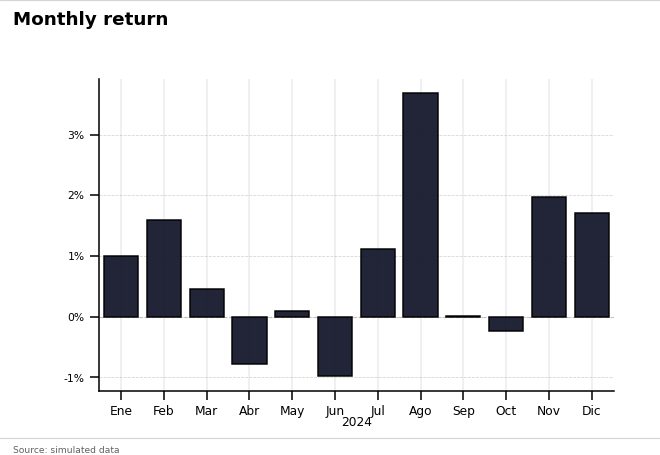
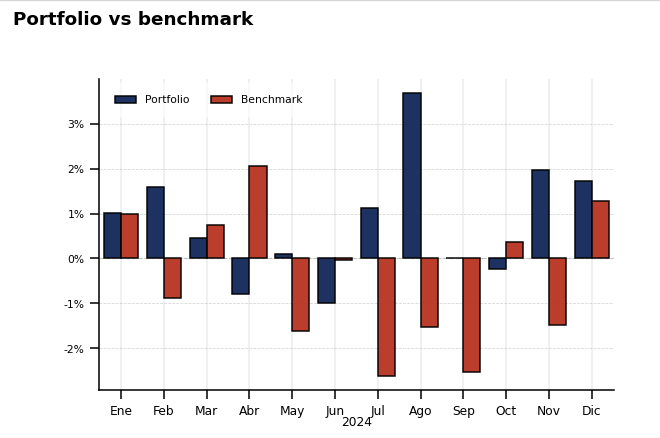
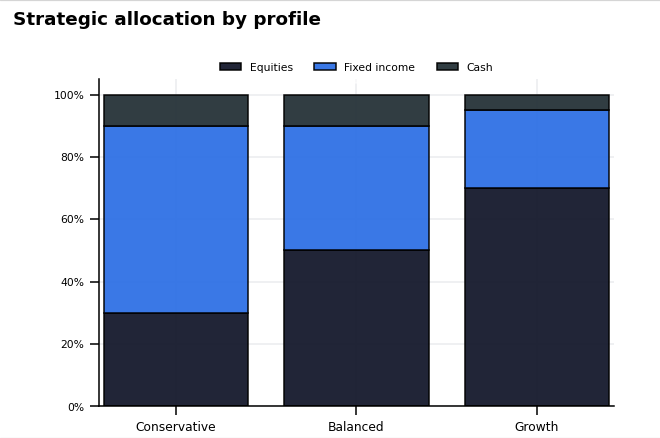
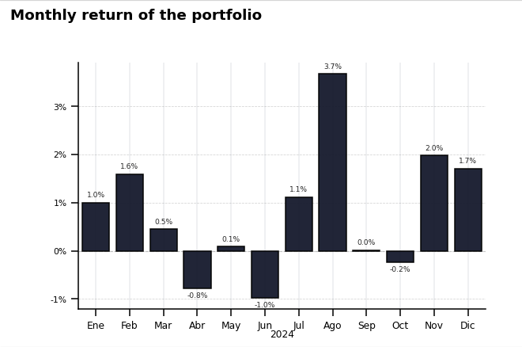
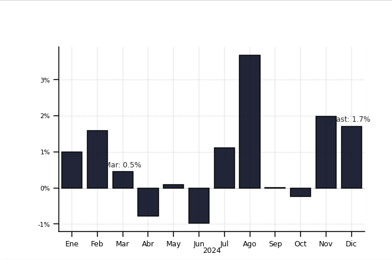
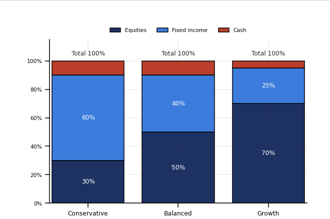
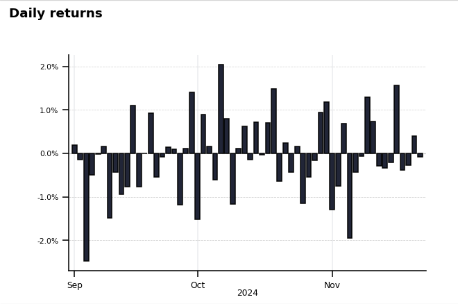

# Bar chart: `graph_bar`

`graph_bar()` draws **simple, grouped or stacked** bars on the active axis. The x-axis can be **time** (the index is a `DatetimeIndex`) or **categorical** (the index holds names such as `"Equity"`, `"Bonds"`).

| Layout | How to get it |
|---|---|
| Simple bars | one series |
| Grouped bars (side by side) | several series (default) or `grouped=True` |
| Stacked bars | `stacked=True` |

---

## Expected DataFrame

The index is the x-axis and every column is a series. For the examples of this page:

```python
import numpy as np
import pandas as pd
import helpers_ps as hp

hp.set_graph_theme()
rng = np.random.default_rng(7)

# Monthly returns: index = month-end dates
monthly = pd.DataFrame(
    {
        "Portfolio": rng.normal(0.010, 0.020, 12),
        "Benchmark": rng.normal(0.008, 0.018, 12),
    },
    index=pd.date_range("2024-01-31", periods=12, freq="ME"),
)

# Asset allocation: index = categories
alloc = pd.DataFrame(
    {
        "Equity": [0.30, 0.50, 0.70],
        "Bonds": [0.60, 0.40, 0.25],
        "Cash": [0.10, 0.10, 0.05],
    },
    index=["Conservative", "Balanced", "Growth"],
)
```

```python
monthly.head(3).round(4)
```
**Output**

```text
            Portfolio  Benchmark
2024-01-31     0.0100     0.0099
2024-02-29     0.0160    -0.0087
2024-03-31     0.0045     0.0075
```

---

## Simple bars

With one series nothing else is needed. For monthly data use `x_axis={"bbg_format": True, "tick_step": 1}`: every bar gets its own position and its month label (the default `tick_step` is `6`, which would label only every sixth month):

```python
g = (
    hp.GraphMtplt(monthly)
    .graph_bar(
        series=[{"ticker": "Portfolio", "label": "Portfolio"}],
        x_axis={"bbg_format": True, "tick_step": 1},
    )
    .config_yaxis(fmt=".0%")
    .horizontal_guides()
    .add_title("Monthly return")
    .add_source("Source: simulated data")
)
```


!!! info "Colors"
    If `color` is omitted, each series takes the next color of the palette `hp.PALETA_COLORES`. Set it explicitly with `{"ticker": "Portfolio", "color": "#12275A"}`.

---

## Grouped bars

When there are **two or more series** and neither `stacked` nor `grouped` is given, the bars are grouped automatically:

```python
g = (
    hp.GraphMtplt(monthly)
    .graph_bar(
        series=[
            {"ticker": "Portfolio", "color": "#12275A"},
            {"ticker": "Benchmark", "color": "#B7331F"},
        ],
        x_axis={"bbg_format": True, "tick_step": 1},
    )
    .config_yaxis(fmt=".0%")
    .horizontal_guides()
    .add_legend(ncol=2)
    .add_title("Portfolio vs benchmark")
)
```


`bar_width` (0-1, default `0.8`) controls the width of the whole group and `alpha` (default `0.95`) the opacity.

---

## Stacked bars

`stacked=True` stacks the series in the order of `series`. Positive and negative values are stacked separately (positives above zero, negatives below), so mixed-sign contributions work.

```python
g = (
    hp.GraphMtplt(alloc)
    .graph_bar(
        stacked=True,
        series=[
            {"ticker": "Equity", "label": "Equities"},
            {"ticker": "Bonds", "label": "Fixed income"},
            {"ticker": "Cash", "label": "Cash"},
        ],
        x_axis={"tick_step": 1},
    )
    .config_yaxis(fmt=".0%")
    .add_legend(ncol=3, loc="upper center", bbox_to_anchor=(0.5, 1.1))
    .add_title("Strategic allocation by profile")
)
```


!!! warning "Categorical axes and `tick_step`"
    On a categorical axis the default `tick_step=6` would print one label every six categories. Use `x_axis={"tick_step": 1}` to show them all.

---

## Bars on the right axis

Each series has its own `axis_side` (`"left"` or `"right"`). Grouped bars can mix both axes; **stacked bars cannot** (`ValueError`).

---

## Tags on bars

Each series accepts a `tag` **list**. Every item draws labels on selected bars. Three modes are available through `show`:

| `show` | Where the label goes | Template fields |
|---|---|---|
| `"value_label"` (default) | Above the bar end (below for negatives). On stacked bars: centered in the segment. | `{y_value}` |
| `"bar_tag"` | Centered inside the bar. | `{y_value}` |
| `"stack_total"` | Above the whole stack. | `{total_value}` |

All modes also support `{ticker}`, `{label}` and `{x_value}`. Other keys of a tag item:

| Key | Default | Description |
|---|---|---|
| `x_values` | `"last"` | `"last"`, `"all"`, one index value or a list of index values (dates or category names). |
| `template` | `"{y_value:,.2f}"` | Python format string. |
| `ubic_etq` | automatic | Offset `(x, y)` in points from the anchor. |
| `fontsize`, `color`, `fontweight`, `fontstyle`, `rotation`, `alpha` | 8, `#262626`, normal... | Text style. |
| `bbox`, `arrowprops` | none | Matplotlib `bbox` / arrow dictionaries. |
| `zorder`, `clip_on`, `label_h_align`, `label_v_align` | 5, False | Drawing order, clipping, alignment. |

### Value labels on all bars

```python
g = (
    hp.GraphMtplt(monthly)
    .graph_bar(
        series=[{
            "ticker": "Portfolio",
            "tag": [{"x_values": "all", "template": "{y_value:.1%}", "fontsize": 6}],
        }],
        x_axis={"bbg_format": True, "tick_step": 1},
    )
    .config_yaxis(fmt=".0%")
    .horizontal_guides()
    .add_title("Monthly return of the portfolio")
)
```


### Only some bars

`x_values` accepts index values. With a `DatetimeIndex` pass `pd.Timestamp` objects (date *strings* are only matched against a text / categorical index), and use `"last"` or `"all"` as a **standalone** value, not inside a list. To combine both, use two tag items:

```python
g = (
    hp.GraphMtplt(monthly)
    .graph_bar(
        series=[{
            "ticker": "Portfolio",
            "tag": [
                {"x_values": [pd.Timestamp("2024-03-31")], "template": "{x_value:%b}: {y_value:.1%}"},
                {"x_values": "last", "template": "Last: {y_value:.1%}"},
            ],
        }],
        x_axis={"bbg_format": True, "tick_step": 1},
    )
    .config_yaxis(fmt=".0%")
    .horizontal_guides()
)
```


### Centered tags and stack totals

```python
g = (
    hp.GraphMtplt(alloc)
    .graph_bar(
        stacked=True,
        series=[
            {"ticker": "Equity", "label": "Equities", "color": "#12275A",
             "tag": [{"show": "bar_tag", "x_values": "all", "template": "{y_value:.0%}", "color": "white"}]},
            {"ticker": "Bonds", "label": "Fixed income", "color": "#3075DB",
             "tag": [{"show": "bar_tag", "x_values": "all", "template": "{y_value:.0%}", "color": "white"}]},
            {"ticker": "Cash", "label": "Cash", "color": "#B7331F",
             "tag": [{"show": "stack_total", "x_values": "all", "template": "Total {total_value:.0%}"}]},
        ],
        x_axis={"tick_step": 1},
    )
    .config_yaxis(fmt=".0%", lim=(0, 1.15))
    .add_legend(ncol=3, loc="upper center", bbox_to_anchor=(0.5, 1.12))
)
```


!!! note "Where to declare `stack_total`"
    A stack total is the same for every series, so declare it on **one** series (usually the last one) to draw it only once.

---

## Daily data: Bloomberg-style axis

With a daily `DatetimeIndex`, `x_axis={"bbg_format": True}` removes the gaps of weekends and holidays (one position per observation) and prints month abbreviations with the year below, like a Bloomberg terminal. Bars and tags use the same positions.

!!! note "Month names"
    In Bloomberg-style axes the default month labels are **Spanish abbreviations** (`Ene`, `Abr`, `Ago`, `Dic`). Pass `fmt="%b-%y"` (or another `strftime` format) to use the language of the active locale instead.

```python
daily = pd.DataFrame(
    {"Daily return": rng.normal(0.0004, 0.01, 60)},
    index=pd.bdate_range("2024-09-02", periods=60),
)

g = (
    hp.GraphMtplt(daily)
    .graph_bar(x_axis={"bbg_format": True, "tick_step": 1})
    .config_yaxis(fmt=".1%")
    .horizontal_guides()
    .add_title("Daily returns")
)
```


---

## Parameters

| Parameter | Default | Description |
|---|---|---|
| `series` | all columns | List of dictionaries / `BarSeriesConfig`: `ticker`, `label`, `color`, `axis_side` (`"left"`/`"right"`), `tag`. |
| `df_index` | `0` | Which DataFrame of the object to use. |
| `grouped` | `None` | `None` = automatic (grouped if there are 2+ series and `stacked` is `False`). |
| `stacked` | `False` | Stack the series. Cannot be combined with `grouped=True`. |
| `bar_width` | `0.8` | Width as a fraction of the spacing between observations (`0 < w <= 1`). |
| `alpha` | `0.95` | Opacity. |
| `x_axis` | `None` | X-axis settings, see [Axes](../axes.md#x-axis). |

Full signature: [API reference](../../api/GraphMtplt/graphs.md#bar-graph).

---

## Typical use cases

- Asset allocation by profile (stacked).
- Return contribution or attribution by asset class (stacked, with negatives).
- Monthly / yearly returns, portfolio vs benchmark (grouped).
- Country, sector or currency distribution (categorical).
