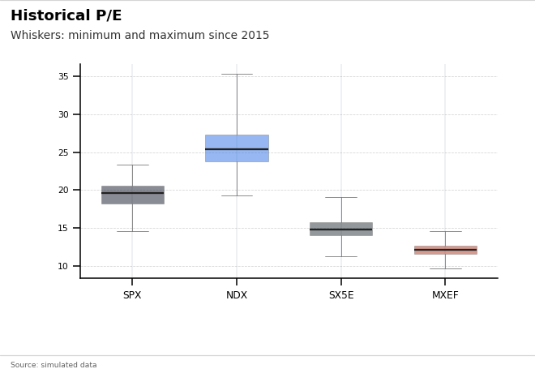
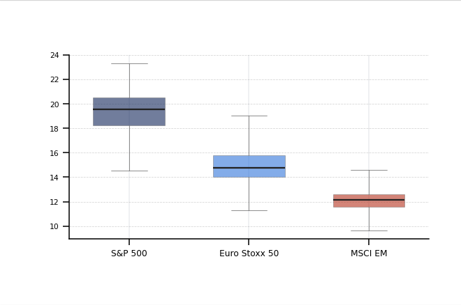
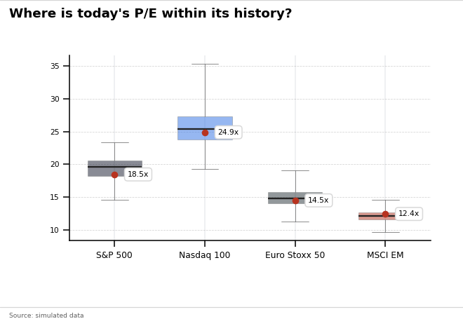
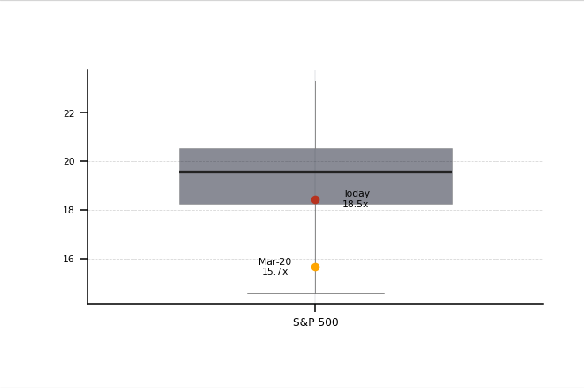
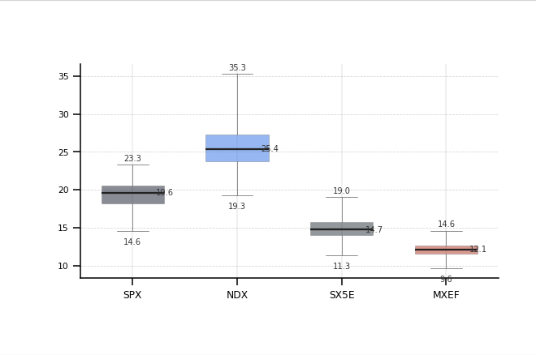
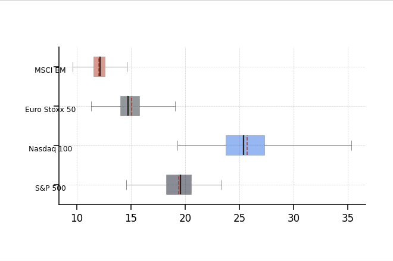

# Box & Whiskers: `graph_box_whiskers`

`graph_box_whiskers()` draws one **box per column** to show the historical distribution of each series: median, quartiles and range. It is typically used for **relative valuation** (P/E, EV/EBITDA), yields or spreads, adding a marker for the **last observation** so you can see where today sits within its own history.

---

## Expected DataFrame

Every column is a series (one box). The index is only used to *locate observations* when you want to highlight one (for example the last date).

```python
import numpy as np
import pandas as pd
import helpers_ps as hp

hp.set_graph_theme()
rng = np.random.default_rng(11)

dates = pd.bdate_range("2015-01-01", periods=2500)

def ar1(mean, sd, n, phi=0.995):
    """Mean-reverting series, similar to a valuation multiple."""
    x = np.empty(n)
    x[0] = mean
    for t in range(1, n):
        x[t] = mean + phi * (x[t - 1] - mean) + rng.normal(0, sd)
    return x

pe = pd.DataFrame(
    {
        "SPX": ar1(19, 0.25, len(dates)),
        "NDX": ar1(25, 0.35, len(dates)),
        "SX5E": ar1(14, 0.15, len(dates)),
        "MXEF": ar1(12, 0.12, len(dates)),
    },
    index=dates,
)
```

```python
pe.describe().round(1).loc[["min", "25%", "50%", "75%", "max"]]
```
**Output**

```text
      SPX   NDX  SX5E  MXEF
min  14.6  19.3  11.3   9.6
25%  18.2  23.8  14.0  11.5
50%  19.6  25.4  14.7  12.1
75%  20.5  27.3  15.8  12.6
max  23.3  35.3  19.0  14.6
```

---

## Basic example

```python
g = (
    hp.GraphMtplt(pe)
    .graph_box_whiskers()
    .config_yaxis(fmt=".0f")
    .horizontal_guides(mostrar_cero=False)
    .add_title("Historical P/E")
    .add_subtitle("Whiskers: minimum and maximum since 2015")
    .add_source("Source: simulated data")
)
```


By default the whiskers reach the **minimum and maximum** (`whis=(0, 100)`) and outliers are not drawn. To use the classic 1.5 x IQR rule pass `box_config={"whis": 1.5, "showfliers": True}`.

---

## Labels, colors and a subset of series

`series` selects the columns, their order, display names and colors:

```python
g = (
    hp.GraphMtplt(pe)
    .graph_box_whiskers(
        series=[
            {"ticker": "SPX", "label": "S&P 500", "color": "#12275A"},
            {"ticker": "SX5E", "label": "Euro Stoxx 50", "color": "#3075DB"},
            {"ticker": "MXEF", "label": "MSCI EM", "color": "#B7331F"},
        ],
        box_face_alpha=0.6,
    )
    .config_yaxis(fmt=".0f")
    .horizontal_guides(mostrar_cero=False)
)
```


---

## Highlight the last observation

Each series takes a `tag` **list**. Every item of the list is a *reference* made of:

- `x_values`: which observations of the DataFrame (`"last"`, `"all"`, an index value or a list of them),
- `dot`: the marker (arguments of [`dot()`](../annotations.md#dot)),
- `tag`: the text label (arguments of [`tag()`](../annotations.md#tag)); its text template goes in the key `label`.

Set `dot` or `tag` to `None` (or omit it) to draw only the other element.

```python
def last_value(ticker, label, color="#B7331F"):
    return {
        "ticker": ticker,
        "label": label,
        "tag": [{
            "x_values": "last",
            "dot": {"color": color, "size": 40, "zorder": 8},
            "tag": {
                "label": "{y_value:.1f}x",
                "ubic_etq": (22, 0),
                "fontsize": 7,
                "bg_color": "white",
                "edge_color": "#D9D9D9",
                "show_bbox": True,
            },
        }],
    }

g = (
    hp.GraphMtplt(pe)
    .graph_box_whiskers(series=[
        last_value("SPX", "S&P 500"),
        last_value("NDX", "Nasdaq 100"),
        last_value("SX5E", "Euro Stoxx 50"),
        last_value("MXEF", "MSCI EM"),
    ])
    .config_yaxis(fmt=".0f")
    .horizontal_guides(mostrar_cero=False)
    .add_title("Where is today's P/E within its history?")
    .add_source("Source: simulated data")
)
```


Fields available in `label` templates: `{ticker}`, `{label}`, `{x_value}` (the date), `{y_value}` / `{value}` and `{statistic}`.

A specific date works too, with the date as a string. Several references can live in the same `tag` list:

```python
g = (
    hp.GraphMtplt(pe)
    .graph_box_whiskers(series=[
        {
            "ticker": "SPX",
            "label": "S&P 500",
            "tag": [
                {"x_values": "2020-03-23", "dot": {"color": "orange", "size": 40, "zorder": 8},
                 "tag": {"label": "{x_value:%b-%y}\n{y_value:.1f}x", "ubic_etq": (-30, 0), "fontsize": 7}},
                {"x_values": "last", "dot": {"color": "#B7331F", "size": 40, "zorder": 8},
                 "tag": {"label": "Today\n{y_value:.1f}x", "ubic_etq": (30, 0), "fontsize": 7}},
            ],
        },
    ])
    .config_yaxis(fmt=".0f")
    .horizontal_guides(mostrar_cero=False)
)
```


---

## Label the statistics of the box

Use `mode="statistic"` (or simply give `statistic`) to annotate calculated values instead of observations. Available statistics: `"low"`, `"high"` (the whisker ends), `"mean"`, `"median"`, `"q1"`, `"q3"`.

```python
def stat_ref(statistic, text, offset):
    return {
        "statistic": statistic,
        "tag": {"label": text, "ubic_etq": offset, "fontsize": 6.5, "font_color": "#333333"},
    }

g = (
    hp.GraphMtplt(pe)
    .graph_box_whiskers(series=[
        {
            "ticker": ticker,
            "tag": [
                stat_ref("high", "{y_value:.1f}", (0, 5)),
                stat_ref("median", "{y_value:.1f}", (26, 0)),
                stat_ref("low", "{y_value:.1f}", (0, -9)),
            ],
        }
        for ticker in pe.columns
    ])
    .config_yaxis(fmt=".0f")
    .horizontal_guides(mostrar_cero=False)
)
```


!!! info "`q1` and `q3`"
    The quartiles are calculated from the data and the whiskers follow `whis`. If you change `whis`, the `low` / `high` statistics follow the same rule as the drawn whiskers.

---

## Mean line, notch and horizontal boxes

`box_config` is passed to `Axes.boxplot`; the most useful keys are:

| Key | Default | Description |
|---|---|---|
| `whis` | `(0, 100)` | Whisker rule: percentiles tuple or a multiple of the IQR. |
| `showfliers` | `False` | Draw outliers. |
| `showmeans`, `meanline` | `False` | Show the mean (as a marker or, with `meanline`, as a line). |
| `widths` | `0.6` | Width of the boxes. |
| `notch` | `False` | Notched boxes. |
| `vert` | `True` | `False` = horizontal boxes. |

```python
g = (
    hp.GraphMtplt(pe)
    .graph_box_whiskers(
        box_config={"vert": False, "showmeans": True, "meanline": True, "widths": 0.5},
        mean_style={"color": "#B7331F", "linestyle": "--", "linewidth": 1.0},
        series=[
            {"ticker": "SPX", "label": "S&P 500"},
            {"ticker": "NDX", "label": "Nasdaq 100"},
            {"ticker": "SX5E", "label": "Euro Stoxx 50"},
            {"ticker": "MXEF", "label": "MSCI EM"},
        ],
    )
    .horizontal_guides(mostrar_cero=False)
    .vertical_guides()
)
```


---

## Styling the parts of the box

| Parameter | What it styles | Default |
|---|---|---|
| `box_style` | Box border | `{"color": "#6E6E6E", "linewidth": 0.5}` |
| `median_style` | Median line | `{"color": "#222222", "linewidth": 1.5}` |
| `whisker_style` | Whiskers | `{"color": "#6E6E6E", "linewidth": 0.5}` |
| `cap_style` | Whisker caps | `{"color": "#6E6E6E", "linewidth": 0.5}` |
| `flier_style` | Outliers | gray circles |
| `mean_style` | Mean marker / line | `{"color": "#404040", "linewidth": 0.5, "linestyle": "--"}` |
| `box_face_alpha` | Opacity of the box fill | `0.50` |

Each dictionary is **merged over** the default (you only pass what you want to change).

---

## Parameters

| Parameter | Default | Description |
|---|---|---|
| `series` | all numeric columns | List of dicts / `BoxSeriesConfig`: `ticker`, `label`, `color`, `tag`. |
| `df_index` | `0` | DataFrame of the object to use. |
| `box_config` | see above | Keyword arguments of `Axes.boxplot`. |
| `box_style`, `median_style`, `whisker_style`, `cap_style`, `flier_style`, `mean_style` | see above | Matplotlib property dictionaries. |
| `box_face_alpha` | `0.50` | Fill opacity. |
| `x_axis` | `None` | Category labels: `fontsize`, `rotation`, `ha`, `label_color`, `tick_labels`, `tick_label_map`. See [Axes](../axes.md#x-axis). |

Full signature: [API reference](../../api/GraphMtplt/graphs.md#box-whiskers-graph).

---

## Typical use cases

- Historical P/E, EV/EBITDA or P/B ratios (with the last value highlighted).
- Historical yields and credit spreads.
- Margin, volatility or drawdown distributions.
- Relative valuation across indices, sectors or countries.
