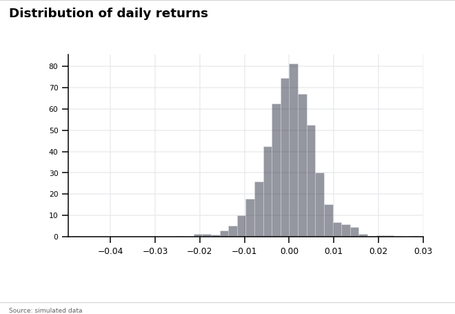
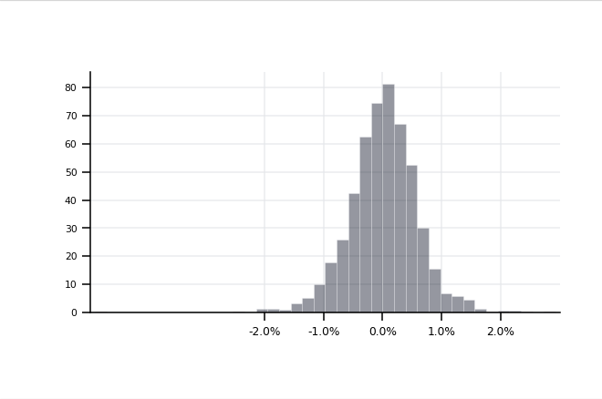
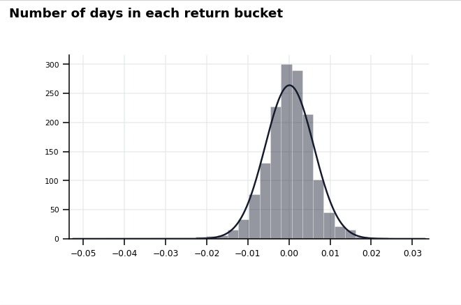
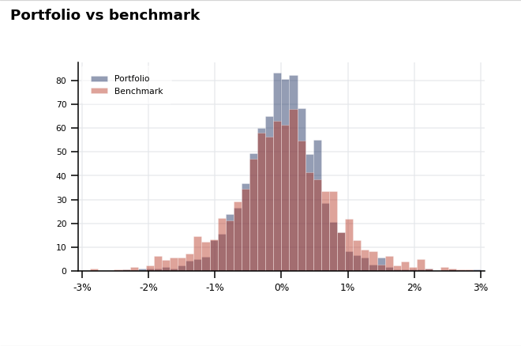
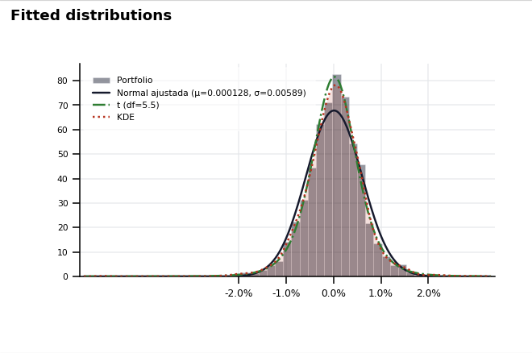
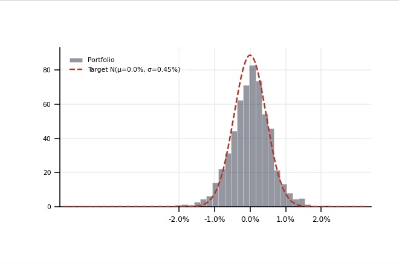
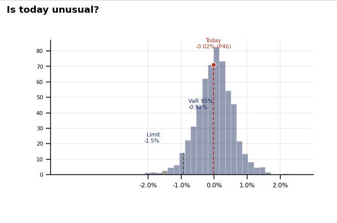
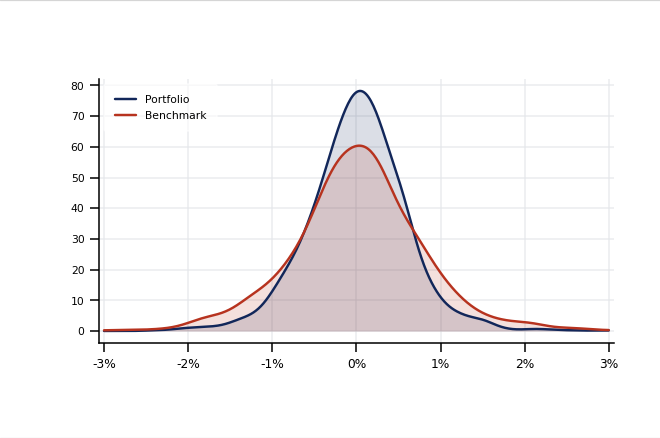

# Distribution chart: `graph_dist`

`graph_dist()` draws a **histogram** of one or more series and can overlay **probability curves**: curves of a *known* distribution (you provide the parameters) and curves *fitted* to the data (parameters estimated from it, or a kernel density estimate). It can also **highlight references** on the distribution: the last observation, a specific date, a literal value (e.g. a VaR) or a statistic (mean, median, percentiles).

Typical question it answers: *"Is today's return / spread / multiple unusual compared with its own history?"*

---

## Expected DataFrame

Each column is a series, and **its values** form the distribution. The index is only used to find observations ("last", a date) when you want to highlight them.

```python
import numpy as np
import pandas as pd
import helpers_ps as hp

hp.set_graph_theme()
rng = np.random.default_rng(3)

dates = pd.bdate_range("2019-01-02", periods=1500)
returns = pd.DataFrame(
    {
        "Portfolio": rng.standard_t(5, len(dates)) * 0.0045 + 0.0004,
        "Benchmark": rng.standard_t(5, len(dates)) * 0.0060 + 0.0003,
    },
    index=dates,
)
```

```python
returns.describe().round(4).loc[["count", "mean", "std", "min", "max"]]
```
**Output**

```text
       Portfolio  Benchmark
count  1500.0000  1500.0000
mean      0.0001     0.0003
std       0.0059     0.0081
min      -0.0487    -0.0340
max       0.0292     0.0513
```

---

## Basic histogram

```python
g = (
    hp.GraphMtplt(returns)
    .graph_dist(series=[{"ticker": "Portfolio", "label": "Portfolio daily returns"}], bins=40)
    .config_yaxis(fmt=".0f")
    .add_title("Distribution of daily returns")
    .add_source("Source: simulated data")
)
```


By default the y-axis is a **density** (area = 1). With `x_axis={"fmt": ".1%"}` the values of the distribution axis (the x-axis) are shown as percentages, and `tick_values` chooses the tick positions.

```python
g = (
    hp.GraphMtplt(returns)
    .graph_dist(
        series=[{"ticker": "Portfolio"}],
        bins=40,
        x_axis={"fmt": ".1%", "tick_values": [-0.02, -0.01, 0, 0.01, 0.02]},
    )
    .config_yaxis(fmt=".0f")
)
```


!!! note "`tick_step` on a distribution axis"
    On a distribution axis `tick_step` is expressed in **axis units** and must be an **integer** (e.g. `tick_step=10` for a spread in basis points). For fractional steps, as with returns, list the ticks in `tick_values`.

---

## Count or probability instead of density

`stat` accepts `"density"` (default), `"count"` or `"probability"` (the bar heights sum to 1). Curves are rescaled to the same unit.

```python
g = (
    hp.GraphMtplt(returns)
    .graph_dist(series=[{"ticker": "Portfolio"}], bins=30, stat="count", fit="norm")
    .config_yaxis(fmt=",.0f")
    .add_title("Number of days in each return bucket")
)
```


---

## Compare two distributions

With several series, `common_bins=True` (default) uses the **same bin edges** so the bars are comparable. The histogram transparency is `hist_alpha` (default `0.45`).

```python
g = (
    hp.GraphMtplt(returns)
    .graph_dist(
        series=[
            {"ticker": "Portfolio", "color": "#12275A"},
            {"ticker": "Benchmark", "color": "#B7331F"},
        ],
        bins=50,
        x_range=(-0.03, 0.03),
        x_axis={"fmt": ".0%"},
    )
    .config_yaxis(fmt=".0f")
    .add_legend()
    .add_title("Portfolio vs benchmark")
)
```


`x_range=(min, max)` restricts the **data** used (values outside are ignored); either side can be `None`.

---

## Curves: `fit` and `known`

| Argument | Meaning | Where parameters come from |
|---|---|---|
| `fit` | Curves **estimated from each series** (`"norm"`, `"t"`, `"lognorm"`, ... any `scipy.stats` name, or `"kde"`). | Estimated from the data. |
| `known` | Curves of a **known distribution** you specify. | You provide `params`. |

Both accept a name, a dictionary, a `DistCurveConfig`, or a **list mixing them**. Examples:

```python
g = (
    hp.GraphMtplt(returns)
    .graph_dist(
        series=[{"ticker": "Portfolio"}],
        bins=45,
        fit=[
            "norm",
            {"dist": "t", "color": "#2E7D32", "linestyle": "-.", "label_template": "t (df={df:.1f})"},
            {"dist": "kde", "fill": True, "color": "#B7331F", "label_template": "KDE"},
        ],
        x_axis={"fmt": ".1%", "tick_values": [-0.02, -0.01, 0, 0.01, 0.02]},
    )
    .config_yaxis(fmt=".0f")
    .add_legend()
    .add_title("Fitted distributions")
)
```


A **known** curve is useful for the "what the model assumes" comparison, e.g. a normal with the *target* volatility of a mandate:

```python
g = (
    hp.GraphMtplt(returns)
    .graph_dist(
        series=[{"ticker": "Portfolio"}],
        bins=45,
        known={
            "dist": "norm",
            "params": {"loc": 0.0, "scale": 0.0045},
            "color": "#B7331F",
            "linestyle": "--",
            "label_template": "Target N(μ={mu:.1%}, σ={sigma:.2%})",
        },
        x_axis={"fmt": ".1%", "tick_values": [-0.02, -0.01, 0, 0.01, 0.02]},
    )
    .config_yaxis(fmt=".0f")
    .add_legend()
)
```


### Curve options

| Key | Description |
|---|---|
| `dist` | `scipy.stats` name (`"norm"`, `"t"`, `"lognorm"`...) or `"kde"` (only in `fit`). In `known` it can also be a frozen scipy distribution or a callable `pdf(x)`. |
| `params` | *(known)* dict (`{"loc": 0, "scale": 1}`) or tuple of positional parameters. Omitted = scipy defaults. |
| `fit_kwargs` | *(fit)* extra arguments of `dist.fit`, e.g. `{"floc": 0}`. |
| `bw_method` | *(kde)* bandwidth rule or factor. |
| `color`, `linewidth` (`lw`), `linestyle` (`ls`), `alpha`, `zorder` | Line style. |
| `label` / `label_template` | Fixed legend text, or a template with `{series}`, `{ticker}`, `{dist}`, `{dist_key}`, `{kind}`, `{params}`, `{n}`, every parameter by name (`{loc}`, `{scale}`, `{df}`...), `{mu}`, `{sigma}` and `{bandwidth}` (kde). |
| `legend` | `False` hides the curve from the legend. |
| `param_fmt`, `param_sep` | Format and separator used by `{params}` (defaults `".3g"` and `", "`). |
| `fill` | `True` or `{"color", "alpha", "zorder", "hatch"}`. |
| `line_kwargs` | Any extra `Axes.plot` argument. |

The same curve can be written with the dataclass:

```python
from helpers_ps.MtpltGraph.models import DistCurveConfig

fit=[DistCurveConfig("t", color="#2E7D32", linestyle="-."), DistCurveConfig("kde", fill=True)]
```

!!! note "Default legend names are in Spanish"
    Fitted / theoretical curves get an automatic legend such as `Normal ajustada (μ=..., σ=...)` (`{kind}` is `ajustada` or `teórica`). Use `label` or `label_template` to write your own text.

!!! tip "One default for every series"
    `fit` and `known` set at function level apply to **every** series that does not define its own. Inside a series, `fit=[]` / `known=[]` disables them for that series only.

---

## Highlight references (VaR, last return, percentiles)

Each series accepts a `tag` **list**. Every item is a reference that can draw a vertical **line**, a text **tag** and a **dot** (`show` combines `"line"`, `"tag"` and `"dot"`, e.g. `"line_tag"`, `"line_tag_dot"`).

A reference is selected with one of three `mode`s (inferred if omitted):

| `mode` | Key | Meaning |
|---|---|---|
| `"observation"` | `x_values` | The value the series takes at `"last"`, `"first"` or any index label (a date). |
| `"value"` | `value` | A literal number (or list) on the distribution axis, e.g. a VaR you computed. |
| `"statistic"` | `statistic` | `"mean"`, `"median"`, `"q1"`, `"q3"`, `"min"`, `"max"` or a percentile `"p5"`, `"p95"` (any `p<N>`, 0-100). Accepts a list. |

Template fields (`template`, `legend_label`): `{ticker}`, `{label}`, `{x_value}`, `{value}` (`{y_value}`), `{statistic}`, `{percentile}` (empirical rank 0-100), `{zscore}` and `{density}`. Default template: `"{value:,.4g}\nP{percentile:.0f}"`.

```python
g = (
    hp.GraphMtplt(returns)
    .graph_dist(
        series=[{
            "ticker": "Portfolio",
            "label": "Daily return",
            "color": "#12275A",
            "tag": [
                # last observation of the series, with its percentile
                {
                    "x_values": "last",
                    "show": "line_tag_dot",
                    "template": "Today\n{value:.2%} (P{percentile:.0f})",
                    "line": {"color": "#B7331F", "linewidth": 1.2},
                    "dot": {"color": "#B7331F", "size": 35},
                    "tag": {"font_color": "#B7331F", "fontsize": 7, "ubic_etq": (0, 20)},
                },
                # the 5th percentile (historical 95% VaR)
                {
                    "statistic": "p5",
                    "show": "line_tag",
                    "template": "VaR 95%\n{value:.2%}",
                    "line": {"color": "#555555", "linestyle": "--"},
                    "tag": {"fontsize": 7, "ubic_etq": (6, 55), "label_h_align": "left"},
                },
                # a literal value: the mandate's loss limit
                {
                    "value": -0.015,
                    "show": "line_tag",
                    "template": "Limit\n{value:.1%}",
                    "line": {"color": "#C9A227"},
                    "tag": {"fontsize": 7, "ubic_etq": (-6, 35), "label_h_align": "right"},
                },
            ],
        }],
        bins=45,
        x_axis={"fmt": ".1%", "tick_values": [-0.02, -0.01, 0, 0.01, 0.02]},
    )
    .config_yaxis(fmt=".0f")
    .add_title("Is today unusual?")
)
```


Reference options:

| Key | Default | Description |
|---|---|---|
| `mode`, `x_values`, `value`, `statistic` | inferred | Selection (see above). |
| `show` | `"line_tag"` | Combination of `line`, `tag`, `dot`. |
| `template`, `legend_label` | see above | Text of the tag / legend entry. |
| `y_from` | `"auto"` | Height used to anchor dots and tags: `"hist"` (bar height), `"curve"` (first curve) or `"auto"`. |
| `line` | none | `extent` (`"curve"` or `"top"`), `color`, `linestyle`, `linewidth`, `alpha`, `zorder`. |
| `tag` | none | Arguments of [`tag()`](../annotations.md#tag). |
| `dot` | none | Arguments of [`dot()`](../annotations.md#dot). |

---

## Only the curves

`hist=False` hides the histogram of a series (at least one curve is then required). It is a clean way to compare shapes:

```python
g = (
    hp.GraphMtplt(returns)
    .graph_dist(
        series=[
            {"ticker": "Portfolio", "hist": False, "color": "#12275A"},
            {"ticker": "Benchmark", "hist": False, "color": "#B7331F"},
        ],
        fit=[{"dist": "kde", "fill": True, "label_template": "{series}"}],
        x_range=(-0.03, 0.03),
        x_axis={"fmt": ".0%"},
    )
    .config_yaxis(fmt=".0f")
    .add_legend()
)
```


---

## Parameters

| Parameter | Default | Description |
|---|---|---|
| `series` | all numeric columns | List of dicts / `DistSeriesConfig`: `ticker`, `label`, `color`, `hist`, `known`, `fit`, `tag`. |
| `df_index` | `0` | DataFrame to use. |
| `bins` | `"auto"` | Anything accepted by `numpy.histogram_bin_edges`: an integer, a rule (`"auto"`, `"fd"`) or explicit edges. |
| `stat` | `"density"` | `"density"`, `"count"` or `"probability"`. |
| `common_bins` | `True` | Same bin edges for all series. |
| `hist_alpha`, `hist_edgecolor`, `hist_linewidth` | `0.45`, `"white"`, `0.4` | Bar style. |
| `hist_style` | `None` | Extra `Axes.hist` arguments, e.g. `{"histtype": "step"}`. |
| `known`, `fit` | `None` | Default curves for all series. |
| `curve_points` | `400` | Resolution of the curves (>= 20). |
| `x_range` | `None` | `(min, max)` of the data used. |
| `lw` | `1.6` | Default width of curves. |
| `x_axis` | `None` | Distribution-axis format: `fmt`, `tick_step` (integer, axis units), `tick_values`, `tick_labels`, `fontsize`, `rotation`, `lim`... plus `fontweight`, `fontstyle`, `tick_color`, `spine_color`, `axis_label`, `axis_label_fontsize`, `axis_label_color` when passed as a dictionary. `bbg_format` is not allowed. |

Full signature: [API reference](../../api/GraphMtplt/graphs.md#distribution-graph).

---

## Typical use cases

- Distribution of daily / monthly returns with VaR and the last observation.
- Tracking error or active-return distribution against a limit.
- Historical distribution of a spread, multiple or yield with today's percentile.
- Comparing return distributions of two strategies.
