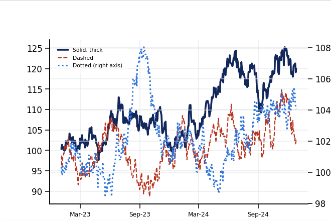
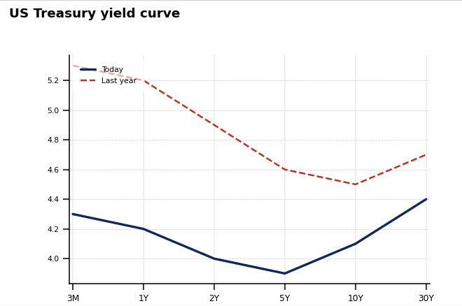

# Line chart: parameters and series options

This page is the quick reference of `graph_line()`. For step-by-step examples see the [Line chart notebook](graph.ipynb).

```python
import numpy as np
import pandas as pd
import helpers_ps as hp

hp.set_graph_theme()

rng = np.random.default_rng(42)
dates = pd.bdate_range("2023-01-02", periods=520)
rets = rng.normal([0.0004, 0.0006, 0.0002], [0.009, 0.013, 0.004], size=(len(dates), 3))
prices = pd.DataFrame(
    100 * np.exp(rets.cumsum(axis=0)),
    index=dates,
    columns=["SPX", "NDX", "AGG"],
)
```

---

## Method parameters

| Parameter | Default | Description |
|---|---|---|
| `series` | all columns | List of dictionaries / `LineSeriesConfig` (see below). |
| `df_index` | `0` | DataFrame of the object to use. |
| `lw` | `1.6` | Default line width. A series can override it with its own `lw`. |
| `x_axis` | `None` | X-axis settings: [Axes](../axes.md#x-axis). |

---

## Series keys

| Key | Default | Description |
|---|---|---|
| `ticker` | required | Column of the DataFrame. Each column may be used only once. |
| `label` | the `ticker` | Name in the legend and in tag templates (`{label}`). |
| `color` | next palette color | Any Matplotlib color (`"#12275A"`, `"red"`). |
| `axis_side` | `"left"` | `"left"` or `"right"`: series of the right side share a secondary y-axis. |
| `lw` | method `lw` | Line width of this series. |
| `linestyle` | `"-"` | `"-"`, `"--"`, `"-."`, `":"` (or `solid`, `dashed`, `dashdot`, `dotted`) or a dash tuple such as `(0, (5, 2))`. |
| `tags` | `None` | List of annotations: [Annotations](../annotations.md#tags-declared-inside-a-line-series). |

```python
g = (
    hp.GraphMtplt(prices)
    .graph_line(
        series=[
            {"ticker": "SPX", "label": "Solid, thick", "color": "#12275A", "lw": 2.4},
            {"ticker": "NDX", "label": "Dashed", "color": "#B7331F", "linestyle": "--"},
            {"ticker": "AGG", "label": "Dotted (right axis)", "color": "#3075DB", "linestyle": ":", "axis_side": "right", "lw": 2},
        ],
        lw=1.4,
    )
    .add_legend()
)
```


---

## Index types

| Index | Behavior |
|---|---|
| `DatetimeIndex` | Time axis (see `bbg_format` to remove non-trading gaps). |
| Numeric | Numeric axis (points are placed at their numeric value): strikes, durations or any `x` vs `y` curve. |
| Text | Categorical axis (equally spaced positions `0, 1, 2...`), e.g. maturity labels. |

A **yield curve** is a line chart with a text (categorical) index; `tick_step=1` prints every maturity:

```python
curve = pd.DataFrame(
    {"Today": [4.3, 4.2, 4.0, 3.9, 4.1, 4.4], "Last year": [5.3, 5.2, 4.9, 4.6, 4.5, 4.7]},
    index=["3M", "1Y", "2Y", "5Y", "10Y", "30Y"],   # maturities as text
)

g = (
    hp.GraphMtplt(curve)
    .graph_line(
        series=[{"ticker": "Today", "color": "#12275A", "lw": 2.2}, {"ticker": "Last year", "color": "#B7331F", "linestyle": "--"}],
        x_axis={"tick_step": 1},
    )
    .config_yaxis(fmt=".1f")
    .horizontal_guides(mostrar_cero=False)
    .add_legend()
    .add_title("US Treasury yield curve")
)
```


---

## Typical use cases

- Equity indices, FX rates and commodities.
- Rates, yields and spreads (with the right axis for a second scale).
- Cumulative portfolio performance vs benchmark.
- Drawdowns and rolling statistics (see [Calcs](../../Calcs/getting_started.md)).
- Yield curves and any curve with a numeric x-axis.
