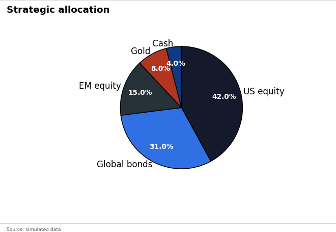
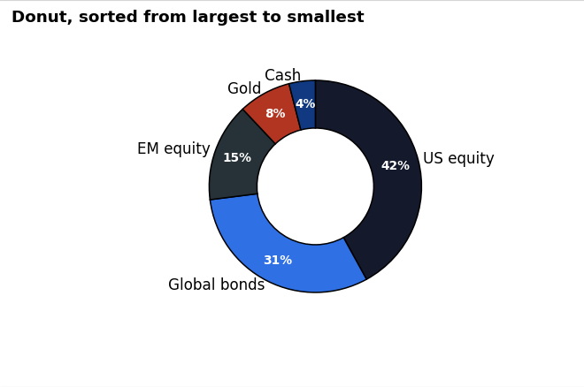
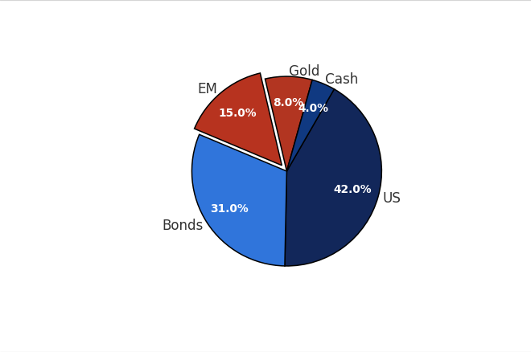
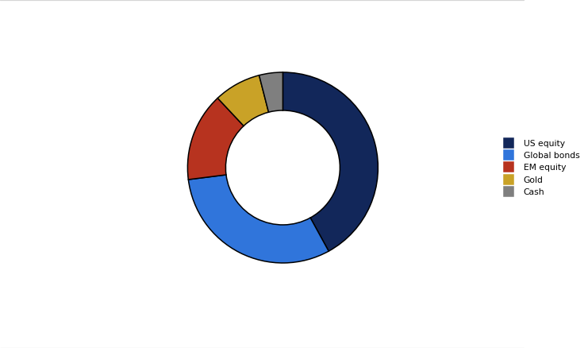
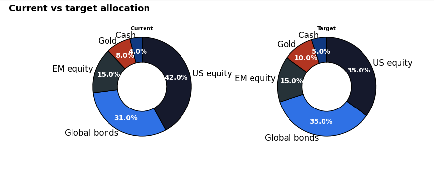

# Pie chart: `graph_pie`

`graph_pie()` draws a **pie or donut chart** from one column of values. The **index holds the categories** (slice names) and the column holds the weights. Use it for a snapshot in time: asset allocation, sector, country, currency or rating distribution.

---

## Expected DataFrame

```python
import pandas as pd
import helpers_ps as hp

hp.set_graph_theme()

weights = pd.DataFrame(
    {"Weight": [0.42, 0.31, 0.15, 0.08, 0.04]},
    index=["US equity", "Global bonds", "EM equity", "Gold", "Cash"],
)
```

```python
weights
```
**Output**

```text
              Weight
US equity       0.42
Global bonds    0.31
EM equity       0.15
Gold            0.08
Cash            0.04
```

- The index values are the **categories**; it must be unique.
- Values cannot be negative and at least one must be greater than zero.
- If the DataFrame has **one column**, `ticker` can be omitted. With several columns, pass `ticker="ColumnName"`.

!!! tip "A time series? Take a snapshot first"
    `graph_pie()` does not select dates. To chart the weights at the last date of a wide DataFrame (`index` = dates, one column per asset), transpose the row you want:

    ```python
    snapshot = wide_df.iloc[[-1]].T      # index = assets, one column = last date
    hp.GraphMtplt(snapshot).graph_pie()
    ```

---

## Basic pie

```python
g = (
    hp.GraphMtplt(weights)
    .graph_pie()
    .add_title("Strategic allocation")
    .add_source("Source: simulated data")
)
```


By default the first slice starts at 12 o'clock and the others follow clockwise (`startangle=90`, `counterclock=False`) and percentages are printed with one decimal (`autopct="%1.1f%%"`).

---

## Donut

`donut_width` (0-1) is the width of the ring as a fraction of the radius: `1` is a full pie, smaller values give a thinner ring.

```python
g = (
    hp.GraphMtplt(weights)
    .graph_pie(donut_width=0.45, sort_values=True, pctdistance=0.78, autopct="%1.0f%%")
    .add_title("Donut, sorted from largest to smallest")
)
```


---

## Labels, colors and exploded slices

`labels`, `colors` and `explode` accept a **list** (same order as the index) or a **dictionary** keyed by category. A single color string paints every slice; a short list of colors repeats cyclically.

```python
g = (
    hp.GraphMtplt(weights)
    .graph_pie(
        labels={"US equity": "US", "Global bonds": "Bonds", "EM equity": "EM"},   # missing keys keep the index name
        colors={"US equity": "#12275A", "Global bonds": "#3075DB", "EM equity": "#B7331F"},
        explode={"EM equity": 0.08},
        startangle=60,
        label_color="#333333",
    )
)
```


---

## Hide percentages or category names

`autopct=None` removes the percentages and `labeldistance=None` removes the category names from the chart. Names are then usually shown in a legend. Pie slices do not feed the automatic legend, so register one marker per category with `add_legend_point()` and then call `add_legend()`:

```python
palette = {
    "US equity": "#12275A",
    "Global bonds": "#3075DB",
    "EM equity": "#B7331F",
    "Gold": "#C9A227",
    "Cash": "#7F7F7F",
}

g = hp.GraphMtplt(weights).graph_pie(
    colors=palette,
    autopct=None,
    labeldistance=None,
    donut_width=0.4,
)

for name, color in palette.items():
    g.add_legend_point(label=name, color=color, marker="s", markersize=8)

g.add_legend(loc="center left", bbox_to_anchor=(1.0, 0.5))
```


---

## Several pies in one figure

Use `plot()` to create the grid and `axis()` to select each panel. Every panel can use a different DataFrame of the list:

```python
current = weights
target = pd.DataFrame(
    {"Weight": [0.35, 0.35, 0.15, 0.10, 0.05]},
    index=weights.index,
)

g = (
    hp.GraphMtplt([current, target])
    .plot(ncols=2, figsize=(8, 4))
    .add_title("Current vs target allocation")
    .axis(0).graph_pie(df_index=0, donut_width=0.5).add_plot_title("Current")
    .axis(1).graph_pie(df_index=1, donut_width=0.5).add_plot_title("Target")
)
```


!!! warning "Call `add_title()` before `add_plot_title()`"
    `add_title()` clears the title of the **active** axis. If you call it after `add_plot_title()`, the title of that panel disappears.

---

## Parameters

| Parameter | Default | Description |
|---|---|---|
| `ticker` | `None` | Column to plot. Optional when the DataFrame has one column. |
| `df_index` | `0` | DataFrame of the object to use. |
| `labels` | index names | List or dict of display names. |
| `colors` | palette | List, dict or a single color. |
| `explode` | `None` | Offset of slices: number, list or dict (non-negative). |
| `donut_width` | `None` | `None` = full pie; `0 < w <= 1` = donut. |
| `startangle` | `90` | Angle of the first slice. |
| `counterclock` | `False` | Draw slices counterclockwise. |
| `autopct` | `"%1.1f%%"` | Percentage format. `None` hides them. A callable is accepted. |
| `pctdistance` | `0.72` | Radial position of the percentages (`0` center, `1` edge). |
| `labeldistance` | `1.05` | Radial position of the names. `None` hides them. |
| `normalize` | `True` | Rescale values so they sum to 100%. With `False`, values that sum less than 1 draw a partial pie. |
| `sort_values` | `False` | Sort slices from largest to smallest. |
| `textprops`, `wedgeprops` | `None` | Raw Matplotlib dictionaries (`wedgeprops={"edgecolor": "white"}`). |
| `label_color`, `autopct_color`, `autopct_fontweight` | `"black"`, `"white"`, `"bold"` | Text colors / weight. |
| `text_edge_color`, `text_edge_width` | `None`, `0.0` | Outline around the text to improve readability. |

Full signature: [API reference](../../api/GraphMtplt/graphs.md#pie-graph).

---

## Typical use cases

- Asset allocation.
- Sector, geographic or issuer distribution.
- Rating distribution of a fixed income portfolio.
- Currency exposure.
