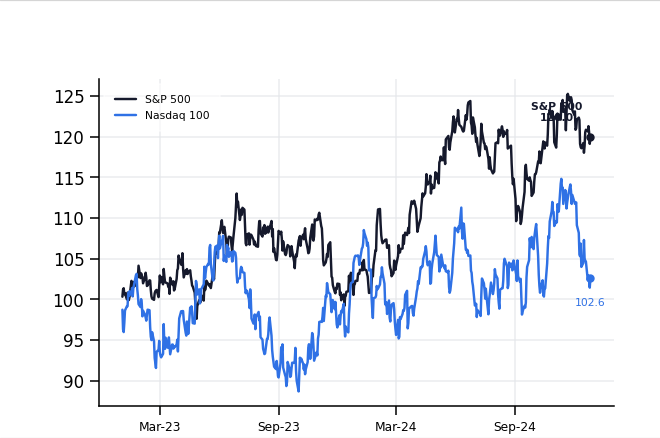
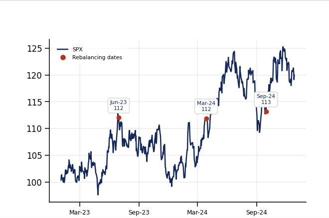
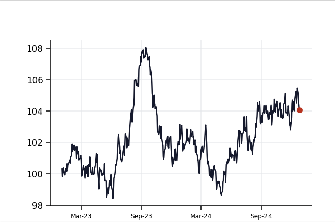
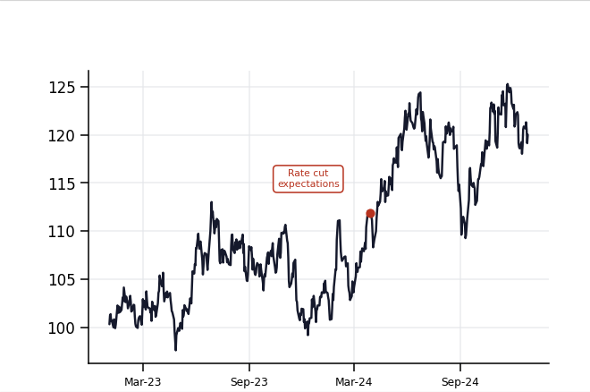
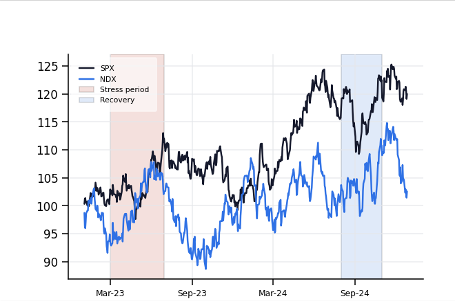
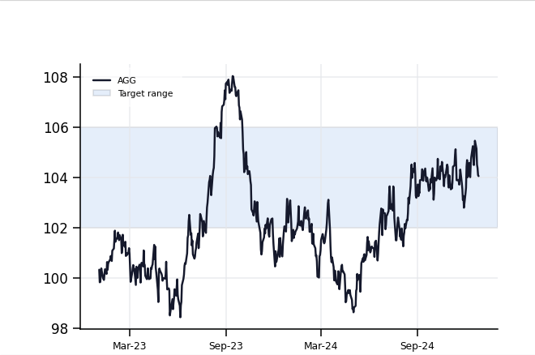

# Annotations: tags, dots and shaded regions

Annotations add emphasis and explanation on top of a chart. There are two ways to use them:

1. **Declared inside a series** (`tags` in `graph_line`, `tag` in `graph_bar`, `graph_box_whiskers` and `graph_dist`). The y-value is looked up for you: this is the recommended way for "last value", "peak" or "a given date".
2. **Free-standing methods** (`tag()`, `dot()`, `shade_x()`, `shade_y()`) when you know the exact coordinates.

```python
import numpy as np
import pandas as pd
import helpers_ps as hp

hp.set_graph_theme()

rng = np.random.default_rng(42)
dates = pd.bdate_range("2023-01-02", periods=520)
rets = rng.normal([0.0004, 0.0006, 0.0002], [0.009, 0.013, 0.004], size=(len(dates), 3))
prices = pd.DataFrame(
    100 * np.exp(rets.cumsum(axis=0)),
    index=dates,
    columns=["SPX", "NDX", "AGG"],
)
```

---

## Tags declared inside a line series

In `graph_line`, each series accepts a `tags` **list**. Each item is one group of annotations:

| Key | Default | Description |
|---|---|---|
| `x_values` | required | `"last"`, one x value or a **list** of x values (dates as strings or `Timestamp`, numbers, categories). |
| `show` | `"tag_dot"` | `"tag"` (text only), `"dot"` (marker only) or `"tag_dot"`. |
| `template` | `"{ticker}\n{x_value:%b-%Y}: {y_value:,.2f}"` | Text, formatted with `{ticker}`, `{label}`, `{x_value}`, `{y_value}`. |
| `tag` | `{}` | Style of the text: arguments of [`tag()`](#tag) (`ubic_etq`, `fontsize`, `fontweight`, `font_color`, `bg_color`, `edge_color`, `show_bbox`...). `font_color` defaults to the series color. |
| `dot` | `{}` | Style of the marker: arguments of [`dot()`](#dot) (`color`, `size`, `zorder`...). `color` defaults to the series color. |
| `legend_label` | `None` | Adds a legend entry for the markers. |

### Last value

```python
g = (
    hp.GraphMtplt(prices)
    .graph_line(series=[
        {
            "ticker": "SPX",
            "label": "S&P 500",
            "tags": [{
                "x_values": "last",
                "template": "{label}\n{y_value:,.1f}",
                "tag": {"ubic_etq": (-22, 16), "fontweight": "bold"},
            }],
        },
        {
            "ticker": "NDX",
            "label": "Nasdaq 100",
            "tags": [{
                "x_values": "last",
                "template": "{y_value:,.1f}",
                "tag": {"ubic_etq": (0, -16)},
            }],
        },
    ])
    .add_legend()
)
```


### Several points, with a legend entry

The y-values of the dates are read from the DataFrame. Pass `pd.Timestamp` objects when the template formats the date (`{x_value:%b-%y}`); a date *string* works to locate the point, but it stays a string and cannot be formatted as a date.

```python
g = (
    hp.GraphMtplt(prices)
    .graph_line(series=[
        {
            "ticker": "SPX",
            "color": "#12275A",
            "tags": [
                {
                    "x_values": [pd.Timestamp("2023-06-30"), pd.Timestamp("2024-03-28"), pd.Timestamp("2024-09-30")],
                    "show": "tag_dot",
                    "template": "{x_value:%b-%y}\n{y_value:,.0f}",
                    "dot": {"color": "#B7331F", "size": 40, "zorder": 8},
                    "tag": {"ubic_etq": (0, 16), "bg_color": "white", "edge_color": "#D9D9D9", "show_bbox": True},
                    "legend_label": "Rebalancing dates",
                },
            ],
        },
    ])
    .add_legend()
)
```


### Dots only

```python
g = (
    hp.GraphMtplt(prices)
    .graph_line(series=[
        {"ticker": "AGG", "tags": [{"x_values": "last", "show": "dot", "dot": {"size": 50, "color": "#B7331F"}}]},
    ])
)
```


!!! tip "Tags in other charts"
    Bars: [`tag`](Bar/graph.md#tags-on-bars) (value labels, centered tags, stack totals). Boxes: [`tag`](Box/graph.md#highlight-the-last-observation) (last observation, statistics). Distributions: [`tag`](Dist/graph.md#highlight-references-var-last-return-percentiles) (last value, percentiles, literal values).

---

## `tag()`

Writes a text at the coordinate `(x_value, y_value)`, optionally inside a rounded box.

| Parameter | Default | Description |
|---|---|---|
| `x_value`, `y_value` | required | Coordinate. For date axes pass a date (string or `Timestamp`); for bar charts with **categories** pass the position `0, 1, 2...`. |
| `label` | required | Text (`\n` for line breaks). |
| `ubic_etq` | `(0, 17)` | Offset `(dx, dy)` **in points** from the coordinate. |
| `label_h_align`, `label_v_align` | `"center"`, `"center"` | Alignment relative to the anchor. |
| `fontsize`, `fontweight`, `font_color` | `7`, `"normal"`, `"black"` | Text style. |
| `show_bbox` | `False` | Draw a rounded box behind the text. |
| `bg_color`, `bg_alpha`, `edge_color` | `"#ECEFF1"`, `1.0`, `"none"` | Box style. |
| `text_edge_color`, `text_edge_width` | `None`, `0.0` | Outline around the letters (readability on busy charts). |
| `zorder` | `6` | Drawing order. |

```python
g = (
    hp.GraphMtplt(prices)
    .graph_line(series=[{"ticker": "SPX"}])
    .tag(
        x_value="2024-03-28",
        y_value=prices.loc["2024-03-28", "SPX"],
        label="Rate cut\nexpectations",
        ubic_etq=(-45, 25),
        show_bbox=True,
        bg_color="white",
        edge_color="#B7331F",
        font_color="#B7331F",
    )
    .dot(x_value="2024-03-28", y_value=prices.loc["2024-03-28", "SPX"], color="#B7331F", size=45)
)
```


---

## `dot()`

Draws a marker (a scatter point) at a coordinate.

| Parameter | Default | Description |
|---|---|---|
| `x_value`, `y_value` | required | Coordinate. |
| `color` | `"red"` | Fill color (`marker_color` overrides it). |
| `size` | `30` | Marker **area** (points²). `markersize` sets the diameter instead. |
| `marker` | `"o"` | Matplotlib marker style (`"s"`, `"^"`, `"D"`...). |
| `marker_edgecolor`, `marker_edgewidth` | `None`, `0.0` | Edge. |
| `alpha`, `zorder`, `clip_on` | `1.0`, `5`, `True` | Opacity, drawing order, clipping. |
| `label`, `legend` | `None`, `True` | Legend text; if `label` is given the dot is added to the legend. |

```python
g.dot(x_value="2024-12-27", y_value=120.0, marker="^", color="green", size=60, label="Buy signal")
```

---

## `shade_x()`: shaded periods

Shades one or more **x ranges** across the full height of the axis: recessions, rate-hiking cycles, events, investment periods.

`periods` can be a single `(start, end)` tuple, a list of tuples, or a list of dictionaries with their own `color`, `alpha`, `label` and `hatch`.

| Parameter | Default | Description |
|---|---|---|
| `periods` | required | `(start, end)`, `[(start, end), ...]` or `[{"start", "end", "color", "alpha", "label", "hatch"}, ...]`. |
| `color`, `alpha` | `"#B0B0B0"`, `0.25` | Default fill. |
| `label` | `None` | Legend label (shown once). |
| `hatch` | `None` | Hatch pattern, e.g. `"//"`. |
| `ymin`, `ymax` | `0.0`, `1.0` | Vertical extent, as fractions of the axis. |
| `zorder` | `0` | Drawing order. |
| `clip_to_xlim` | `True` | Do not extend the axis. |

```python
g = (
    hp.GraphMtplt(prices)
    .graph_line(series=[{"ticker": "SPX"}, {"ticker": "NDX"}])
    .shade_x(
        [
            {"start": "2023-03-01", "end": "2023-06-30", "color": "#B7331F", "alpha": 0.15, "label": "Stress period"},
            {"start": "2024-08-01", "end": "2024-10-31", "color": "#3075DB", "alpha": 0.15, "label": "Recovery"},
        ]
    )
    .add_legend()
)
```


For recessions there is a ready-made helper: [`add_recessions()`](guides.md#recessions).

---

## `shade_y()`: shaded bands

Shades a horizontal band between two y values: target ranges, risk zones, valuation bands.

```python
g = (
    hp.GraphMtplt(prices)
    .graph_line(series=[{"ticker": "AGG"}])
    .shade_y((102, 106), color="#3075DB", alpha=0.12, label="Target range")
    .add_legend()
)
```


| Parameter | Default | Description |
|---|---|---|
| `period` | required | `(lower, upper)` y values. |
| `color`, `alpha`, `zorder`, `label`, `hatch` | as `shade_x` | Style. |
| `xmin`, `xmax` | `0.0`, `1.0` | Horizontal extent, as fractions of the axis. |
| `clip_to_ylim` | `True` | Do not extend the axis. |

---

## Which axis do annotations use?

Annotations go to the **active subplot** (`axis(i)`) and, for charts with two y axes, the series tags of a `"right"` series are drawn on the right axis automatically.

[API reference of annotations](../api/GraphMtplt/annotations.md)
