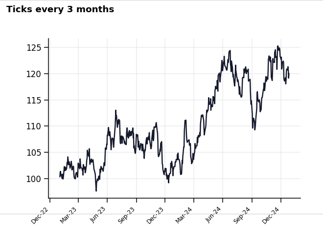
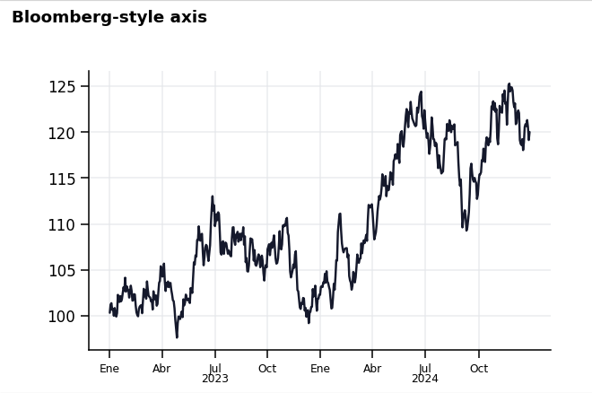
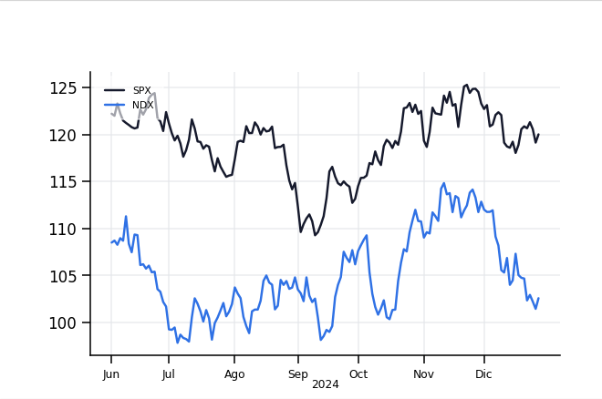
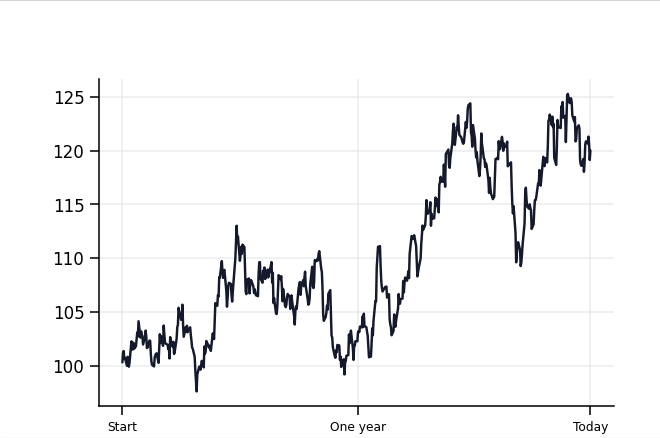
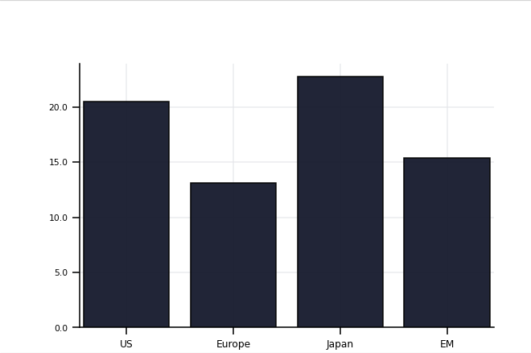
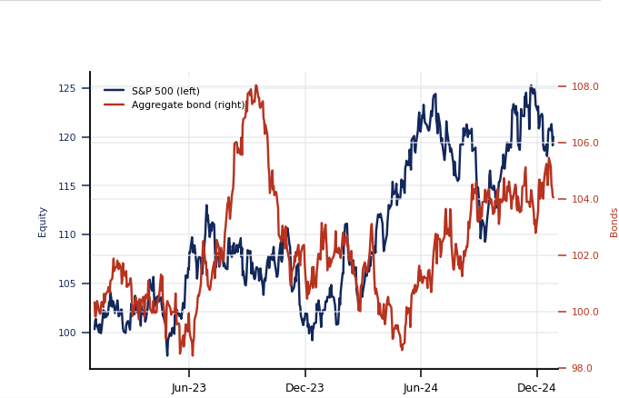
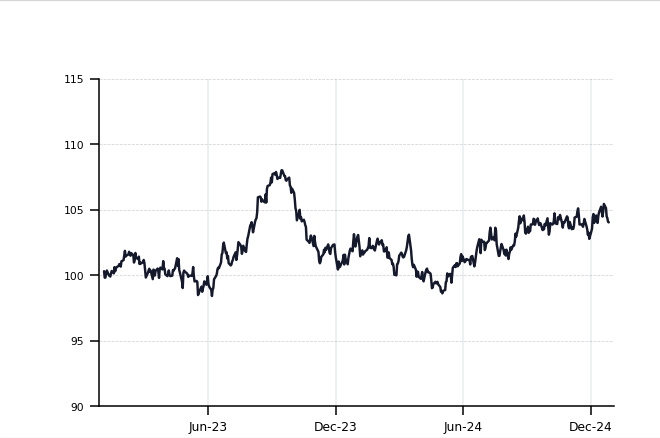

# Axes

Every chart method takes an `x_axis` argument to format the **x-axis**, and the method `config_yaxis()` formats the **y-axes** (left and right). `get_axis()` gives you the raw Matplotlib axis for anything not covered.

```python
import numpy as np
import pandas as pd
import helpers_ps as hp

hp.set_graph_theme()

rng = np.random.default_rng(42)
dates = pd.bdate_range("2023-01-02", periods=520)
rets = rng.normal([0.0004, 0.0006, 0.0002], [0.009, 0.013, 0.004], size=(len(dates), 3))
prices = pd.DataFrame(
    100 * np.exp(rets.cumsum(axis=0)),
    index=dates,
    columns=["SPX", "NDX", "AGG"],
)
```

---

## X axis

`x_axis` is a dictionary (or an `XAxisConfig`). The method that interprets it is `prep_x_axis()` (see the [API reference](../api/GraphMtplt/axes.md)), which looks at the **type of the index** and picks one of four modes:

| Index | Mode | What you get |
|---|---|---|
| `DatetimeIndex` | `datetime` | A real time axis. Ticks every `tick_step` **months**, labels formatted with `fmt` (default `%b-%y`). Weekends are visible as gaps. |
| `DatetimeIndex` + `bbg_format=True` | `bbg` | Bloomberg-style: one position per observation (no gaps), month labels with the year below. `tick_step` counts **months**. |
| Numeric index | `numeric` | Ticks every `tick_step` **observations**, labels with `fmt` (default `",.0f"`). |
| Anything else (text) | `categorical` | One position per category, ticks every `tick_step` **categories**. |

### Options

| Key | Default | Description |
|---|---|---|
| `bbg_format` | `False` | Bloomberg-style axis (dates only). |
| `tick_step` | `6` | Spacing of ticks (see the table above for the unit of each mode). Must be a positive integer. |
| `fmt` | `None` | Format of the labels: `strftime` for dates (`"%b-%y"`, `"%Y"`), a format spec for numbers (`",.0f"`, `".1%"`). |
| `lim` | `None` | `(start, end)` tuple. **Filters the rows** of the DataFrame before drawing. Either side can be `None`. |
| `tick_values` | `None` | Explicit positions of the ticks. Dates, numbers or category names (or positions). |
| `tick_labels` | `None` | Text of each tick (same length as `tick_values`). |
| `tick_label_map` | `None` | Dictionary to rename **some** labels: `{"Jan-24": "Start"}`. |
| `fontsize` | `8` | Label size. |
| `rotation`, `ha`, `va` | `0`, `"center"`, `"top"` | Label rotation and alignment. |
| `label_color` | `None` | Label color. |
| `show_years` | `True` | Year labels under a Bloomberg-style axis. |
| `year_y_offset` | `-0.08` | Vertical position of those year labels. |

### Regular time axis

```python
g = (
    hp.GraphMtplt(prices)
    .graph_line(series=[{"ticker": "SPX"}], x_axis={"fmt": "%b-%y", "tick_step": 3, "rotation": 45, "ha": "right"})
    .add_title("Ticks every 3 months")
)
```


### Bloomberg-style axis

Removes the gaps of non-trading days and prints each year centered below its months. Month names are Spanish abbreviations unless `fmt` is given.

```python
g = (
    hp.GraphMtplt(prices)
    .graph_line(series=[{"ticker": "SPX"}], x_axis={"bbg_format": True, "tick_step": 3})
    .add_title("Bloomberg-style axis")
)
```


### Restrict the period

`lim` removes rows outside the range, so all charts and tags use only that period:

```python
g = (
    hp.GraphMtplt(prices)
    .graph_line(
        series=[{"ticker": "SPX"}, {"ticker": "NDX"}],
        x_axis={"bbg_format": True, "tick_step": 1, "lim": ("2024-06-01", None)},
    )
    .add_legend()
)
```


### Custom ticks and labels

```python
g = (
    hp.GraphMtplt(prices)
    .graph_line(
        series=[{"ticker": "SPX"}],
        x_axis={
            "tick_values": ["2023-01-02", "2024-01-02", "2024-12-27"],
            "tick_labels": ["Start", "One year", "Today"],
        },
    )
)
```


### Categorical axis

For text indexes the ticks are positions (`tick_step=6` by default, so use `1` to show every category). `tick_label_map` renames individual labels:

```python
by_country = pd.DataFrame(
    {"P/E": [20.5, 13.1, 22.8, 15.4]},
    index=["US", "Europe", "Japan", "EM"],
)

g = (
    hp.GraphMtplt(by_country)
    .graph_bar(x_axis={"tick_step": 1, "tick_label_map": {"US": "United States", "EM": "Emerging"}})
    .config_yaxis(fmt=".1f")
)
```


!!! note "Box plots and pies"
    `graph_box_whiskers()` reads `fontsize`, `rotation`, `ha`, `va`, `label_color`, `tick_labels` and `tick_label_map` from `x_axis` to format the names under each box. `graph_dist()` reads `fmt`, `tick_values`, `tick_labels`, `lim`... for its numeric axis (see [Distribution](Dist/graph.md)). `graph_pie()` has no x-axis.

---

## Y axes: `config_yaxis`

`config_yaxis()` acts on the left axis by default or on the right axis with `side="right"`. Calls can be chained: each one configures one side.

| Parameter | Default | Description |
|---|---|---|
| `lim` | `None` | `(min, max)` of the axis. |
| `fmt` | `None` | Number format of the ticks: `",.0f"`, `".1%"`, `",.2f"`. |
| `fontsize` | `7` | Tick label size. |
| `tick_step` | `None` | Fixed spacing between ticks (in axis units). |
| `label`, `label_fontsize`, `label_color` | `None` | Axis title and its style. |
| `tick_color`, `spine_color` | `None` | Colors of the ticks and of the axis line. |
| `margins_x` | `0.01` | Horizontal margin around the data. |
| `side` | `None` (left) | `"left"` or `"right"`. |
| `ax` | `None` | A specific Matplotlib axis. |

### Two axes

Give each series its `axis_side` and format each side separately:

```python
g = (
    hp.GraphMtplt(prices)
    .graph_line(series=[
        {"ticker": "SPX", "label": "S&P 500 (left)", "axis_side": "left", "color": "#12275A"},
        {"ticker": "AGG", "label": "Aggregate bond (right)", "axis_side": "right", "color": "#B7331F"},
    ])
    .config_yaxis(side="left", fmt=",.0f", label="Equity", label_color="#12275A", spine_color="#12275A", tick_color="#12275A")
    .config_yaxis(side="right", fmt=",.1f", label="Bonds", label_color="#B7331F", spine_color="#B7331F", tick_color="#B7331F")
    .add_legend()
)
```


!!! info "Right-axis legend"
    `add_legend()` merges the entries of both axes (`include_right_axis=True`).

### Axis limits and tick spacing

```python
g = (
    hp.GraphMtplt(prices)
    .graph_line(series=[{"ticker": "AGG"}])
    .config_yaxis(lim=(90, 115), tick_step=5, fmt=",.0f")
    .horizontal_guides(mostrar_cero=False)
)
```


---

## The raw Matplotlib axis

`get_axis(side="left")` returns the `matplotlib.axes.Axes` of the active subplot (`"right"` returns the secondary axis if the chart has one). Use it for anything the API does not cover:

```python
ax = g.get_axis()
ax.set_ylabel("Index level")
ax.annotate("Rate hike", xy=(pd.Timestamp("2024-03-20"), 105), xytext=(10, 20), textcoords="offset points")
```

The complete figure is available with `g.show()` (see [Export](export.md)).

---

## Selecting the active subplot

In a multi-panel figure, `axis(i)` selects the subplot where the next chart / decoration goes (`0` = top-left, counting row by row). See [Plotting](plotting.ipynb).
