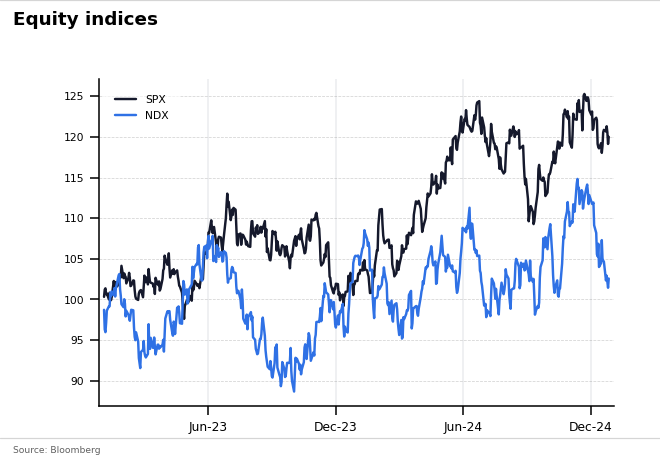

# Export, reuse and chaining

Once a chart is built you can display it, get the Matplotlib `Figure`, save a PNG file or keep the image **in memory** (a `BytesIO` buffer) to insert it later in a PowerPoint, a Word report or a [`TableSheet`](../DfStyling/panels_images.md).

```python
import numpy as np
import pandas as pd
import helpers_ps as hp

hp.set_graph_theme()

rng = np.random.default_rng(42)
dates = pd.bdate_range("2023-01-02", periods=520)
rets = rng.normal([0.0004, 0.0006, 0.0002], [0.009, 0.013, 0.004], size=(len(dates), 3))
prices = pd.DataFrame(
    100 * np.exp(rets.cumsum(axis=0)),
    index=dates,
    columns=["SPX", "NDX", "AGG"],
)

def build():
    return (
        hp.GraphMtplt(prices)
        .graph_line(series=[{"ticker": "SPX"}])
        .add_title("S&P 500")
    )
```

---

## Overview

| Method | Returns | Use it for |
|---|---|---|
| `show()` | `matplotlib.figure.Figure` | Display in a notebook or get the figure for further Matplotlib work. The chart stays editable. |
| `save()` | `io.BytesIO` (or `None` if `dir` is given) | In-memory PNG, ready for PowerPoint / Word / other libraries. **Closes the figure.** |
| `render(name, dir)` | `None` | Write `<dir>/<name>.png` to disk. **Closes the figure.** |
| `render_from_dict(images)` | `None` | Display and save a whole dictionary of buffers (`from helpers_ps.MtpltGraph import render_from_dict`). |

---

## `show()`

Returns the figure. In a notebook the figure is displayed automatically; in a script you decide what to do with it:

```python
fig = build().show()
fig.savefig("chart.png", dpi=300, bbox_inches="tight")   # any Matplotlib option
```

`show()` raises `RuntimeError("Plot must exist")` if no chart has been created.

---

## `save()`: PNG in memory

`save()` renders the figure into a `BytesIO` object (PNG, `dpi=400` by default), closes it and resets the internal state, so **the same `GraphMtplt` object can be reused** for another chart.

```python
buffer = build().save(dpi=200)
type(buffer).__name__, len(buffer.getvalue()) > 10_000
```
**Output**

```text
('BytesIO', True)
```

### Collect many charts in a dictionary

Pass a dictionary with `dir=` and a `name`; the buffer is stored as `dir[name]` and the method returns `None`. This is the standard way to prepare all the charts of a report:

```python
images = {}

build().save(dir=images, name="spx")
(
    hp.GraphMtplt(prices)
    .graph_line(series=[{"ticker": "AGG"}])
    .add_title("Aggregate bond")
    .save(dir=images, name="agg")
)

list(images)
```
**Output**

```text
['spx', 'agg']
```

The module also provides a shared registry, `helpers_ps.MtpltGraph.config.buffers`, that you can use as `dir=buffers` when several notebooks / functions need to share images:

```python
from helpers_ps.MtpltGraph.config import buffers

build().save(dir=buffers, name="spx")
```

### Reading the buffer

```python
from PIL import Image
image = Image.open(buffer)         # buffer.seek(0) if it was already read

with open("chart.png", "wb") as file:
    file.write(buffer.getvalue())
```

---

## `render()`: PNG on disk

`render(name, dir, dpi=400)` writes `<dir>/<name>.png`. The folder **must exist**.

```python
import os

os.makedirs("charts", exist_ok=True)
build().render(name="spx", dir="charts", dpi=300)
os.listdir("charts")
```
**Output**

```text
['spx.png']
```

---

## `render_from_dict()`: preview and save a dictionary of buffers

Displays every buffer of a dictionary with Matplotlib and writes them to `output_dir` (created if missing):

```python
from helpers_ps.MtpltGraph import render_from_dict

render_from_dict(images, output_dir="saved_plots", figsize=(6, 4))
```

---

## Figure size and resolution

The figure size is set when the canvas is created, with `plot(figsize=(width, height))` in inches (default `(6.0, 4.8)`). `dpi` in `save()` / `render()` controls the pixel resolution of the export:

| Target | Suggestion |
|---|---|
| Slide with one chart | `plot(figsize=(6, 4.8))`, `dpi=400` (default) |
| Wide chart | `plot(figsize=(10, 4))` |
| Quick preview | `dpi=100` |

!!! tip "Fixed-size canvas + a different layout"
    Titles, subtitles and the source are placed with **figure coordinates** (`x=0.02`, `y=0.93`...), so they keep their position when you change `figsize`. Fine-tune with `subplot_adjust(left=..., right=..., top=..., bottom=...)` (see [Plotting](plotting.ipynb)).

---

## Chaining helpers: `pipe()` and `tap()`

Both receive the graph object as first argument, which lets you package a *style* or a *debug step* in a reusable function **without breaking the chain**.

| Method | The function returns... | The chain continues with... |
|---|---|---|
| `pipe(func, *args, **kwargs)` | a graph object, or `None` | the returned object (or the same graph if `None`) |
| `tap(func, *args, **kwargs)` | ignored | always the same graph |

```python
def corporate_style(graph, title):
    """Reusable block: title, source and guides in one call."""
    return (
        graph
        .add_title(title)
        .add_source("Source: Bloomberg")
        .horizontal_guides(mostrar_cero=False)
        .config_yaxis(fmt=",.0f")
    )

g = (
    hp.GraphMtplt(prices)
    .graph_line(series=[{"ticker": "SPX"}, {"ticker": "NDX"}])
    .pipe(corporate_style, title="Equity indices")
    .tap(lambda graph: print("series drawn:", [t[0] for t in graph._ticker_label_color]))
    .add_legend()
)
```


`tap()` is also the way to call methods that **do not return the graph**, such as [`add_recessions()`](guides.md#recessions).

---

## Using the chart in other modules

| Destination | How |
|---|---|
| **PowerPoint** | Save to a buffer and insert with `python-pptx`: `slide.shapes.add_picture(buffer, left, top, width)`. For *native* (editable) charts use the [Ppt](../Ppt/getting_started.md) module instead. |
| **Table sheet** (`TableSheet`) | `sheet.add_image(g, name="curve")` accepts the `GraphMtplt` object directly. See [DfStyling: charts in a sheet](../DfStyling/panels_images.md). |
| **Excel** | Save to a file with `render()` and use `openpyxl` / `xlsxwriter` to insert the picture. |
