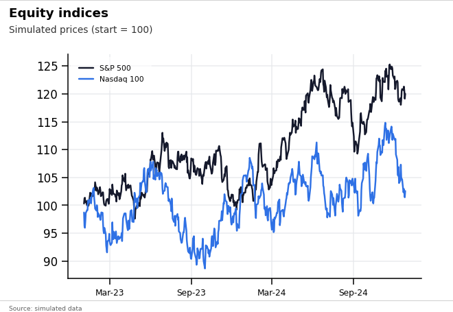
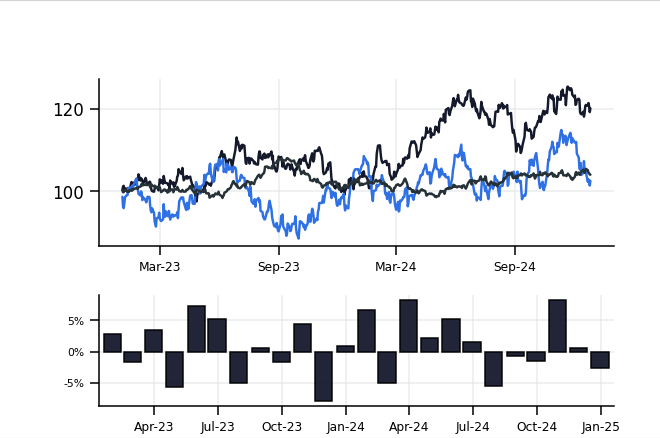

# GraphMtplt: Getting Started

`GraphMtplt` is the main charting class of Helpers PS. It builds **institutional-style Matplotlib charts** (consistent fonts, colors, title / subtitle / source blocks, tags and reference lines) from a plain `pandas.DataFrame`, using a fluent, chainable API.

```python
import helpers_ps as hp

g = hp.GraphMtplt(df).graph_line().add_title("My first chart")
```

Every method returns the same `GraphMtplt` object, so a chart is normally written as **one chained expression**: create the object, add one or more charts, decorate, export.

---

## The mental model

| Step | What you do | Main methods |
|---|---|---|
| 1. **Data** | Pass a DataFrame (or a list of them). The **index is the x-axis** and **each column is a series**. | `hp.GraphMtplt(df)` |
| 2. **Canvas** | *Optional.* Create the figure and its grid of subplots. If you skip it, a single-plot figure is created automatically by the first chart method. | `.plot()`, `.axis()`, `.subplot_adjust()` |
| 3. **Chart** | Draw one chart type on the active axis. | `.graph_line()`, `.graph_bar()`, `.graph_pie()`, `.graph_box_whiskers()`, `.graph_dist()` |
| 4. **Decorate** | Titles, legend, axes formatting, tags, dots, shaded regions, reference lines. | `.add_title()`, `.add_legend()`, `.config_yaxis()`, `.tag()`, `.horizontal_lines()` ... |
| 5. **Export** | Show it, get the Matplotlib figure, or save a PNG / an in-memory buffer. | `.show()`, `.save()`, `.render()` |

---

## Your first chart

First create some sample data. Every example of this documentation can be copied and pasted after this block.

```python
import numpy as np
import pandas as pd
import helpers_ps as hp

hp.set_graph_theme()          # fonts and number formatting (see "Theme" below)

rng = np.random.default_rng(42)
dates = pd.bdate_range("2023-01-02", periods=520)
rets = rng.normal([0.0004, 0.0006, 0.0002], [0.009, 0.013, 0.004], size=(len(dates), 3))
prices = pd.DataFrame(
    100 * np.exp(rets.cumsum(axis=0)),
    index=dates,
    columns=["SPX", "NDX", "AGG"],
)
```

```python
prices.tail(3).round(2)
```
**Output**

```text
               SPX     NDX     AGG
2024-12-25  120.57  102.20  104.37
2024-12-26  119.14  101.43  104.09
2024-12-27  120.02  102.57  104.05
```

A line chart with a title, a subtitle, a source line and a legend:

```python
g = (
    hp.GraphMtplt(prices)
    .graph_line(series=[
        {"ticker": "SPX", "label": "S&P 500"},
        {"ticker": "NDX", "label": "Nasdaq 100"},
    ])
    .add_title("Equity indices")
    .add_subtitle("Simulated prices (start = 100)")
    .add_source("Source: simulated data")
    .add_legend()
)
```


In a Jupyter notebook the figure is displayed automatically when the cell finishes. In a script, call `.show()` to get the `matplotlib.figure.Figure` or `.save()` / `.render()` to write a PNG (see [Export](export.md)).

!!! tip "Where do the series come from?"
    `series` is a list of one *dictionary per column* you want to draw. If you omit `series`, **all columns** are drawn with default colors. Keys such as `label`, `color`, `axis_side` or `lw` customize each series; they are documented in every chart page.

---

## Chart types

| Method | Use it for | Data layout | Page |
|---|---|---|---|
| `graph_line()` | Time series, indices, yields, cumulative performance. | index = dates (or numbers / categories), columns = series | [Line](Line/graph.ipynb) |
| `graph_bar()` | Simple, grouped or stacked bars: monthly returns, allocations, contributions. | index = x (dates or categories), columns = series | [Bar](Bar/graph.md) |
| `graph_pie()` | Pie and donut: weights of a portfolio at one point in time. | index = categories, **one** column of values | [Pie](Pie/graph.md) |
| `graph_box_whiskers()` | Historical distribution of each series (P/E, spreads, yields) with markers for the last observation. | each column = one box | [Box & Whiskers](Box/graph.md) |
| `graph_dist()` | Histogram with optional fitted / theoretical curves and highlighted references (VaR, last return, percentiles). | each column = one distribution | [Distribution](Dist/graph.md) |

---

## Building blocks

Besides the chart methods there are ready-made blocks that work on **any** chart type.

| Group | Methods | Page |
|---|---|---|
| **Figure and layout** | `plot()`, `axis()`, `subplot_adjust()`, `add_title()`, `add_subtitle()`, `add_source()`, `add_plot_title()` | [Plotting](plotting.ipynb), [Layout](layout.ipynb) |
| **Axes** | `x_axis={...}` argument of every chart, `config_yaxis()`, `get_axis()` | [Axes](axes.md) |
| **Annotations** | `tag()`, `dot()`, `shade_x()`, `shade_y()` | [Annotations](annotations.md) |
| **Legends and reference lines** | `add_legend()`, `add_legend_point()`, `horizontal_lines()`, `vertical_lines()`, `horizontal_guides()`, `vertical_guides()`, `add_recessions()` | [Legends and reference lines](guides.md) |
| **Export and chaining** | `show()`, `save()`, `render()`, `pipe()`, `tap()`, `render_from_dict()` | [Export](export.md) |

---

## Several DataFrames in one object

`GraphMtplt` accepts a single DataFrame or a list. Chart methods take `df_index` to pick which one to draw (default `0`):

```python
returns = prices.pct_change().dropna()
monthly = returns.resample("ME").apply(lambda r: (1 + r).prod() - 1)

g = (
    hp.GraphMtplt([prices, monthly])
    .plot(nrows=2, height_ratios=[3, 2], hspace=0.35)
    .axis(0).graph_line(df_index=0)
    .axis(1).graph_bar(
        df_index=1,
        series=[{"ticker": "SPX"}],
        x_axis={"fmt": "%b-%y", "tick_step": 3},
    )
    .config_yaxis(fmt=".0%")
)
```


---

## Series configuration: dictionaries or dataclasses

A series can be described with a plain dictionary (recommended, autocompletion-friendly in most editors thanks to `TypedDict`) or with the equivalent dataclass:

```python
from helpers_ps.MtpltGraph.models import LineSeriesConfig

hp.GraphMtplt(prices).graph_line(series=[
    {"ticker": "SPX", "color": "#12275A", "lw": 2},          # dictionary
    LineSeriesConfig(ticker="NDX", color="#B7331F", lw=1.2), # dataclass
])
```

Invalid keys or values fail early with an explicit message (for example `axis_side` must be `"left"` or `"right"`). The available dataclasses are `LineSeriesConfig`, `BarSeriesConfig`, `BoxSeriesConfig`, `DistSeriesConfig`, `DistCurveConfig` and `XAxisConfig`, all importable from `helpers_ps.MtpltGraph.models`.

---

## Theme

`hp.set_graph_theme()` configures Matplotlib globally (font family, base font size, title size / weight and locale-aware number formatting). Call it **once** at the top of a notebook or script.

```python
hp.set_graph_theme(
    font_family="Inter",          # default; falls back to a system font if not installed
    font_size=9,
    title_size=12,
    title_weight="bold",
    use_locale=True,              # decimal / thousand separators of the locale
    locale_name="es_ES.UTF-8",    # Windows: "Spanish_Spain.1252"
)
```

!!! note "Font not found?"
    If you installed the *Inter* font after Matplotlib was imported, call `hp.set_graph_theme(rebuild_font_cache=True)` once. Use `ignore_matplotlib_warnings=True` to silence font warnings.

The default **color palette** is `hp.PALETA_COLORES` (a list of hex colors). Series without an explicit `color` take colors from it in order.

---

## Typical errors

| Message | Cause | Fix |
|---|---|---|
| `Ticker 'X' was not found in the selected DataFrame.` | The `ticker` of a series is not a column. | Check `df.columns`. |
| `Duplicated tickers are not allowed in 'series'.` | The same column appears twice in `series`. | Use one entry per column. |
| `Multiple bar series require grouped=True or stacked=True.` | `graph_bar(grouped=False)` with several series. | Remove `grouped=False` or use `stacked=True`. |
| `No existe grafico para agregar las recesiones` / `...no tiene como eje fechas` | `add_recessions()` before a chart, or on a non-date axis. | Draw a time-series chart first. |
| The title of a subplot disappears | `add_title()` clears the title of the active axis. | Call `add_title()` **before** `add_plot_title()`. |
| Few labels on the x-axis of a bar chart | Default `tick_step` is `6`. | Use `x_axis={"tick_step": 1}`. See [Axes](axes.md). |

---

## Next step

[Plotting: figure, grid and axes ->](plotting.ipynb)
