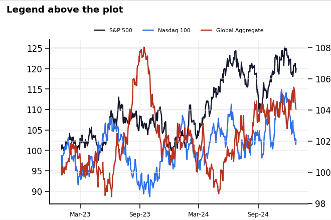
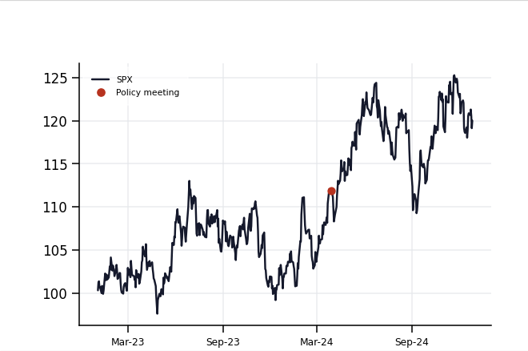
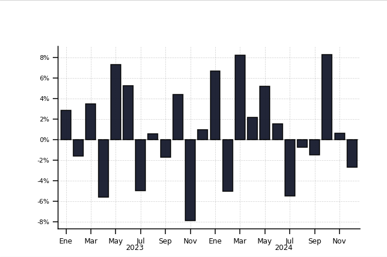
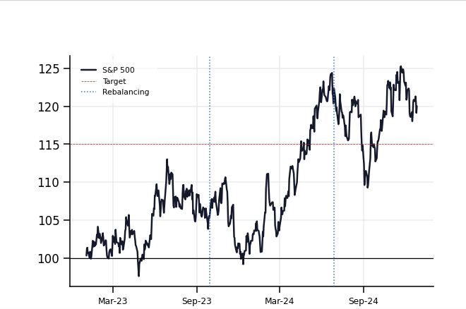
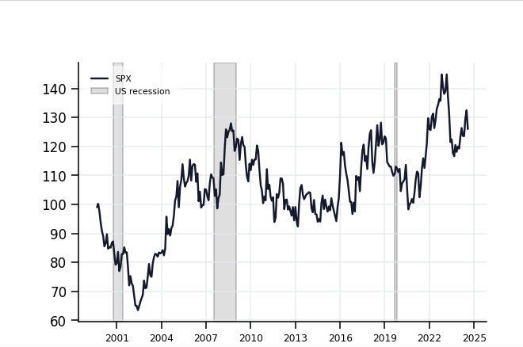

# Legends, guides and reference lines

This page covers the elements that help to **read** a chart: legends, grid guides, reference levels, event lines and recession shading. All of them work on any chart that has an x-axis and can be chained after the chart method.

```python
import numpy as np
import pandas as pd
import helpers_ps as hp

hp.set_graph_theme()

rng = np.random.default_rng(42)
dates = pd.bdate_range("2023-01-02", periods=520)
rets = rng.normal([0.0004, 0.0006, 0.0002], [0.009, 0.013, 0.004], size=(len(dates), 3))
prices = pd.DataFrame(
    100 * np.exp(rets.cumsum(axis=0)),
    index=dates,
    columns=["SPX", "NDX", "AGG"],
)
```

---

## Legends

`add_legend()` collects the labels of everything drawn on the active axis **and** on its right axis, plus any custom entries registered with `add_legend_point()`, removes duplicates and draws **one** legend.

| Parameter | Default | Description |
|---|---|---|
| `loc` | `"upper left"` | Matplotlib location. |
| `bbox_to_anchor` | `None` | Anchor to place the legend outside the plot, e.g. `(0.5, -0.12)`. |
| `ncol` | `1` | Number of columns. |
| `fontsize` | `7` | Text size. |
| `frameon`, `edgecolor`, `facecolor`, `framealpha` | `True`, `"white"`, `"white"`, `0.6` | Frame. |
| `include_right_axis` | `True` | Also list the series of the right axis. |
| `legend_mode` | `"all"` | `"all"` (default), `"series"` or `"points"` (only the custom markers registered through `dot(label=...)` / `add_legend_point()`). |

The text of each entry is the `label` of the series (the column name if omitted).

```python
g = (
    hp.GraphMtplt(prices)
    .graph_line(series=[
        {"ticker": "SPX", "label": "S&P 500"},
        {"ticker": "NDX", "label": "Nasdaq 100"},
        {"ticker": "AGG", "label": "Global Aggregate", "axis_side": "right", "color": "#B7331F"},
    ])
    .add_legend(loc="upper center", bbox_to_anchor=(0.5, 1.12), ncol=3)
    .add_title("Legend above the plot")
)
```


### Custom legend points

`add_legend_point()` adds an entry without plotting anything: useful for events, signals or markers drawn with `dot()`.

```python
g = (
    hp.GraphMtplt(prices)
    .graph_line(series=[{"ticker": "SPX"}])
    .dot(x_value="2024-03-28", y_value=float(prices.loc["2024-03-28", "SPX"]), color="#B7331F", size=45)
    .add_legend_point(label="Policy meeting", color="#B7331F", marker="o", markersize=6)
    .add_legend()
)
```


---

## Guides (grid lines)

Guides are the light dashed grid lines that make values easier to read.

| Method | What it does | Main options |
|---|---|---|
| `horizontal_guides()` | Horizontal grid on the left, right or both y-axes, with an emphasized **zero line**. | `side` (`"left"`, `"right"`, `"both"`), `mostrar_cero`, `linestyle`, `linewidth`, `color`, `alpha`, `zero_color`, `zero_linewidth`... |
| `vertical_guides()` | Vertical grid on the x-axis. | `linestyle`, `linewidth`, `color`, `alpha`. |

```python
returns = prices.pct_change().dropna().resample("ME").apply(lambda r: (1 + r).prod() - 1)

g = (
    hp.GraphMtplt(returns)
    .graph_bar(series=[{"ticker": "SPX"}], x_axis={"bbg_format": True, "tick_step": 2})
    .config_yaxis(fmt=".0%")
    .horizontal_guides(zero_color="black", zero_linewidth=1.2)
    .vertical_guides()
)
```


!!! info "Guides and the right axis"
    With two y-axes use `horizontal_guides(side="both")` to draw guides for both, or choose the side whose scale you want the grid to follow.

---

## Reference lines

Reference lines mark **levels** (targets, thresholds, averages) and **events** (dates).

### `horizontal_lines()`

| Parameter | Default | Description |
|---|---|---|
| `y_values` | required | One value or a list. |
| `side` | `"left"` | Axis whose scale the values refer to (`"left"` / `"right"`). |
| `color`, `linestyle`, `linewidth`, `alpha` | `"gray"`, `None`, `0.5`, `1.0` | Style. |
| `label` | `None` | Legend label (applied to the first line). |
| `zorder` | `4` | Drawing order. |

### `vertical_lines()`

| Parameter | Default | Description |
|---|---|---|
| `x_values` | required | One x value or a list (dates, numbers, categories). |
| `labels` | `None` | Legend label(s): a string or a list (one per line). |
| `color`, `linestyle`, `linewidth`, `alpha` | `"gray"`, `None`, `0.5`, `1.0` | Style. |
| `ymin`, `ymax` | `0.0`, `1.0` | Vertical extent as a fraction of the axis. |
| `zorder` | `4` | Drawing order. |

```python
g = (
    hp.GraphMtplt(prices)
    .graph_line(series=[{"ticker": "SPX", "label": "S&P 500"}])
    .horizontal_lines([100], color="black", linewidth=0.8)
    .horizontal_lines([115], color="#B7331F", linestyle="--", label="Target")
    .vertical_lines(["2023-09-29", "2024-06-28"], color="#3075DB", linestyle=":", linewidth=1, labels="Rebalancing")
    .add_legend()
)
```


---

## Recessions

`add_recessions()` shades recession periods from the database bundled with the package (`helpers_ps/Data/recessions.csv`). Available countries: **`"United States"`** (default) and **`"Peru"`**. It only works on **date axes** (`datetime` or Bloomberg-style).

```python
monthly_idx = pd.date_range("2000-01-31", "2024-12-31", freq="ME")
long_history = pd.DataFrame(
    {"SPX": 100 * np.exp(np.cumsum(rng.normal(0.006, 0.04, len(monthly_idx))))},
    index=monthly_idx,
)

g = (
    hp.GraphMtplt(long_history)
    .graph_line(series=[{"ticker": "SPX"}], x_axis={"tick_step": 36, "fmt": "%Y"})
    .tap(lambda graph: graph.add_recessions(controles={"color": "grey", "alpha": 0.25, "label": "US recession"}))
    .add_legend()
)
```


!!! warning "`add_recessions()` ends the chain"
    When it draws, `add_recessions()` returns `None` instead of the graph object, so a method chained after it fails. Either call it last, or wrap it in `tap()` as above (`tap` runs a function and keeps the chain alive). Other countries: `graph.add_recessions(country="Peru")`.

`controles` is passed to [`shade_x()`](annotations.md#shade_x-shaded-periods): `color`, `alpha`, `hatch`, `label`, `zorder`. The default is gray with `alpha=0.3`.

To read the data without drawing:

```python
recessions = hp.GraphMtplt().add_recessions(data_frame=True)
recessions.query("country == 'Peru'").tail(3)
```
**Output**

```text
            country start_date   end_date     description
recesion_id                                              
34             Peru 1998-01-01 1999-12-31  Asia + El Niño
35             Peru 2009-01-01 2009-12-31   Crisis global
36             Peru 2020-03-01 2020-12-31     COVID shock
```

!!! warning "Order matters"
    Call `add_recessions()` **after** the chart method: it needs the axis mode and limits that the chart creates. On non-date axes it raises `TypeError`; for countries without data, `NotImplementedError`.

---

[API reference of legends and reference lines](../api/GraphMtplt/legends_lines.md)
