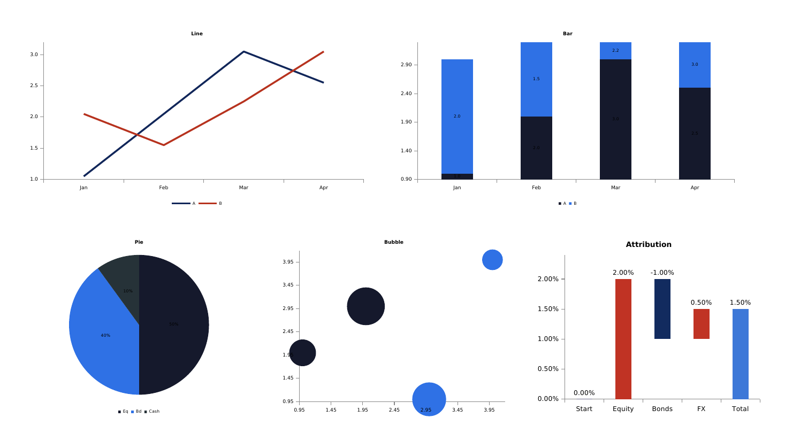

# Native PowerPoint charts

All chart classes share the same base parameters and a `.chart()` method that inserts the chart in the slide. This page documents the parameters of each class and shows a complete example.



---

## Shared parameters

Every class inherits these fields (`BasePowerPointChart`):

| Field | Default | Description |
|---|---|---|
| `presentation` | required | A `pptx.Presentation` (`ValueError` if `None`). |
| `slide` | `0` | Position of the target slide. Out of range raises `ValueError`. |
| `position_x`, `position_y` | `5`, `5` | Top-left corner, in **cm**. |
| `width`, `height` | `10`, `10` | Size, in **cm**. |
| `title_show`, `title` | `False`, `""` | Chart title. |
| `font_name` | `"Inter"` | Font of titles, legend and axes. |
| `title_font_size` | `6` | Title size (pt). |
| `legend_show` | `False` | Show the legend. |
| `legend_font_size` | `5` | Legend size (pt). |
| `legend_position` | `"bottom"` | `"bottom"`, `"top"`, `"right"`, `"left"`, `"corner"`. |

Shared value / category axis fields of the category charts (`LineChart`, `BarChart`, `BubbleChart`):

| Pattern | Meaning |
|---|---|
| `x_axis_title_show`, `x_axis_title`, `x_axis_font_size`, `x_axis_number_format` | Category (x) axis: title, size (pt), Excel number format (`"0.00"`, `"0%"`, `"mmm-yy"`). |
| `y_axis_title_show`, `y_axis_title`, `y_axis_font_size`, `y_axis_number_format`, `y_axis_gridlines_show` | Value (y) axis. |
| `y_axis_minimum_adjustment`, `y_axis_maximum_adjustment` | **Percentage margin** added below the minimum and above the maximum of the data to set the axis range automatically. |

!!! info "Automatic axis range"
    The value axis limits are **calculated from the data** (min and max of all values, plus the adjustment percentages). For **stacked** bars the maximum is computed from the individual values, not from the stack totals: increase `y_axis_maximum_adjustment` (for example `100`) so the tallest stack is not cut.

Reference keys:

| Setting | Valid keys |
|---|---|
| `legend_position` | `bottom`, `top`, `right`, `left`, `corner` |
| `data_labels_position` | `outside`, `outside_end`, `inside_base`, `inside_end`, `center`, `best_fit`, `left`, `right`, `top`, `bottom` |
| axis `*_position` | `low`, `high`, `center`, `next_to_axis`, `none` |

An invalid key raises `ValueError` naming the parameter and the valid options.

---

## Preparing the data

```python
import numpy as np
import pandas as pd
import helpers_ps as hp
from pptx import Presentation
from pptx.util import Cm

prs = Presentation()
prs.slide_width, prs.slide_height = Cm(33.867), Cm(19.05)      # 16:9
prs.slides.add_slide(prs.slide_layouts[6])                      # blank slide

months = ["Jan", "Feb", "Mar", "Apr", "May", "Jun"]
df = pd.DataFrame(
    {"Portfolio": [1.2, 0.8, -0.4, 1.6, 0.9, 1.1], "Benchmark": [1.0, 0.9, -0.2, 1.1, 0.7, 1.0]},
    index=months,
)
```

---

## `LineChart`

Line chart with one or more series. Because PowerPoint line charts are **category charts**, every series must share the **same categories** (`ValueError` otherwise).

| Field | Description |
|---|---|
| `series_names: list[str]` | One name per series. |
| `x_values: list[list]` | Categories **for each series** (the same list repeated). |
| `y_values: list[list[float]]` | Values for each series. |
| `colors: list[str]` | Hex colors per series (default: the house palette). |

```python
line = hp.Ppt.LineChart(
    presentation=prs, slide=0,
    position_x=1, position_y=1, width=15, height=8,
    title_show=True, title="Monthly return (%)",
    series_names=list(df.columns),
    x_values=[df.index.tolist()] * len(df.columns),
    y_values=[df[c].tolist() for c in df.columns],
    colors=["#12275A", "#B7331F"],
    legend_show=True, legend_position="bottom",
    y_axis_gridlines_show=True, y_axis_number_format="0.0",
).chart()

type(line).__name__
```
**Output**

```text
'Chart'
```

---

## `BarChart`

Column / bar chart (clustered, stacked, 100% stacked). Same data fields as `LineChart`, plus data labels. The chart type is chosen when you call `.chart(chart_type)`:

| `chart_type` | Result |
|---|---|
| `"COLUMN_CLUSTERED"` (default), `"COLUMN_STACKED"`, `"COLUMN_STACKED_100"` | Vertical columns |
| `"BAR_CLUSTERED"`, `"BAR_STACKED"`, `"BAR_STACKED_100"` | Horizontal bars |

| Field | Default | Description |
|---|---|---|
| `data_labels_show` | `False` | Show values on the bars. |
| `data_labels_position` | `"center"` | See the keys above. |
| `data_labels_number_format` | `"0.0"` | Excel number format (`"0.0%"`...). |
| `data_labels_font_size` | `5` | Label size. |
| `x_axis_position`, `y_axis_position` | `"center"` | Tick label position (`"low"` keeps labels at the bottom when there are negative bars). |
| `y_axis_minimum_adjustment`, `y_axis_maximum_adjustment` | `10.0` | Axis margins (%). |

```python
bar = hp.Ppt.BarChart(
    presentation=prs, slide=0,
    position_x=17, position_y=1, width=15, height=8,
    title_show=True, title="Return by month",
    series_names=list(df.columns),
    x_values=[df.index.tolist()] * 2,
    y_values=[df[c].tolist() for c in df.columns],
    colors=["#12275A", "#B7331F"],
    data_labels_show=True, data_labels_position="outside_end", data_labels_number_format="0.0",
    x_axis_position="low",
    legend_show=True,
).chart("COLUMN_CLUSTERED")

type(bar).__name__
```
**Output**

```text
'Chart'
```

---

## `PieChart`

One series: `series_name`, `categories` and `values`. Colors apply per slice.

| Field | Default | Description |
|---|---|---|
| `series_name` | `""` | Name of the series. |
| `categories`, `values` | `[]` | Same length (`ValueError` otherwise). |
| `colors` | palette | Hex colors per slice. |
| `title_show` | **`True`** | Unlike the other charts the title is on by default. |
| `data_labels_show`, `data_labels_position`, `data_labels_number_format`, `data_labels_font_size` | `False`, `"center"`, `"0.0"`, `5` | Slice labels. Use `"0%"` for fractions that sum to 1. |

```python
pie = hp.Ppt.PieChart(
    presentation=prs, slide=0,
    position_x=1, position_y=10, width=10, height=8,
    title="Allocation", series_name="Weight",
    categories=["Equity", "Bonds", "Cash"],
    values=[0.5, 0.4, 0.1],
    colors=["#12275A", "#3075DB", "#B7331F"],
    data_labels_show=True, data_labels_number_format="0%", data_labels_font_size=7,
    legend_show=True,
).chart()

type(pie).__name__
```
**Output**

```text
'Chart'
```

---

## `BubbleChart`

Each series needs **x values, y values and bubble sizes** (same lengths). Axis limits are adjusted on both axes through `x_axis_minimum_adjustment` / `x_axis_maximum_adjustment` and the `y_axis_*` equivalents (default 5%).

| Field | Description |
|---|---|
| `series_names` | One name per series. |
| `x_values`, `y_values`, `bubble_sizes` | `list[list[float]]`, one list per series. |
| `colors` | Hex color per series (bubbles have no border). |

```python
bubble = hp.Ppt.BubbleChart(
    presentation=prs, slide=0,
    position_x=12, position_y=10, width=10, height=8,
    title_show=True, title="Risk vs return",
    series_names=["Strategy A", "Strategy B"],
    x_values=[[6.0, 8.5], [4.0, 10.0]],           # volatility
    y_values=[[4.0, 6.5], [2.5, 7.0]],            # return
    bubble_sizes=[[10, 25], [8, 15]],             # assets
    x_axis_title_show=True, x_axis_title="Volatility (%)",
    y_axis_title_show=True, y_axis_title="Return (%)",
).chart()

type(bubble).__name__
```
**Output**

```text
'Chart'
```

---

## `WaterfallChart`

PowerPoint (through `python-pptx`) has no native waterfall type, so the class **builds one with a stacked column chart** that uses hidden base series plus visible increase, decrease and total series.

| Field | Default | Description |
|---|---|---|
| `categories` | `[]` | Labels on the x-axis. |
| `values` | `[]` | One value per step. Use **decimals for percentages** (`0.012` is 1.2%). |
| `bar_types` | `[]` | One entry per category: `"total"` marks a **total bar** (drawn from zero in `total_color`); anything else (`""`) is a contribution (increase / decrease). |
| `increase_color`, `decrease_color`, `total_color` | `RGBColor` red / navy / blue | Colors (`pptx.dml.color.RGBColor`). |
| `data_labels_show` | `False` | Show the value of each step. |
| `data_labels_position` | `"inside_base"` | See the keys above. |
| `data_labels_number_format` | `"0.00%"` | |
| `y_axis_number_format` | `"0.00%"` | |
| `x_axis_position`, `y_axis_position` | `"low"` | Tick label position. |
| `y_axis_minimum_adjustment`, `y_axis_maximum_adjustment` | `20` | Axis margins (%). |
| `reset_running_total_except_last` | `True` | After a `"total"` bar the running total restarts, except for the last one. |

```python
waterfall = hp.Ppt.WaterfallChart(
    presentation=prs, slide=0,
    position_x=23, position_y=10, width=10, height=8,
    title="Return attribution", title_font_size=9,
    categories=["Start", "Equity", "Bonds", "FX", "Total"],
    values=[0.0, 0.020, -0.010, 0.005, 0.015],
    bar_types=["", "", "", "", "total"],
    data_labels_show=True,
).chart()

type(waterfall).__name__
```
**Output**

```text
'Chart'
```

`categories`, `values` and `bar_types` must have the same length.

---

## Save the presentation

```python
prs.save("charts.pptx")
len(prs.slides[0].shapes)
```
**Output**

```text
5
```

---

## Placing several charts on a slide

`hp.Ppt.layouts` contains predefined grids as dictionaries: `height` and `width` (cm) common to all charts, and the lists `position_x` and `position_y` with one position per chart, in reading order (left to right, top to bottom). Their coordinates fit a 16:9 slide of 33.87 x 19.05 cm (13.33 x 7.5 in), the size used in the examples; check them against your template and scale them if the slide size is different.

| Constant | Grid | Charts |
|---|---|---|
| `LAYOUT2_2` | 2 columns x 2 rows | 4 |
| `LAYOUT3_2` | 3 columns x 2 rows | 6 |
| `LAYOUT3_3` | 3 columns x 3 rows | 9 |
| `LAYOUT4_3` | 4 columns x 3 rows | 12 |

```python
layout = hp.Ppt.layouts.LAYOUT3_2

for i, column in enumerate(columns[:6]):
    hp.Ppt.LineChart(
        presentation=prs, slide=0,
        position_x=layout["position_x"][i],
        position_y=layout["position_y"][i],
        width=layout["width"],
        height=layout["height"],
        title_show=True, title=column,
        series_names=[column],
        x_values=[dates],
        y_values=[df[column].tolist()],
    ).chart()
```

---

## Modifying a chart after creation

`.chart()` returns the native chart, so anything `python-pptx` offers is available:

```python
from pptx.util import Pt
from pptx.dml.color import RGBColor

plot = line.plots[0]
plot.series[0].format.line.width = Pt(2.5)
plot.series[0].smooth = False
line.value_axis.has_major_gridlines = True
```

---

## Next step

[Template helpers ->](utilities.md)
