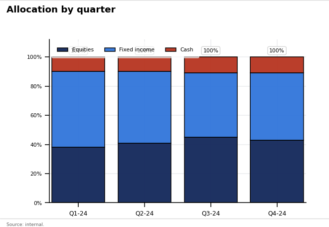

# Stacked bars with totals

Stacked bars of an asset allocation by date, with the stack total on top of each bar.

```python
import numpy as np
import pandas as pd
import helpers_ps as hp

hp.set_graph_theme()

alloc = pd.DataFrame(
    {
        "Equity": [0.38, 0.41, 0.45, 0.43],
        "Bonds": [0.52, 0.49, 0.44, 0.46],
        "Cash": [0.10, 0.10, 0.11, 0.11],
    },
    index=["Q1-24", "Q2-24", "Q3-24", "Q4-24"],
)
```

```python
g = (
    hp.GraphMtplt(alloc)
    .graph_bar(
        stacked=True,
        series=[
            {"ticker": "Equity", "label": "Equities", "color": "#12275A"},
            {"ticker": "Bonds", "label": "Fixed income", "color": "#3075DB"},
            {
                "ticker": "Cash",
                "label": "Cash",
                "color": "#B7331F",
                "tag": [{
                    "show": "stack_total",
                    "x_values": "all",
                    "template": "{total_value:.0%}",
                    "fontsize": 7,
                    "color": "black",
                    "bbox": {"boxstyle": "round,pad=0.3", "fc": "white", "ec": "#D9D9D9"},
                }],
            },
        ],
        x_axis={"tick_step": 1},
    )
    .config_yaxis(fmt=".0%", lim=(0, 1.12))
    .add_legend(loc="upper left", ncol=3)
    .add_title("Allocation by quarter")
    .add_source("Source: internal.")
)
```


Key points:

- `stacked=True` stacks the series in the order of `series`.
- The `stack_total` tag is declared on **one** series only, so the total is drawn once per bar (`x_values="all"`).
- For a **categorical** x-axis (text index) use `x_axis={"tick_step": 1}` so every label is shown.
