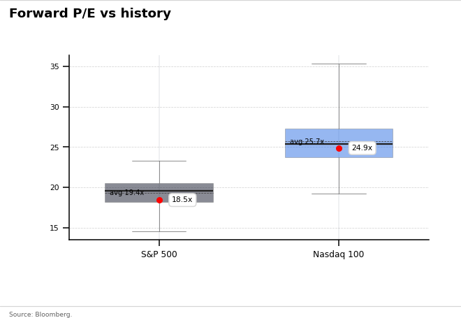

# Box & Whiskers with the last observation

Compare today's valuation of several indices with their history. The box shows the distribution, the dot the **last observation**, and the mean is labeled.

```python
import numpy as np
import pandas as pd
import helpers_ps as hp

hp.set_graph_theme()
rng = np.random.default_rng(11)

dates = pd.bdate_range("2015-01-01", periods=2500)

def ar1(mean, sd, n, phi=0.995):
    x = np.empty(n)
    x[0] = mean
    for t in range(1, n):
        x[t] = mean + phi * (x[t - 1] - mean) + rng.normal(0, sd)
    return x

pe = pd.DataFrame(
    {"SPX_PE": ar1(19, 0.25, len(dates)), "NDX_PE": ar1(25, 0.35, len(dates))},
    index=dates,
)
```

```python
def valuation_series(ticker, label):
    return {
        "ticker": ticker,
        "label": label,
        "tag": [
            # last observation: red dot + label
            {
                "x_values": "last",
                "dot": {"size": 35, "color": "red", "zorder": 8},
                "tag": {"label": "{y_value:,.1f}x", "ubic_etq": (22, 0), "fontsize": 7,
                        "bg_color": "white", "edge_color": "#D9D9D9", "show_bbox": True, "zorder": 9},
            },
            # historical mean: text only
            {
                "statistic": "mean",
                "tag": {"label": "avg {y_value:,.1f}x", "ubic_etq": (-30, 0), "fontsize": 6.5},
            },
        ],
    }

g = (
    hp.GraphMtplt(pe)
    .graph_box_whiskers(
        series=[valuation_series("SPX_PE", "S&P 500"), valuation_series("NDX_PE", "Nasdaq 100")],
        box_config={"showmeans": True, "meanline": True},
    )
    .config_yaxis(fmt=".0f")
    .horizontal_guides(mostrar_cero=False)
    .add_title("Forward P/E vs history")
    .add_source("Source: Bloomberg.")
)
```


Key points:

- Each series takes a `tag` list; each element is either an **observation** (`x_values`) or a **statistic** (`statistic`).
- Inside each element, `dot` configures the marker and `tag` the label; the label text goes in `tag["label"]`.
