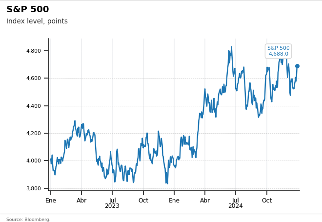

# Line chart with the last value highlighted

Highlight the **last value** of a series with a dot and a label, and add a title block with the data source.

```python
import numpy as np
import pandas as pd
import helpers_ps as hp

hp.set_graph_theme()

rng = np.random.default_rng(42)
dates = pd.bdate_range("2023-01-02", periods=520)
df = pd.DataFrame(
    {"SPX": 4000 * np.exp(rng.normal(0.0004, 0.009, len(dates)).cumsum())},
    index=dates,
)
```

```python
g = (
    hp.GraphMtplt(df)
    .graph_line(
        series=[{
            "ticker": "SPX",
            "label": "S&P 500",
            "color": "#1F77B4",
            "tags": [{
                "x_values": "last",
                "show": "tag_dot",
                "template": "{label}\n{y_value:,.1f}",
                "dot": {"size": 35, "zorder": 8},
                "tag": {
                    "ubic_etq": (-25, 20),
                    "fontsize": 7,
                    "bg_color": "white",
                    "edge_color": "#D9D9D9",
                    "show_bbox": True,
                    "zorder": 9,
                },
            }],
        }],
        x_axis={"bbg_format": True, "tick_step": 3},
    )
    .config_yaxis(fmt=",.0f")
    .horizontal_guides(mostrar_cero=False)
    .add_title("S&P 500")
    .add_subtitle("Index level, points")
    .add_source("Source: Bloomberg.")
)
```


Key points:

- `tags` lives **inside** the series dictionary and `x_values="last"` finds the last non-null observation.
- `show="tag_dot"` draws the marker and the label; use `"tag"` or `"dot"` to draw only one.
- `ubic_etq=(dx, dy)` moves the label, in points, relative to the dot.
