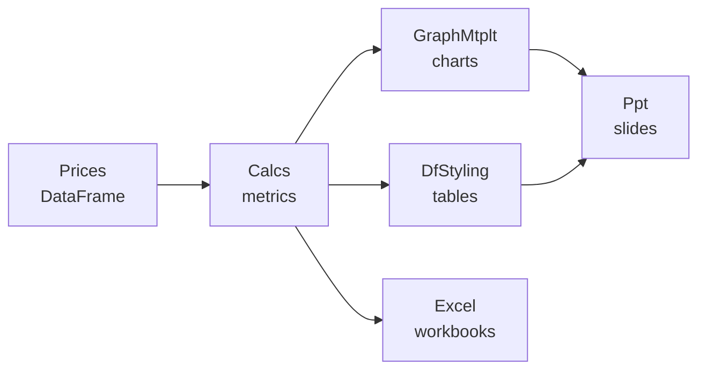

# Helpers PS

Internal library of the Portfolio Solutions team for **financial analysis, institutional charts and report production**. It turns a pandas DataFrame into a standardized chart, a styled table image, a PowerPoint slide or an Excel sheet, with the same look and feel everywhere.

```python
import helpers_ps as hp

hp.set_graph_theme()
g = hp.GraphMtplt(prices).graph_line().add_title("Equity indices").add_legend()
```

---

## What is inside

| Component | Access | What it does | Documentation |
|---|---|---|---|
| **GraphMtplt** | `hp.GraphMtplt` | Matplotlib charts in the institutional style: line, bar, pie, box & whiskers and distribution, with tags, dots, shaded regions, reference lines and Bloomberg-style axes. | [GraphMtplt](GraphMtplt/getting_started.md) |
| **Calcs** | `hp.Calcs` | Financial calculations over price DataFrames: YTD / MTD, volatility, Sharpe, drawdown, beta, tracking error, capture ratios, VaR, technical indicators... | [Calcs](Calcs/getting_started.md) |
| **DfStyling** | `hp.DfStyling` | Turns tables (and charts) into one presentation-ready image: styled DataFrames on a grid with titles, notes and sources. | [DfStyling](DfStyling/getting_started.md) |
| **Ppt** | `hp.Ppt` | Native, editable PowerPoint charts (line, bar, pie, bubble, waterfall) and template helpers to fill texts and tables. | [Ppt](Ppt/getting_started.md) |
| **Excel** | `hp.Excel` | Write DataFrames to open or closed workbooks, optionally as Excel tables or with styles. | [Excel](Excel/getting_started.md) |

Other public objects: `hp.set_graph_theme` (global chart theme), `hp.PALETA_COLORES` (institutional color palette) and `hp.__version__`.

---

## A typical workflow



1. **Calculate** the metrics with `hp.Calcs` (returns a Series / DataFrame).
2. **Chart** them with `hp.GraphMtplt` (a PNG buffer) and **format** the tables with `hp.DfStyling` (an image).
3. **Deliver** in a deck with `hp.Ppt` (native charts, or the pictures from step 2) and / or in `hp.Excel`.

The same data layout runs through the whole package: **a DataFrame whose index is the date (or category) and whose columns are the series**.

---

## Where to start

| If you... | Go to |
|---|---|
| Are installing the package for the first time | [Installation](install_guide.md) |
| Want to make a chart | [GraphMtplt: Getting Started](GraphMtplt/getting_started.md) |
| Want a metric (volatility, beta, drawdown...) | [Calcs: Getting Started](Calcs/getting_started.md) |
| Want a table as an image for a slide | [DfStyling: Getting Started](DfStyling/getting_started.md) |
| Fill a PowerPoint template | [Ppt: Template helpers](Ppt/utilities.md) |
| Look for a ready-to-copy recipe | [Examples](examples/line_last_value.md) |

!!! note "Not documented yet"
    The Bloomberg helpers (`Bbg`, based on `xbbg`) are not part of this documentation yet.

---

## Conventions used in this documentation

- Code blocks are **complete**: copy and paste them in order and they run. Each page starts with the sample data it needs (generated with `numpy`, so no files are required).
- `hp` is always `import helpers_ps as hp`.
- Images are produced by the code shown next to them.
- Argument tables list the **default value** of every parameter.
- Methods of `GraphMtplt` and `TableSheet` **return the object**, so calls are chained between parentheses.
